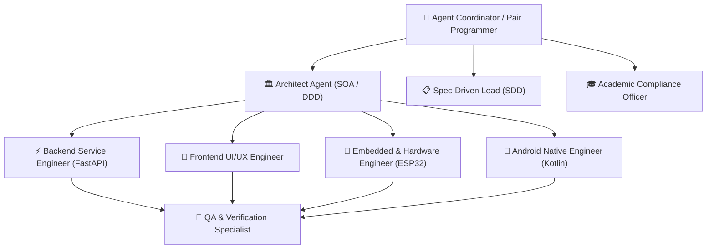

# AGENTS.md — Protocolo de Agentes y Roles del Proyecto AgroSense AI (ASAI)

> **Plataforma:** AgroSense AI (ASAI) — Hub de Servicios Agrícolas y Ciberfísicos  
> **Versión:** 2.1 (Arquitectura Tri-Servicio SOA / SDD + Orquestación Multi-Modelo)  
> **Ámbito:** Integración de Competencias II (IEI-094), IoT (IEI-059), Programación Android (IEI-058) y Feria de Innovación Santo Tomás.

---

## 1. Visión y Propósito del Documento
Este archivo define la taxonomía de roles, responsabilidades, contratos de entrada/salida y reglas de colaboración para agentes de IA y desarrolladores humanos en el ecosistema **AgroSense AI**. El desarrollo se rige bajo la metodología **Spec-Driven Development (SDD)**, donde ninguna línea de código se escribe sin una especificación previa validada, criterios de aceptación y registro de trazabilidad.

---

## 2. Taxonomía de Roles y Sub-Agentes



### 2.1. `architect` — System & Domain Architect
* **Misión:** Garantizar la cohesión de la Arquitectura Orientada a Servicios (SOA), el desacoplamiento de dominios (Domain-Driven Design) y la escalabilidad del sistema.
* **Responsabilidades:**
  * Mantener los 3 servicios delimitados:
    1. **AgroField Service:** Campos e Invernaderos Tradicionales (Caso Orquídeas - IEI-094).
    2. **HomeTower Service:** Mini Torres Domiciliarias Urbanas (Feria de Innovación & Android).
    3. **VerticalFarm Service:** Invernaderos Verticales Industriales (Visión comercial a escala).
  * Validar contratos de API (OpenAPI/REST, JSON Schemas y eventos).
  * Supervisar el esquema relacional de base de datos en SQLite / PostgreSQL.

### 2.2. `spec_lead` — Spec-Driven Development (SDD) Lead
* **Misión:** Diseñar y actualizar las especificaciones funcionales y técnicas antes de cualquier fase de código.
* **Responsabilidades:**
  * Mantener los documentos en `specs/`: requerimientos funcionales, no funcionales, diagramas de secuencia y contratos Pydantic.
  * Mantener el archivo `specs/PROGRESS_LOGS.md` actualizado en cada iteración.
  * Verificar que cada feature cuente con criterios de aceptación verificables (Given / When / Then).

### 2.3. `academic_compliance` — Academic & Rubric Compliance Officer
* **Misión:** Auditar continuamente que el código y la documentación cumplan al 100% las pautas de evaluación de Santo Tomás.
* **Ámbitos de Supervisión:**
  * **Integración de Competencias II (IEI-094):** RF1 (Calendario semanal L-D + horas), RF2 (Notificaciones), RF3 (Sensores humedad Wi-Fi/Bluetooth), RF4 (Monitoreo 80% HR y 18-24 °C), RF5 (Histórico horario), RF6 (Base de datos), RF7 (Visualización tiempo real).
  * **IoT (IEI-059):** Mapeo de pines, protección contra cavitación, señal anti-electrólisis de 50 ms en GPIO 25/34, MQTT/HTTP con ESP32.
  * **Programación Android (IEI-058):** Consumo de endpoints REST, interfaz intuitiva de control de mini torres, notificaciones locales.
  * **Feria de Innovación:** Propuesta de valor, viabilidad técnica, modelo de agricultura urbana domiciliaria.

### 2.4. `backend_service_dev` — Backend & Microservices Engineer
* **Misión:** Implementar y refactorizar la lógica de servidor en FastAPI (Python 3.12+).
* **Responsabilidades:**
  * Crear y mantener los routers independientes para cada uno de los 3 servicios.
  * Implementar persistencia en SQLite (`agrosense.db`) con auditoría y series de tiempo.
  * Gestionar el motor determinista de respaldo y fallback de decisiones ciberfísicas.
  * Garantizar tiempos de respuesta < 50 ms en endpoints de telemetría IoT.

### 2.5. `frontend_ui_engineer` — Frontend UI/UX Developer
* **Misión:** Construir interfaces web claras, funcionales y minimalistas (estilo Vercel/Linear).
* **Responsabilidades:**
  * Implementar el selector de servicio dinámico en la barra superior (Switch entre Módulo Orquídeas, Mini Torre Domiciliaria e Invernadero Industrial).
  * Adaptar visualmente tarjetas de telemetría, controles de actuadores y calendario semanal según el servicio seleccionado.
  * Garantizar compatibilidad móvil/desktop sin sobrecargar la vista con elementos innecesarios.

### 2.6. `iot_firmware_engineer` — Embedded Systems & Hardware Specialist
* **Misión:** Mantener el firmware del ESP32 DevKit V1 y la integración de sensores/actuadores físicos.
* **Responsabilidades:**
  * Mapeo de pines oficial (`INVENTARIO_HARDWARE_Y_MAPEO_PINES_MVP.md`): DHT11 (GPIO 4), BME280 (I2C 21/22), Sensor de nivel (GPIO 34 con pulso 50 ms en GPIO 25), Relé Bomba (GPIO 26), Servo SG90 (GPIO 18), Motor PaP ULN2003 (GPIO 19, 23, 5, 13).
  * Payload JSON estandarizado hacia el backend (MQTT / HTTP REST).
  * Lógica local de fail-safe: apagado automático de bomba si el nivel cae de 20%.

### 2.7. `android_engineer` — Android Native Developer
* **Misión:** Guiar la arquitectura y consumo de servicios desde la aplicación móvil Android.
* **Responsabilidades:**
  * Diseñar las pantallas de monitoreo de la mini torre domiciliaria.
  * Gestionar la conexión Wi-Fi/Bluetooth y sincronización periódica de telemetría.
  * Disparar comandos manuales a los actuadores (bomba, ventilación, dosificación).

### 2.8. `qa_verification` — Quality Assurance & Verification Specialist
* **Misión:** Validar que los entregables funcionen end-to-end antes de dar por cerrada una tarea.
* **Responsabilidades:**
  * Ejecutar pruebas de endpoints REST (HTTP GET/POST) y registrar código de respuesta.
  * Probar escenarios de estrés y simulación (estanque vacío, golpe térmico, sobrehumedad).
  * Mantener el log de verificación en `specs/PROGRESS_LOGS.md`.

---

## 3. Protocolo Operativo SDD (Spec-Driven Development)

Para cada nueva característica, refactorización o servicio, se debe seguir estrictamente este flujo de 5 etapas:

```
[1. ESPECIFICAR]  -->  [2. PLANIFICAR]  -->  [3. REGISTRAR LOG]  -->  [4. IMPLEMENTAR]  -->  [5. VERIFICAR]
  (Crear/editar          (Definir tareas       (Actualizar estado       (Escribir código       (Tests HTTP,
   archivo spec)          y contratos)          en PROGRESS_LOGS)        limpio y modular)      UI y hardware)
```

1. **Especificar (`specs/`):** Describir el *qué*, el *por qué* y los contratos antes de programar.
2. **Planificar:** Determinar qué rol/sub-agente es responsable de cada parte.
3. **Registrar Log (`specs/PROGRESS_LOGS.md`):** Marcar la tarea en estado `[EN PROCESO]`.
4. **Implementar:** Ejecutar el código manteniendo la integridad de lo existente.
5. **Verificar:** Ejecutar pruebas automáticas o llamadas HTTP reales; al tener éxito, marcar como `[COMPLETADO]`.

### 3.1. Regla de Consulta Previa antes de Desarrollar (Alineación Obligatoria)
* **Consultas y Auditorías:** Si el usuario realiza una pregunta de análisis, revisión arquitectónica, duda conceptual o comparación contra pautas docentes, el agente debe **responder sin modificar archivos de código ni lanzar desarrollos** salvo que el usuario lo autorice explícitamente.
* **Cambios de Alcance o Nuevas Features:** Antes de escribir o modificar código frente a un requerimiento nuevo, cambio de diseño o tarea grande (ej. iniciar ESP32 o App Android), el agente debe:
  1. Revisar únicamente las especificaciones relevantes en `specs/` (sin releer todo el código innecesariamente).
  2. Señalar brechas, riesgos o decisiones técnicas que requieran criterio (ej. persistencia, seguridad de hardware, simplicidad).
  3. **Confirmar explícitamente con el usuario** antes de implementar.

---

## 4. Estructura de Directorios del Proyecto

```text
Proyecto Feria/
├── AGENTS.md                               <- Este documento (Roles, Modelos y Reglas SDD)
├── specs/                                  <- Especificaciones SDD y Logs de Progreso
│   ├── spec-001-architecture-overview.md   <- Arquitectura Tri-Servicio, SQL DDL y Contratos Base
│   ├── spec-002-field-greenhouse-service.md<- Servicio Campos / Orquídeas (Integración II)
│   ├── spec-003-home-tower-service.md      <- Servicio Mini Torres Domiciliarias (Feria)
│   ├── spec-004-vertical-farm-service.md   <- Servicio Invernadero Vertical Industrial
│   ├── spec-005-frontend-adaptive-hub.md   <- Especificación de UI Adaptativa
│   ├── spec-006-ai-and-simulation.md       <- Motor JEV, Chat Agronómico y Simulaciones
│   ├── spec-007-esp32-firmware.md          <- Firmware C++ ESP32 DevKit V1, MQTT y Fail-Safe
│   ├── spec-008-android-app.md             <- Aplicación Nativa Android (IEI-058)
│   └── PROGRESS_LOGS.md                    <- Registro de Trazabilidad y Estado de Avance
├── ProyectoServiciosASAI/                  <- Documentación Formal Académica y de Arquitectura
├── backend/                                <- Servidor FastAPI Modular
│   ├── app/
│   │   ├── routers/                        <- Routers independientes por servicio
│   │   ├── templates/                      <- Frontend adaptativo (index.html)
│   │   ├── main.py                         <- Núcleo del servidor y montaje de routers
│   │   ├── models.py                       <- Contratos Pydantic
│   │   └── database_schema.sql             <- Esquema SQLite / PostgreSQL
│   └── agrosense.db                        <- Base de datos SQLite persistente
├── Programacion Android/                   <- Aplicación nativa Android (IEI-058)
└── firmware/                               <- Código C++ para ESP32 DevKit V1 (IEI-059)
```

---

## 5. Política de Orquestación, Modelos y Esfuerzos (Gemini Pro / Argon)

### 5.1. Modo de Orquestación Elegido: Enjambre Nativo (`swarm`) + Subagentes Tácticos
* **Modo Principal (`swarm`):** Es el mecanismo oficial para sprints multi-disciplina y trabajo paralelo (ej. desarrollar **Firmware ESP32** + **App Android** + **Backend MQTT** simultáneamente).
  * **Justificación técnica:** Es el único modo que permite asignar el ID exacto de modelo y nivel de esfuerzo (`high`, `medium`, `low`), aislar carpetas de autores mediante `workspace: "share"` sin conflictos de edición, y mantener un rol verificador (`qa_verification`) auditando en paralelo mediante tablero compartido.
* **Modo Secundario (`invoke_subagent`):** Se usa únicamente para tareas unitarias, aisladas y de un solo hilo (ej. extraer texto de una pauta PDF o consultar un archivo puntual con `flash` / `pro`), evitando el sobrecosto de tokens de abrir un enjambre cuando no existe paralelismo.

### 5.2. Autorización Explícita y Matriz de Modelos / Esfuerzos
Por instrucción expresa del propietario del proyecto (cuenta **Gemini Pro**), el Coordinador está autorizado a asignar un modelo y nivel de esfuerzo específico al crear o reasignar workers (`swarm add` / `swarm model`), siguiendo esta matriz:

| Rol / Sub-agente | Alcance y Dominio | Modelo y Esfuerzo Asignado | Nivel de Razonamiento |
| :--- | :--- | :--- | :--- |
| `architect` / `spec_lead` | Diseño SOA, contratos Pydantic/SQL, specs SDD críticas | `gemini-4-argon-high` | Alto (sin margen de error estructural) |
| `iot_firmware_engineer` | Firmware C++ ESP32, pulso 50 ms GPIO 25/34, MQTT y fail-safe | `gemini-4-argon-high` | Alto (seguridad física y hardware) |
| `android_engineer` | App Android (Kotlin/Java), Retrofit, BLE/Wi-Fi y notificaciones | `gemini-4-argon-medium` *(subir a `gemini-4-argon-high` en arquitectura de red/servicios)* | Medio–Alto |
| `backend_service_dev` | Endpoints FastAPI, routers de los 3 servicios, consultas SQLite | `gemini-3.8-flash-high` *(subir a `gemini-4-argon-medium` en refactors complejos)* | Medio–Alto (rápido sobre patrón ya definido) |
| `frontend_ui_engineer` | UI adaptativa en `index.html`, Tailwind CSS y Fetch JS | `gemini-3.8-flash-medium` | Medio (iteración visual ágil) |
| `academic_compliance` | Auditoría contra pautas IEI-094, IEI-059, IEI-058 y Feria | `gemini-3.8-flash-medium` | Medio |
| `qa_verification` | Pruebas HTTP, simulación de fallos y bitácora `PROGRESS_LOGS.md` | `gemini-3.8-flash-low` *(subir a `gemini-3.8-flash-medium` en pruebas E2E)* | Bajo–Medio (verificación mecánica) |

> **Regla de Cuota y Respaldo:** Los modelos `gemini-4-argon-*` tienen cuota semanal y se reservan para decisiones de arquitectura, hardware embebido crítico y lógica móvil compleja. Si algún worker agota cuota o capacidad, el Coordinador usará `swarm{action:"model"}` documentando el motivo en el tablero, sin destruir el historial del worker.

### 5.3. Reglas de Concurrencia y Propiedad de Archivos
1. **Un dueño por carpeta/archivo:** Ningún autor comparte ruta editable con otro en el mismo turno (`firmware/` -> `iot_firmware_engineer`, `Programacion Android/` -> `android_engineer`, `backend/app/routers/` -> `backend_service_dev`, `backend/app/templates/` -> `frontend_ui_engineer`).
2. **Aislamiento de escritura (`workspace: "share"`):** Todo worker que edite o compile código en paralelo se lanza con `workspace: "share"`. Al terminar y ser verificado, sus cambios se integran limpiamente en la rama/directorio principal antes de cerrar el worker (`kill`).
3. **Verificadores en solo lectura (`workspace: "inherit"`):** `qa_verification` y `academic_compliance` trabajan sobre `inherit`, ejecutan pruebas o inspecciones y reportan hallazgos por número de mensaje (`#seq`) al Coordinador o al autor correspondiente; nunca corrigen código directamente sobre archivos ajenos.
4. **Cierre de ciclo SDD:** Ninguna iteración del enjambre se da por cerrada hasta que `qa_verification` valide la ejecución y el Coordinador registre el resultado en `specs/PROGRESS_LOGS.md`.

