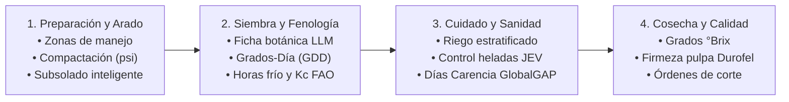
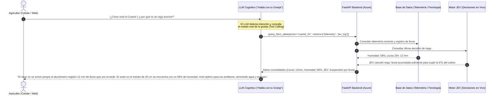

# AgroSense AI — Especificación de Arquitectura y Ecosistema de Doble IA

**Versión:** 2.0 (Ciclo Integral de Cultivo y Orquestación Ciberfísica)  
**Proyecto:** AgroSense AI (Plataforma de Agricultura de Precisión y Gestión Ciberfísica)  
**Institución:** Santo Tomás (Sede Pedro de Valdivia, Temuco)  
**Audiencia:** Desarrolladores juniors, equipo de desarrollo, docentes evaluadores y jurado de feria.

---

## 1. Visión General del Sistema

**AgroSense AI** es una plataforma ciberfísica e integral de agricultura de precisión, riego inteligente estratificado y orquestación de flota (electrobombas, válvulas, drones de pulverización, sensores meteorológicos y maquinaria agrícola).

El sistema está concebido bajo una premisa fundamental: **tolerancia a fallos de conectividad en zonas rurales (*Offline-First*)**, combinando la inmediatez de la respuesta física en terreno (milisegundos) con la capacidad de razonamiento botánico avanzado y trazabilidad en la nube.

---

## 2. El Ecosistema de Doble Inteligencia Artificial

Para no sobrecargar los microcontroladores en campo y garantizar tanto **velocidad instantánea de reacción física** como **profundidad analítica y botánica**, la inteligencia se desacopla estrictamente en dos niveles complementarios:

```mermaid
flowchart TD
    subgraph Campo ["1. Capa Física (Terreno Agrícola)"]
        SENSORES["Sensores de Campo Multiprofundidad<br>(Humedad 20/40/60cm, Tensión Mátrica, CE,<br>NPK, Mojamiento Foliar, Viento 360°, Lluvia)"]
        FLOTA["Flota y Actuadores Ciberfísicos<br>(Bomba Riego, Válvulas, Drones, Aspersores Helada)"]
        HUMANOS_ROBOTS["Cuadrillas Humanas / Robots Futuros<br>(Labores de Arado, Poda y Cosecha)"]
    end

    subgraph BackendAzure ["2. Capa Cloud Backend (FastAPI sobre Azure)"]
        GATEWAY["API Gateway / FastAPI Hub<br>(Validación Pydantic v2 & Ingesta)"]
        DB[(Base de Datos Cloud Azure<br>Series Temporales, Fenología FAO,<br>Históricos y Auditoría GlobalGAP)]
    end

    subgraph DobleIA ["3. Capa de Inteligencia Dual"]
        JEV["IA 1: TypeSafe Jev (jevai.net)<br>Motor de Decisión Ciberfísica System One<br>Noul (Sí/No) | Score (0-100%) | Choice (Herramienta)"]
        LLM["IA 2: LLM Cognitivo (DeepSeek / Gemini)<br>Asistente Botánico e Investigador Agronómico<br>Diagnóstico Fitosanitario | 'Habla con tu Granja'"]
    end

    subgraph Interfaces ["4. Interfaces de Usuario y Mando"]
        DASHBOARD["Dashboard Web en Azure (Tailwind CSS)<br>Monitoreo en Vivo, Simulador y Chat"]
        APP_MOVIL["App Móvil Android (Room SQLite)<br>Operación Offline en el Potrero"]
    end

    %% Conexiones Terreno - Cloud
    SENSORES -->|Telemetría continua (REST/WebSockets)| GATEWAY
    GATEWAY -->|Persistencia Time-Series| DB
    GATEWAY <-->|Inferencia inmediata (70-150 ms)| JEV
    JEV -->|Señales de control ciberfísico| FLOTA
    JEV -->|Emisión de Órdenes de Trabajo validadas| HUMANOS_ROBOTS

    %% Interacción Dual IA
    JEV -.->|Alertas de anomalías / Estrés hídrico / Plagas| LLM
    LLM -->|Recalibración de umbrales y perfiles de cultivo| JEV
    LLM <-->|Consultas SQL a históricos y registros de carencia| DB

    %% Interacción Usuario
    DASHBOARD <-->|Mando y Supervisión| GATEWAY
    APP_MOVIL <-->|Sincronización Offline-First| GATEWAY
    APP_MOVIL <-->|'Habla con tu Granja' (Chat botánico contextual)| LLM
```

---

## 3. IA 1: TypeSafe Jev (jevai.net — Modelo de Decisiones System One)

> [!IMPORTANT]
> **Definición Oficial de JEV en el Proyecto:**  
> Cuando en este proyecto y en la documentación técnica se menciona **JEV**, nos referimos explícitamente a **TypeSafe Jev (`jevai.net`)**, la inteligencia artificial de decisiones desarrollada por TypeSafe AI (fundada por ex-investigadores de OpenAI). No es un generador de texto ni un chatbot: es un modelo discriminativo *"System 1"* de alta velocidad optimizado para inferencia máquina a máquina vía API (`typesafe/jev-latest` o `typesafe/jev-1.14` en OpenRouter).

### 3.1 Propósito y Filosofía
JEV **no genera texto libre** ni conversa. Es un motor de inferencia y orquestación de políticas de control que opera en la nube a través de la API de Decisiones. 

A diferencia de la programación tradicional basada en `if / else` rígidos que se vuelven inmanejables cuando crecen las variables, JEV procesa el estado completo de la granja (humedad a 3 niveles, potencial mátrico, salinidad, viento, lluvia, temperatura de rocío) y resuelve compromisos multidimensionales en tiempo real evaluando preguntas tipadas en una sola pasada paralela de alta velocidad (70 a 200 ms).

### 3.2 Las 3 Primitivas Nativas de Decisión de JEV
TypeSafe Jev estructura sus decisiones en torno a 3 tipos de preguntas fundamentales:
1. **Noul ("Sí o No" / Booleano con Probabilidad)**: Determina inequívocamente si una maniobra física (ej: activación de bomba de riego o protocolo de helada) está autorizada o debe bloquearse (`true / false`).
2. **Score ("0 a 100" / Modulación Continua Ponderada)**: Evalúa el estado sobre una escala ordenada (niveles del 0% al 100%) para definir la potencia de la electrobomba, el grado de apertura de una electroválvula o la velocidad de un actuador.
3. **Choice ("Decisiones de la Lista de Herramientas")**: Selecciona la herramienta específica dentro del catálogo de la flota (`ninguna`, `bomba_riego_principal`, `calefactor_antihelada_sec1`, `electrovalvula_cuartel_01`, `dron_fumigador_alfa`).

### 3.3 Escalabilidad Futura de la Flota (Robótica y Nuevos Sensores)
Cuando la granja incorpore nuevos equipos (sensores de savia, drones autónomos de cosecha o tractores robóticos), **no se requiere reprogramar el código de los microcontroladores en terreno**. La nueva maquinaria simplemente se registra en el catálogo de herramientas de FastAPI, y JEV aprende a orquestarla dentro de su lógica global en la nube.

### 3.4 Manejo de Caídas de Red (*Fail-Safe* & *Lease Time*)
Para evitar riesgos si se corta internet:
* Cada orden emitida por JEV tiene un **tiempo de vigencia** (*lease time*, ej. 15 minutos).
* Si el hardware en terreno pierde el "latido" (*heartbeat*) de JEV, la maquinaria finaliza su ciclo seguro y conmuta a un estado de prevención local (*Hold/Failsafe*), evitando inundaciones, sobrecargas o daños mecánicos.

---

## 4. IA 2: LLM Cognitivo (DeepSeek / Gemini / GPT)

### 4.1 Propósito
Es el "Cerebro Consultor y Agrónomo Investigador". Se utiliza un modelo de lenguaje de última generación optimizado en relación costo-rendimiento (DeepSeek V3 / Gemini 1.5 Flash). Este modelo no procesa el bucle de control de cada segundo, sino que interviene en tres escenarios de alto valor analítico:

### 4.2 Funciones Principales

#### A. Diagnóstico Fitosanitario y Detección de Anomalías Complejas
Cuando JEV o los drones detectan un patrón anómalo (como mojamiento foliar prolongado, salinidad elevada o manchas foliares por visión artificial):
* El LLM recibe el contexto completo: telemetría de 72 horas, imágenes multiespectrales y condiciones microclimáticas.
* Identifica la plaga, hongo o deficiencia nutricional y genera un plan de remediación agronómica y dosis recomendada.

#### B. Investigación Agronómica Profunda en Tiempo Real
Cuando el agricultor siembra un nuevo cultivo (por ejemplo, avellanos europeos en La Araucanía o arándanos en suelos volcánicos de Trumao):
* El LLM investiga los requerimientos óptimos de pH, humedad, umbrales de helada y proporciones NPK.
* **Recalibración de JEV**: El LLM traduce la investigación en directivas numéricas para JEV (*"Para este cultivo en fase de floración, ajusta la humedad mínima al 50% y suspende riego si la temperatura cae de -1.5°C"*).

#### C. Informes Periódicos y Trazabilidad GlobalGAP
Genera automáticamente reportes semanales con métricas de agua ahorrada (en litros y porcentaje), eficiencia energética y verificación de que ningún cuartel sea cosechado antes de cumplir sus Días de Carencia legal.

---

## 5. El Ciclo Agrícola Completo: De la Preparación del Suelo a la Cosecha

AgroSense AI cubre los 4 hitos productivos de cualquier explotación agropecuaria moderna:



### 5.1 ¿Qué automatiza TypeSafe Jev hoy y qué coordina para el futuro?

| Proceso Agrícola | Nivel de Automatización | Cómo opera en el sistema actual | Preparación para el futuro |
| :--- | :---: | :--- | :--- |
| **Riego y Fertirriego** | **100% Autónomo** | JEV modula electrobomba y abre válvulas según humedad 20/40/60cm y potencial mátrico. | Integración directa con bombas solares y sistemas de pulso variable. |
| **Control de Heladas** | **100% Autónomo** | JEV activa aspersores y ventiladores antes de que la temperatura alcance el punto de rocío crítico. | Coordinación con torres de viento automatizadas. |
| **Bloqueo por Viento (Deriva)** | **100% Autónomo** | JEV frena drones fumigadores si el viento supera 15 km/h o sopla hacia cursos de agua/vecinos. | Bloqueo perimetral geo-referenciado para pulverizadores autónomos. |
| **Preparación de Suelo / Arado** | **Asistido por Datos** | El sistema analiza resistencia del suelo y genera la `WorkOrder` de subsolado para el tractorista. | La misma `WorkOrder` se enviará a tractores autónomos (ej. AgBot / Monarch) vía API. |
| **Cosecha y Corte de Fruta** | **Asistido por Datos** | El sistema valida que el lote cumpla los Días de Carencia (PHI) y que los °Brix sean óptimos, alertando al capataz. | Se despacharán robots recolectores con visión artificial sin cambiar la arquitectura. |

---

## 6. Funcionalidad: "Habla con tu Granja"

### 6.1 Concepto
Es la interfaz conversacional entre el agricultor y su campo, integrada en la aplicación móvil de Android y el Dashboard Web de Azure.



---

## 7. Matriz de Comunicación: ¿Quién se comunica con quién?

| Emisor | Receptor | Protocolo / Canal | Tipo de Información Transmitida |
| :--- | :--- | :--- | :--- |
| **Sensores / ESP32** | **FastAPI Backend** | WebSockets (`/ws/telemetry`) / REST HTTPS | Lecturas de humedad 20/40/60cm, potencial mátrico, CE, NPK, microclima y *heartbeat*. |
| **FastAPI Backend** | **Motor JEV (API)** | REST asíncrono interno (`openrouter.ai/api/alpha/decisions`) | Envío de telemetría normalizada y recepción de señales (**Noul**, **Score**, **Choice**). |
| **FastAPI Backend** | **Flota / Actuadores** | MQTT / WebSockets / CoAP | Despacho de órdenes de encendido/apagado, modulación de potencia (0-100%) y *lease time*. |
| **FastAPI / JEV** | **Base de Datos Azure** | Conexión segura SQL / PostgreSQL | Histórico de telemetría, fenología FAO, bitácora de decisiones JEV y auditoría GlobalGAP. |
| **FastAPI Backend** | **LLM Cognitivo** | HTTPS API (DeepSeek / Gemini / OpenRouter) | Peticiones de diagnóstico de emergencias, reportes semanales y chat "Habla con tu Granja". |
| **LLM Cognitivo** | **FastAPI / DB** | Function Calling / Tool Calling | Consultas dinámicas a tablas de telemetría, carencia de agroquímicos y calidad de fruta. |
| **LLM Cognitivo** | **Motor JEV** | Interfaz interna FastAPI | Inyección de nuevos límites y umbrales fisiológicos investigados para calibrar las decisiones. |
| **App Android / Web** | **FastAPI Backend** | REST HTTPS + WebSockets | Visualización del tablero en tiempo real, cambio de modos (Auto/Manual) y chat con la granja. |

---

## 8. Despliegue Cloud en Microsoft Azure

El backend está preparado para ejecutarse como un microservicio contenerizado de grado de producción:
* **Docker Multi-Stage**: Imagen optimizada y liviana basada en Python 3.12 Slim.
* **Azure Container Registry (ACR)**: Almacenamiento seguro de imágenes dockerizadas.
* **Azure Container Instances (ACI)**: Despliegue elástico con FQDN público accesible por internet, con probe de salud `/api/v1/health` para monitoreo continuo.
