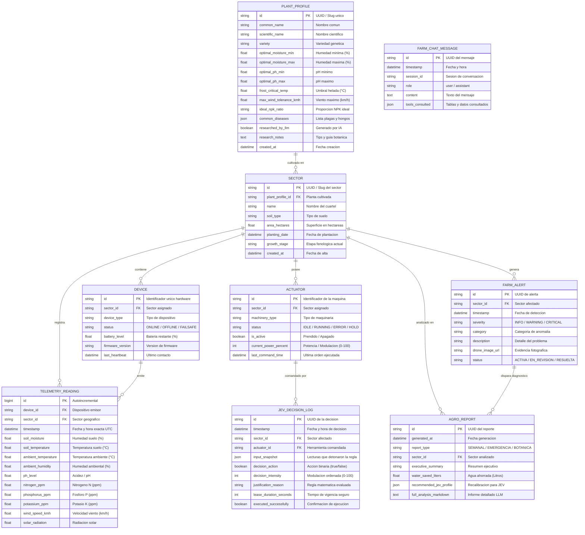
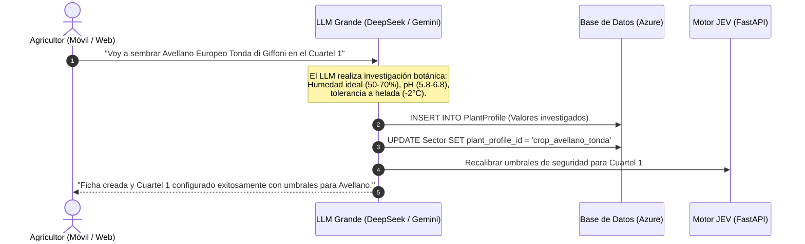
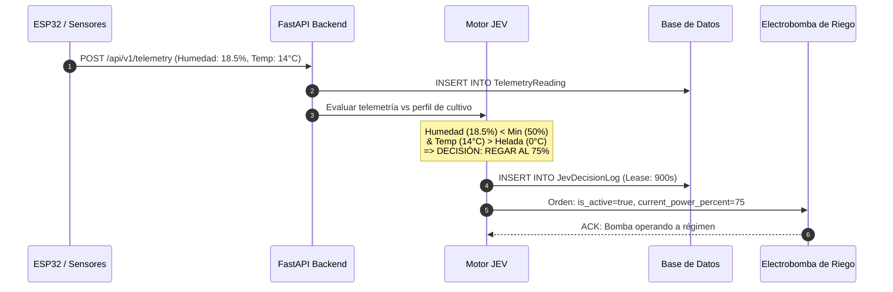
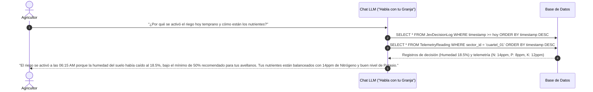

# AgroSense AI — Documento Maestro: Especificación de Base de Datos y Modelo de Entidades

**Versión:** 1.0  
**Proyecto:** AgroSense AI (Ecosistema de Riego Inteligente, Orquestación de Flota y Doble IA)  
**Institución:** Santo Tomás (Sede Pedro de Valdivia, Temuco)  
**Propósito:** Fuente de verdad técnica para desarrollo, evaluación académica y presentación ante jueces y comisiones de innovación.

---

## 1. Filosofía de la Arquitectura de Datos

El modelo de datos de **AgroSense AI** está diseñado para resolver la realidad del agro en el sur de Chile: **zonas remotas con conectividad intermitente**. Para lograr alta disponibilidad y consistencia sin perder datos, el sistema implementa una **Arquitectura Híbrida y Distribuida (*Offline-First*)**:

1. **Persistencia Central en la Nube (Microsoft Azure)**:
   * Almacén principal accesible por FastAPI, el motor **JEV** y el **LLM Grande**.
   * Soporta escalabilidad horizontal, análisis de series temporales históricas y auditoría permanente.
2. **Persistencia Local en Dispositivos Móviles (Android Room / SQLite)**:
   * Copia espejo de los sectores, directivas de cultivo y telemetría reciente en la memoria interna del celular del agricultor.
   * Permite consultar estados y registrar decisiones en el potrero sin cobertura celular.
3. **Persistencia Edge en Microcontroladores (ESP32 NVS - Memoria No Volátil)**:
   * Búfer circular local para retener las últimas lecturas y eventos de emergencia durante desconexiones de red, garantizando cero pérdida de información.
4. **Estrategia de Sincronización Anticolisión**:
   * Todas las entidades emplean identificadores universales únicos (**UUID**) generados en el origen y marcas de tiempo estandarizadas en **UTC**. Esto permite operaciones de inserción y fusión (*UPSERT*) sin conflictos de llaves foráneas al sincronizar.

---

## 2. Diagrama Entidad-Relación Global (ERD)



---

## 3. Especificación Detallada de Entidades y Atributos

### 3.1 Entidad `PlantProfile` (Perfil Botánico y Conocimiento del LLM)
* **Propósito:** Enciclopedia botánica viviente en la base de datos. Almacena las características agronómicas de cada cultivo, investigadas y redactadas por el **LLM Grande** cuando el agricultor da de alta una nueva siembra. Provee los umbrales predeterminados de calibración a **JEV**.

| Atributo | Tipo de Dato | Llave | Nulo | Descripción y Uso Práctico |
| :--- | :--- | :--- | :--- | :--- |
| `id` | `VARCHAR(64)` | **PK** | No | Identificador legible o UUID (ej: `crop_avellano_tonda`, `crop_arandano_duke`). |
| `common_name` | `VARCHAR(100)` | - | No | Nombre común de la especie (ej: *"Avellano Europeo"*, *"Arándano"*). |
| `scientific_name` | `VARCHAR(150)` | - | Sí | Nombre botánico formal (ej: *Corylus avellana*, *Vaccinium corymbosum*). |
| `variety` | `VARCHAR(100)` | - | Sí | Variedad o cultivar específico (ej: *"Tonda di Giffoni"*, *"Duke"*, *"Lapins"*). |
| `optimal_moisture_min` | `FLOAT` | - | No | Umbral inferior de humedad (%): bajo este valor, JEV debe regar para evitar estrés. |
| `optimal_moisture_max` | `FLOAT` | - | No | Umbral superior de humedad (%): sobre este valor, JEV suspende riego para no ahogar raíces. |
| `optimal_ph_min` | `FLOAT` | - | No | Nivel de acidez mínimo tolerado (ej: `4.5` en arándanos). |
| `optimal_ph_max` | `FLOAT` | - | No | Nivel de acidez máximo tolerado (ej: `5.5` en arándanos). |
| `frost_critical_temp` | `FLOAT` | - | No | Temperatura crítica de daño por helada en °C (ej: `-1.5` en floración). |
| `max_wind_tolerance_kmh` | `FLOAT` | - | No | Límite de viento para polinización y pulverización segura de drones. |
| `ideal_npk_ratio` | `VARCHAR(30)` | - | Sí | Proporción recomendada de nutrientes N-P-K (ej: *"12-8-16"*). |
| `common_diseases` | `JSON` | - | Sí | Arreglo JSON de patógenos frecuentes investigados por el LLM (hongos, bacterias, insectos). |
| `researched_by_llm` | `BOOLEAN` | - | No | Marca de auditoría (`true` si fue investigado autónomamente por la IA). |
| `research_notes` | `TEXT` | - | Sí | Guía botánica en Markdown redactada por el LLM con recomendaciones agronómicas. |
| `created_at` | `TIMESTAMP` | - | No | Fecha de creación del registro. |

* **Ejemplo JSON:**
```json
{
  "id": "crop_arandano_duke",
  "common_name": "Arándano",
  "scientific_name": "Vaccinium corymbosum",
  "variety": "Duke",
  "optimal_moisture_min": 60.0,
  "optimal_moisture_max": 80.0,
  "optimal_ph_min": 4.5,
  "optimal_ph_max": 5.5,
  "frost_critical_temp": -1.0,
  "max_wind_tolerance_kmh": 18.0,
  "ideal_npk_ratio": "10-5-10",
  "common_diseases": ["Botrytis cinerea", "Pulgón", "Antracnosis"],
  "researched_by_llm": true,
  "research_notes": "Variedad precoz de alto rendimiento. Requiere suelos bien drenados y acidez estricta."
}
```

---

### 3.2 Entidad `Sector` (Lote / Cuartel / Zona Agrícola)
* **Propósito:** Representa la demarcación física del terreno. Asocia una parcela con su tipo de suelo y con la planta que está actualmente cultivada en ella (`plant_profile_id`).

| Atributo | Tipo de Dato | Llave | Nulo | Descripción y Uso Práctico |
| :--- | :--- | :--- | :--- | :--- |
| `id` | `VARCHAR(64)` | **PK** | No | Identificador del sector (ej: `sector_cuartel_01`, `sector_invernadero_norte`). |
| `plant_profile_id` | `VARCHAR(64)` | **FK** | Sí | Enlace al perfil de planta (`PlantProfile.id`) cultivado en este lote. |
| `name` | `VARCHAR(150)` | - | No | Nombre descriptivo del cuartel visible en la App y Dashboard. |
| `soil_type` | `VARCHAR(80)` | - | No | Tipo de suelo predominante (ej: *"Trumao / Volcánico"*, *"Franco Arcilloso"*). |
| `area_hectares` | `FLOAT` | - | No | Superficie física en hectáreas para cálculo de dotación hídrica. |
| `planting_date` | `DATE` | - | Sí | Fecha de siembra o trasplante inicial. |
| `growth_stage` | `VARCHAR(50)` | - | No | Fase fenológica actual: `BROTACION`, `FLORACION`, `FRUCTIFICACION`, `COSECHA`, `LATENCIA`. |
| `created_at` | `TIMESTAMP` | - | No | Fecha de registro del sector. |

---

### 3.3 Entidad `Device` (Nodos de Terreno, ESP32 y Drones)
* **Propósito:** Inventario y estado de salud operativa del hardware desplegado en campo. Permite detectar caídas de enlace y verificar versiones de firmware.

| Atributo | Tipo de Dato | Llave | Nulo | Descripción y Uso Práctico |
| :--- | :--- | :--- | :--- | :--- |
| `id` | `VARCHAR(64)` | **PK** | No | Identificador de hardware (ej: `esp32_nodo_01`, `dron_inspeccion_alfa`). |
| `sector_id` | `VARCHAR(64)` | **FK** | No | Cuartel donde está físicamente instalado el equipo. |
| `device_type` | `VARCHAR(50)` | - | No | Clasificación: `ESP32_EDGE`, `ESTACION_METEO`, `DRON_VISION`, `GATEWAY_LOCAL`. |
| `status` | `VARCHAR(30)` | - | No | Estado de conexión: `ONLINE`, `OFFLINE`, o `FAILSAFE` (modo de emergencia autónomo). |
| `battery_level` | `FLOAT` | - | Sí | Porcentaje de batería restante (0 - 100%). Vital para nodos solares. |
| `firmware_version` | `VARCHAR(30)` | - | No | Versión del firmware compilado (ej: `v1.2.0-esp-idf-v5.3`). |
| `last_heartbeat` | `TIMESTAMP` | - | No | Última señal de vida (*latido*) recibida por la nube. |

---

### 3.4 Entidad `TelemetryReading` (Series Temporales de Sensores)
* **Propósito:** El pulso continuo del ecosistema agrícola. Almacena las mediciones capturadas por los sensores de suelo, aire y nutrientes.

| Atributo | Tipo de Dato | Llave | Nulo | Descripción y Uso Práctico |
| :--- | :--- | :--- | :--- | :--- |
| `id` | `BIGINT` | **PK** | No | Identificador numérico autoincremental de la muestra. |
| `device_id` | `VARCHAR(64)` | **FK** | No | Dispositivo que transmitió la medición. |
| `sector_id` | `VARCHAR(64)` | **FK** | No | Sector geográfico al que corresponde el dato. |
| `timestamp` | `TIMESTAMP` | - | No | Fecha y hora exacta de captura en estándar UTC. |
| `soil_moisture` | `FLOAT` | - | No | Humedad volumétrica del suelo (0 - 100%). |
| `soil_temperature` | `FLOAT` | - | Sí | Temperatura de la zona radicular en °C. |
| `ambient_temperature` | `FLOAT` | - | No | Temperatura del aire en °C. Disparador de alerta de helada. |
| `ambient_humidity` | `FLOAT` | - | No | Humedad relativa del aire (0 - 100%). |
| `ph_level` | `FLOAT` | - | Sí | Acidez/alcalinidad del suelo (0 - 14). |
| `nitrogen_ppm` | `FLOAT` | - | Sí | Nitrógeno disponible (ppm / simulado por potenciómetro en maqueta). |
| `phosphorus_ppm` | `FLOAT` | - | Sí | Fósforo disponible (ppm / simulado por potenciómetro). |
| `potassium_ppm` | `FLOAT` | - | Sí | Potasio disponible (ppm / simulado por potenciómetro). |
| `wind_speed_kmh` | `FLOAT` | - | Sí | Velocidad del viento en km/h. |
| `solar_radiation` | `FLOAT` | - | Sí | Radiación solar / índice UV para estimar evapotranspiración. |

---

### 3.5 Entidad `Actuator` (Maquinaria y Actuadores de Flota)
* **Propósito:** Representa cada herramienta física capaz de realizar una acción en el campo (electrobombas, electroválvulas, drones fumigadores, tractores).

| Atributo | Tipo de Dato | Llave | Nulo | Descripción y Uso Práctico |
| :--- | :--- | :--- | :--- | :--- |
| `id` | `VARCHAR(64)` | **PK** | No | Nombre único de la herramienta (ej: `bomba_riego_sec1`, `dron_fumigador_01`). |
| `sector_id` | `VARCHAR(64)` | **FK** | No | Sector sobre el cual ejerce su acción. |
| `machinery_type` | `VARCHAR(50)` | - | No | `ELECTROBOMBA`, `ELECTROVALVULA`, `DRON_FUMIGADOR`, `TRACTOR_AUTONOMO`, `VENTILACION`. |
| `status` | `VARCHAR(30)` | - | No | Condición mecánica actual: `IDLE` (en espera), `RUNNING`, `ERROR`, `HOLD`. |
| `is_active` | `BOOLEAN` | - | No | **Salida binaria de JEV:** `true` (encendido) / `false` (apagado). |
| `current_power_percent` | `INTEGER` | - | No | **Salida 0-100% de JEV:** Potencia de bombeo, apertura de válvula o acelerador. |
| `last_command_time` | `TIMESTAMP` | - | No | Fecha y hora en que recibió su última orden operativa. |

---

### 3.6 Entidad `JevDecisionLog` (Auditoría de la IA TypeSafe Jev - jevai.net)
* **Propósito:** Registro estricto y auditable de cada inferencia emitida por la IA de decisiones **TypeSafe Jev (`jevai.net`)**. Almacena la resolución de sus 3 primitivas nativas: **Noul** (`decision_action`), **Score** (`decision_intensity`) y **Choice** (`actuator_id`), garantizando total explicabilidad de por qué se encendió o detuvo una maquinaria.

| Atributo | Tipo de Dato | Llave | Nulo | Descripción y Uso Práctico |
| :--- | :--- | :--- | :--- | :--- |
| `id` | `VARCHAR(64)` | **PK** | No | UUID de la transacción de decisión. |
| `timestamp` | `TIMESTAMP` | - | No | Momento exacto de la inferencia. |
| `sector_id` | `VARCHAR(64)` | **FK** | No | Sector evaluado. |
| `actuator_id` | `VARCHAR(64)` | **FK** | No | Herramienta comandada por la regla. |
| `input_snapshot` | `JSON` | - | No | Foto estática de las variables de entrada evaluadas: `{"humedad": 18.2, "temp": 11.5, "viento": 7.0}`. |
| `decision_action` | `BOOLEAN` | - | No | Resultado binario: `true` (activa) o `false` (detiene). |
| `decision_intensity` | `INTEGER` | - | No | Modulación aplicada: `0` a `100`%. |
| `justification_reason` | `VARCHAR(255)` | - | No | Regla técnica evaluada (ej: *"Riego activado al 75% por humedad < 20% previa a las 06:00"*). |
| `lease_duration_seconds`| `INTEGER` | - | No | Tiempo de vigencia seguro (ej: `900` s = 15 min). Previene desastres si se corta internet. |
| `executed_successfully`| `BOOLEAN` | - | No | `true` cuando el hardware confirmó el acuse de recibo (*ACK*). |

---

### 3.7 Entidad `FarmAlert` (Alertas y Emergencias Fitosanitarias)
* **Propósito:** Registro de eventos que requieren atención agronómica inmediata (heladas, plagas detectadas por visión en drones, caídas críticas de pH).

| Atributo | Tipo de Dato | Llave | Nulo | Descripción y Uso Práctico |
| :--- | :--- | :--- | :--- | :--- |
| `id` | `VARCHAR(64)` | **PK** | No | UUID de la alerta. |
| `sector_id` | `VARCHAR(64)` | **FK** | No | Sector afectado. |
| `timestamp` | `TIMESTAMP` | - | No | Fecha y hora de detección. |
| `severity` | `VARCHAR(20)` | - | No | Nivel de urgencia: `INFO`, `WARNING`, `CRITICAL`. |
| `category` | `VARCHAR(50)` | - | No | `RIESGO_HELADA`, `SEQUIA_SEVERA`, `PLAGA_INSECTO`, `HONGO_RADICULAR`, `PH_ANOMALO`. |
| `description` | `TEXT` | - | No | Explicación detallada de la anomalía física. |
| `drone_image_url` | `VARCHAR(255)` | - | Sí | Enlace a la fotografía satelital o de dron que evidencia el daño foliar. |
| `status` | `VARCHAR(30)` | - | No | Ciclo de vida: `ACTIVA`, `EN_DIAGNOSTICO_LLM`, `TRATAMIENTO_EN_CURSO`, `RESUELTA`. |

---

### 3.8 Entidad `AgroReport` (Informes Agronómicos del LLM Grande)
* **Propósito:** Resúmenes ejecutivos, análisis fitosanitarios y recetas botánicas redactadas por el **LLM Grande** (DeepSeek / Gemini / GPT).

| Atributo | Tipo de Dato | Llave | Nulo | Descripción y Uso Práctico |
| :--- | :--- | :--- | :--- | :--- |
| `id` | `VARCHAR(64)` | **PK** | No | UUID del informe. |
| `generated_at` | `TIMESTAMP` | - | No | Fecha y hora de emisión. |
| `report_type` | `VARCHAR(50)` | - | No | Clasificación: `SEMANAL_CONSOLIDADO`, `DIAGNOSTICO_EMERGENCIA`, `INVESTIGACION_CULTIVO`. |
| `sector_id` | `VARCHAR(64)` | **FK** | Sí | Sector analizado (nulo si es un informe global de la granja). |
| `executive_summary` | `TEXT` | - | No | Síntesis concisa en lenguaje humano para lectura rápida en el celular. |
| `water_saved_liters` | `FLOAT` | - | Sí | Estimación cuantitativa de litros de agua ahorrados versus riego por calendario fijo. |
| `recommended_jev_profile`| `JSON` | - | Sí | **Parámetros de recalibración:** Nuevos límites de humedad y pH sugeridos para actualizar a JEV. |
| `full_analysis_markdown` | `TEXT` | - | No | Documento completo con diagnóstico, fundamentación científica y plan de acción. |

---

### 3.9 Entidad `FarmChatMessage` (Historial de "Habla con tu Granja")
* **Propósito:** Registro de las interacciones entre el agricultor y el asistente botánico inteligente. Permite al LLM recordar el hilo de la conversación y registrar qué datos consultó para fundamentar su respuesta.

| Atributo | Tipo de Dato | Llave | Nulo | Descripción y Uso Práctico |
| :--- | :--- | :--- | :--- | :--- |
| `id` | `VARCHAR(64)` | **PK** | No | UUID del mensaje. |
| `timestamp` | `TIMESTAMP` | - | No | Hora exacta del intercambio. |
| `session_id` | `VARCHAR(64)` | - | No | Identificador de la conversación o del usuario móvil. |
| `role` | `VARCHAR(20)` | - | No | Emisor: `user` (agricultor) o `assistant` (el LLM de la granja). |
| `content` | `TEXT` | - | No | Cuerpo del mensaje textual. |
| `tools_consulted` | `JSON` | - | Sí | Metadatos de auditoría: qué tablas o APIs consultó el LLM (`{"tools": ["query_jev_log", "query_telemetry"]}`). |

---

## 4. Flujos de Datos Integrados (Casos de Uso Reales)

### Flujo 1: Alta de Nuevo Cultivo e Investigación Autónoma


### Flujo 2: Ciclo de Inferencia y Mando en Tiempo Real


### Flujo 3: Conversación Contextual ("Habla con tu Granja")


---

## 5. Implementación Técnica en Código

Para garantizar la coherencia en todo el stack tecnológico:

1. **En Backend FastAPI (Azure)**: Se modelan como clases **SQLAlchemy / SQLModel** y esquemas de validación **Pydantic v2**.
2. **En App Móvil (Android Studio)**: Se modelan idénticamente como clases `@Entity` de **Room Database** en Kotlin, utilizando corrutinas asíncronas para la sincronización en segundo plano (*Background Sync*).
3. **En Docker / Azure**: La base de datos puede inicializarse en desarrollo como un archivo SQLite embebido de alto rendimiento con modo WAL (*Write-Ahead Logging*) y escalarse de forma transparente a **Azure Database for PostgreSQL** sin modificar el código de la aplicación.
