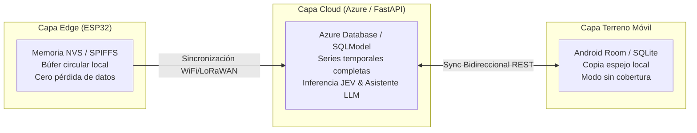

# AgroSense AI — Documento Maestro: Especificación de Base de Datos y Modelo de Entidades

**Versión:** 2.0 (Ciclo Integral de Cultivo y Variables Agronómicas Profesionales)  
**Proyecto:** AgroSense AI (Ecosistema Ciberfísico de Riego Inteligente, Orquestación de Flota y Doble IA)  
**Institución:** Santo Tomás (Sede Pedro de Valdivia, Temuco)  
**Propósito:** Especificación técnica completa, arquitectura de persistencia y fuente de verdad para desarrolladores, evaluadores docentes y jurados de innovación.

---

## 1. Guía Rápida para Desarrolladores Junior: ¿Qué significan estos datos y por qué importan?

Si vienes del mundo del software tradicional, una base de datos suele almacenar usuarios, carritos de compras o facturas. En **AgroSense AI**, nuestra base de datos modela un **organismo biológico vivo** (el cultivo) y su interacción con la física del suelo, la atmósfera y máquinas automáticas.

Para entender el código y las tablas, ten en mente estos conceptos clave explicados de forma sencilla:

### 1.1 Humedad Estratificada (20 cm, 40 cm y 60 cm)
* **¿Por qué 3 profundidades y no una sola?**  
  * **20 cm (Zona de absorción activa):** Aquí es donde las raíces beben día a día. Si baja de cierto umbral, la planta tiene sed.
  * **40 cm (Zona de reserva intermedia):** Es el colchón hídrico de seguridad.
  * **60 cm (Zona profunda de escape):** Las raíces de hortalizas o frutales jóvenes casi no llegan acá. Si el sensor de 60 cm se satura de agua, significa que **estamos regando de más**, perdiendo dinero en electricidad y lavando (*lixiviando*) los fertilizantes hacia las napas subterráneas.
* **En el código:** Si `soil_moisture_20cm` es bajo pero `soil_moisture_60cm` está saturado, JEV sabe que debe programar pulsos cortos de riego en lugar de riegos largos.

### 1.2 Potencial Mátrico (`matric_potential_kpa`)
* **La analogía:** Imagina una esponja húmeda. Al principio es fácil sacar agua apretándola suave; pero cuando le queda poca agua, tienes que estrujar con muchísima fuerza.
* **En agronomía:** El sensor mide la fuerza de succión (en kiloPascales, kPa) que las raíces deben hacer para tomar agua. En un suelo arcilloso puede haber 25% de agua, pero si el suelo la retiene con fuerza (tensión muy negativa), la planta se marchita. Es el indicador más confiable de estrés hídrico real.

### 1.3 Conductividad Eléctrica y Salinidad (`ec_salinity_dsm`)
* Los fertilizantes comerciales son sales disueltas. Si aplicamos demasiado abono químico, la salinidad sube y las raíces sufren una quemadura osmótica ("se deshidratan al revés"). El sensor de conductividad eléctrica (en deciSiemens por metro, dS/m) le indica a JEV si debe dosificar fertilizante o inyectar solo agua pura para lavar sales.

### 1.4 Macronutrientes Primarios (NPK) y Secundarios (Calcio y Magnesio)
* **Nitrógeno (N):** Crecimiento vegetativo y hojas verdes.
* **Fósforo (P):** Enraizamiento y flores.
* **Potasio (K):** Llenado, peso y dulzor del fruto.
* **Calcio (Ca):** El "cemento" de las paredes celulares. Sin calcio, la fruta se pudre antes de cosechar (ej. *blossom end rot* o bitter pit).
* **Magnesio (Mg):** El átomo central de la molécula de clorofila. Sin magnesio no hay fotosíntesis.

### 1.5 Mojamiento Foliar (`leaf_wetness_minutes`)
* Es una pequeña placa electrónica que simula la superficie de una hoja. Si detecta agua líquida (rocío o lluvia) durante muchas horas continuas con temperaturas moderadas, se cumplen las condiciones biológicas para la germinación de esporas de hongos destructivos como *Botrytis cinerea* o sarna (*Venturia inaequalis*). JEV utiliza esta variable para emitir alertas fitosanitarias preventivas antes de que la infección sea visible.

### 1.6 Dirección del Viento (`wind_direction_deg`) y Normativa Legal
* Conocer la velocidad del viento es útil, pero conocer su **dirección (0° a 360°)** es un requisito legal (normativas SAG en Chile / EPA internacional). Si el viento sopla a más de 15 km/h hacia una casa vecina, un camino público o un estero natural, la aplicación con drones fumigadores o pulverizadores se bloquea automáticamente para evitar derivas tóxicas.

### 1.7 Déficit de Presión de Vapor (`vpd_kpa` - VPD)
* Mide la "sequedad" del aire combinando temperatura y humedad ambiental.
  * Si el VPD es **muy alto** (> 1.8 kPa), el aire seca la planta tan rápido que esta cierra sus estomas (poros de las hojas) para no deshidratarse, frenando en seco la fotosíntesis aunque el suelo esté húmedo.
  * Si el VPD es **muy bajo** (< 0.4 kPa), la planta no puede transpirar y deja de transportar nutrientes como el Calcio.

### 1.8 Punto de Rocío (`dew_point_c`) y Alerta de Heladas
* Si la temperatura baja a 0°C con un punto de rocío cercano, el vapor se condensa formando escarcha (**helada blanca**, menos destructiva). Pero si el punto de rocío está muy por debajo de 0°C, el frío congela directamente los jugos internos de la planta sin escarcha visible (**helada negra**), matando brotes tiernos. JEV utiliza el diferencial entre temperatura y punto de rocío para activar con anticipación los aspersores o calefactores.

---

## 2. Filosofía de la Arquitectura de Datos (*Offline-First*)

El ecosistema **AgroSense AI** opera en tres capas de persistencia coordinadas:

1. **Persistencia Central en la Nube (Microsoft Azure)**:
   * Almacén de series temporales, telemetría histórica y registro inmutable de decisiones emitidas por **TypeSafe Jev (`jevai.net`)**.
2. **Persistencia Local en Móviles (Android Room / SQLite)**:
   * Copia espejo de los sectores, directivas de cultivo y telemetría reciente para consultar en terreno sin cobertura celular.
3. **Persistencia Edge en Nodos (ESP32 NVS - Memoria No Volátil)**:
   * Búfer circular que retiene las últimas lecturas si se interrumpe la conexión WiFi o LoRaWAN.
4. **Identificadores UUID y UTC**:
   * Todas las entidades emplean UUIDs universales y marcas de tiempo en UTC para sincronización *UPSERT* anticolisión.

---

## 3. Diagrama Entidad-Relación Global (ERD 2.0)

```mermaid
erDiagram
    PLANT_PROFILE ||--o{ SECTOR : "cultivado en"
    SECTOR ||--o{ MANAGEMENT_ZONE : "zonificado en"
    SECTOR ||--o{ CROP_PHENOLOGY : "monitorea fase"
    SECTOR ||--o{ DEVICE : "contiene"
    SECTOR ||--o{ ACTUATOR : "posee"
    SECTOR ||--o{ TELEMETRY_READING : "registra"
    SECTOR ||--o{ PHYTOSANITARY_APPLICATION : "recibe aplicaciones"
    SECTOR ||--o{ HARVEST_QUALITY_LOG : "evalua madurez"
    SECTOR ||--o{ WORK_ORDER : "ejecuta labores"
    SECTOR ||--o{ FARM_ALERT : "genera"
    SECTOR ||--o{ AGRO_REPORT : "analizado en"
    
    DEVICE ||--o{ TELEMETRY_READING : "emite"
    ACTUATOR ||--o{ JEV_DECISION_LOG : "comandado por"
    WORK_ORDER ||--o{ ACTUATOR : "despachado a"
    FARM_ALERT ||--o{ AGRO_REPORT : "dispara diagnostico"

    PLANT_PROFILE {
        string id PK "UUID / Slug unico"
        string common_name "Nombre comun"
        string scientific_name "Nombre botánico formal"
        string variety "Variedad o clon genético"
        float optimal_moisture_min "Humedad minima (%)"
        float optimal_moisture_max "Humedad maxima (%)"
        float optimal_ph_min "pH minimo tolerado"
        float optimal_ph_max "pH maximo tolerado"
        float frost_critical_temp "Umbral helada (°C)"
        float max_wind_tolerance_kmh "Viento maximo seguro (km/h)"
        string ideal_npk_ratio "Proporcion NPK ideal"
        json common_diseases "Patógenos típicos investigados"
        boolean researched_by_llm "Generado por IA"
        text research_notes "Guia agronómica del LLM"
    }

    SECTOR {
        string id PK "UUID / Slug del sector"
        string plant_profile_id FK "Planta cultivada"
        string name "Nombre del cuartel"
        string soil_type "Tipo de suelo predominante"
        float area_hectares "Superficie en hectáreas"
        date planting_date "Fecha de plantación"
        string growth_stage "Fase fenológica actual"
    }

    MANAGEMENT_ZONE {
        string id PK "UUID zona de manejo"
        string sector_id FK "Sector geográfico"
        string texture_class "Clase textural (Franco, Arcilloso)"
        float organic_matter_percent "Materia orgánica (%)"
        float compaction_psi "Compactación / Resistencia suelo"
        int plowing_depth_recommended_cm "Profundidad de arado sugerida"
        boolean requires_subsoiling "Requiere subsolado / arado profundo"
    }

    CROP_PHENOLOGY {
        string id PK "UUID registro fenológico"
        string sector_id FK "Sector monitoreado"
        string current_stage "Fase actual (FLORACION, LLENADO, etc.)"
        float gdd_accumulated "Grados-Día Acumulados (GDD)"
        float chill_hours_accumulated "Horas de Frío acumuladas"
        float kc_coefficient "Coeficiente de cultivo dinámico Kc"
        float etc_mm_day "Evapotranspiración diaria estimada mm"
    }

    TELEMETRY_READING {
        bigint id PK "Autoincremental"
        string device_id FK "Dispositivo emisor"
        string sector_id FK "Sector geográfico"
        datetime timestamp "Marca temporal exacta UTC"
        float soil_moisture "Humedad suelo promedio (%)"
        float soil_moisture_20cm "Humedad estrato 20cm (%)"
        float soil_moisture_40cm "Humedad estrato 40cm (%)"
        float soil_moisture_60cm "Humedad estrato 60cm (%)"
        float matric_potential_kpa "Potencial mátrico (kPa)"
        float ec_salinity_dsm "Conductividad eléctrica (dS/m)"
        float soil_temperature "Temperatura suelo (°C)"
        float ph_level "Acidez del suelo (0-14)"
        float nitrogen_ppm "Nitrógeno N (ppm)"
        float phosphorus_ppm "Fósforo P (ppm)"
        float potassium_ppm "Potasio K (ppm)"
        float calcium_ppm "Calcio Ca (ppm)"
        float magnesium_ppm "Magnesio Mg (ppm)"
        float ambient_temperature "Temperatura aire (°C)"
        float ambient_humidity "Humedad ambiental (%)"
        float wind_speed_kmh "Velocidad viento (km/h)"
        float wind_direction_deg "Dirección del viento (0-360°)"
        float rain_gauge_mm "Lluvia acumulada 24h (mm)"
        float leaf_wetness_minutes "Mojamiento foliar acumulado"
        float vpd_kpa "Déficit Presión Vapor VPD (kPa)"
        float dew_point_c "Punto de rocío (°C)"
        float par_radiation "Radiación fotosintética útil PAR"
    }

    PHYTOSANITARY_APPLICATION {
        string id PK "UUID de la aplicación"
        string sector_id FK "Sector tratado"
        string target_pest_or_disease "Plaga o enfermedad objetivo"
        string product_name "Nombre comercial producto"
        string active_ingredient "Ingrediente activo químico/biológico"
        string dose_per_hectare "Dosis por hectárea"
        datetime application_date "Fecha y hora de aplicación"
        int phi_days "Días de Carencia (PHI GlobalGAP)"
        date safe_harvest_date "Fecha segura legal de cosecha"
        string applied_by "Operador humano o dron asignado"
    }

    HARVEST_QUALITY_LOG {
        string id PK "UUID de la muestra"
        string sector_id FK "Sector evaluado"
        datetime sampling_date "Fecha de muestreo"
        float brix_degrees "Azúcares solubles (°Brix)"
        float firmness_durofel "Firmeza de pulpa (Durofel / kg-cm2)"
        float titratable_acidity "Acidez titulable (%)"
        boolean harvest_ready "Apto comercialmente para cosechar"
    }

    WORK_ORDER {
        string id PK "UUID de la orden de labor"
        string sector_id FK "Sector objetivo"
        string operation_type "ARADO, RIEGO, PULVERIZACION, COSECHA"
        string assigned_entity_type "HUMANO o ROBOT_AUTONOMO"
        string assigned_entity_id "ID cuadrilla o ID maquinaria"
        string status "PENDING, IN_PROGRESS, COMPLETED, CANCELLED"
        boolean weather_safe_validated "Ventana climática aprobada por IA"
        datetime created_at "Fecha de emisión"
        datetime completed_at "Fecha de finalización"
    }

    ACTUATOR {
        string id PK "Identificador de la máquina"
        string sector_id FK "Sector asignado"
        string machinery_type "Tipo de maquinaria"
        string status "IDLE / RUNNING / ERROR / HOLD"
        boolean is_active "Prendido / Apagado"
        int current_power_percent "Potencia / Modulación (0-100)"
        datetime last_command_time "Última orden ejecutada"
    }

    JEV_DECISION_LOG {
        string id PK "UUID de la decisión"
        datetime timestamp "Fecha y hora de decisión"
        string sector_id FK "Sector evaluado"
        string actuator_id FK "Herramienta comandada"
        json input_snapshot "Lecturas que detonaron la regla"
        boolean decision_action "Salida Noul (true/false)"
        int decision_intensity "Salida Score (0-100%)"
        string justification_reason "Regla matemática evaluada"
        int lease_duration_seconds "Tiempo de vigencia seguro"
        boolean executed_successfully "Confirmación ACK de la máquina"
    }

    FARM_ALERT {
        string id PK "UUID de la alerta"
        string sector_id FK "Sector afectado"
        datetime timestamp "Fecha de detección"
        string severity "INFO / WARNING / CRITICAL"
        string category "Categoría de anomalía"
        string description "Detalle del problema"
        string drone_image_url "Evidencia fotográfica"
        string status "ACTIVA / EN_REVISION / RESUELTA"
    }

    AGRO_REPORT {
        string id PK "UUID del reporte"
        datetime generated_at "Fecha generación"
        string report_type "SEMANAL / EMERGENCIA / BOTANICA"
        string sector_id FK "Sector analizado"
        string executive_summary "Resumen ejecutivo"
        float water_saved_liters "Agua ahorrada (Litros)"
        json recommended_jev_profile "Recalibración para JEV"
        text full_analysis_markdown "Informe detallado LLM"
    }

    FARM_CHAT_MESSAGE {
        string id PK "UUID del mensaje"
        datetime timestamp "Fecha y hora"
        string session_id "Sesión de conversación"
        string role "user / assistant"
        text content "Texto del mensaje"
        json tools_consulted "Tablas y datos consultados"
    }
```

---

## 4. Especificación Detallada de Entidades y Atributos

### 4.1 Entidad `PlantProfile` (Ficha Agronómica y Perfil Botánico)
* **Propósito:** Catálogo botánico investigado y generado por el **LLM Grande** (DeepSeek / Gemini) al dar de alta una nueva especie. Provee a **TypeSafe Jev** los límites numéricos de seguridad.

| Atributo | Tipo | Llave | Nulo | Descripción y Uso Práctico |
| :--- | :--- | :--- | :--- | :--- |
| `id` | `VARCHAR(64)` | **PK** | No | Slug único (ej: `crop_avellano_tonda`, `crop_arandano_duke`). |
| `common_name` | `VARCHAR(100)` | - | No | Nombre común en lenguaje natural (ej: *"Avellano Europeo"*). |
| `scientific_name` | `VARCHAR(150)` | - | Sí | Nombre científico botánico (ej: *Corylus avellana*). |
| `variety` | `VARCHAR(100)` | - | Sí | Variedad o clon comercial (ej: *"Tonda di Giffoni"*). |
| `optimal_moisture_min` | `FLOAT` | - | No | Umbral inferior de humedad (%): bajo este valor JEV autoriza riego. |
| `optimal_moisture_max` | `FLOAT` | - | No | Umbral superior (%): sobre este valor JEV detiene riego para no ahogar raíces. |
| `optimal_ph_min` | `FLOAT` | - | No | Acidez mínima tolerada (ej: `5.8`). |
| `optimal_ph_max` | `FLOAT` | - | No | Acidez máxima tolerada (ej: `6.8`). |
| `frost_critical_temp` | `FLOAT` | - | No | Temperatura en °C que destruye los tejidos florales (ej: `-1.5`). |
| `max_wind_tolerance_kmh` | `FLOAT` | - | No | Viento máximo tolerado para pulverización y polinización. |
| `ideal_npk_ratio` | `VARCHAR(30)` | - | Sí | Proporción de fertilización balanceada recomendada (ej: *"12-8-16"*). |
| `common_diseases` | `JSON` | - | Sí | Lista JSON de patógenos y plagas comunes (*Botrytis*, *Pulgón*). |
| `researched_by_llm` | `BOOLEAN` | - | No | Marca de auditoría (`true` si fue generado autónomamente por la IA). |
| `research_notes` | `TEXT` | - | Sí | Guía botánica de manejo redactada en Markdown por el LLM. |

---

### 4.2 Entidad `Sector` (Cuartel / Lote Agrícola)
* **Propósito:** Demarcación espacial y administrativa del terreno agrícola.

| Atributo | Tipo | Llave | Nulo | Descripción y Uso Práctico |
| :--- | :--- | :--- | :--- | :--- |
| `id` | `VARCHAR(64)` | **PK** | No | Identificador del cuartel (ej: `cuartel_01_avellanos`). |
| `plant_profile_id` | `VARCHAR(64)` | **FK** | No | Enlace a la especie sembrada (`PlantProfile.id`). |
| `name` | `VARCHAR(150)` | - | No | Nombre descriptivo visible para el agricultor en la App y Dashboard. |
| `soil_type` | `VARCHAR(80)` | - | No | Suelo predominante (ej: *"Trumao / Volcánico"*, *"Franco Arcilloso"*). |
| `area_hectares` | `FLOAT` | - | No | Superficie en hectáreas para cálculo de dotación de riego y fertilización. |
| `planting_date` | `DATE` | - | Sí | Fecha en que se realizó el trasplante o la siembra. |
| `growth_stage` | `VARCHAR(50)` | - | No | Estado fenológico: `VEGETATIVO`, `FLORACION`, `CUAJADO`, `MADURACION`, `REPOSO`. |

---

### 4.3 Entidad `ManagementZone` (Zonificación de Suelo y Preparación de Terreno)
* **Propósito:** Información espacial para labores previas a la siembra, arado, subsolado y nivelación del suelo. Permite agricultura de precisión intra-cuartel.

| Atributo | Tipo | Llave | Nulo | Descripción y Uso Práctico |
| :--- | :--- | :--- | :--- | :--- |
| `id` | `VARCHAR(64)` | **PK** | No | Identificador de la zona de manejo (ej: `zm_cuartel1_zona_arcilla`). |
| `sector_id` | `VARCHAR(64)` | **FK** | No | Sector geográfico al que pertenece. |
| `texture_class` | `VARCHAR(50)` | - | No | Clase textural del suelo: `Arenoso`, `Franco`, `Franco Arcilloso`, `Trumao`. |
| `organic_matter_percent`| `FLOAT` | - | No | Materia orgánica (%), vital para capacidad de retención de agua. |
| `compaction_psi` | `FLOAT` | - | No | Resistencia mecánica del suelo medida con penetrómetro (psi o bar). |
| `plowing_depth_recommended_cm`| `INTEGER` | - | No | Profundidad óptima de labor de arado calculada por el sistema (ej: 35 cm). |
| `requires_subsoiling` | `BOOLEAN` | - | No | `true` si se detecta pie de arado duro que impide el paso de raíces y drena mal. |

---

### 4.4 Entidad `CropPhenology` (Seguimiento Fenológico y Demanda Hídrica FAO)
* **Propósito:** Seguimiento térmico del crecimiento vegetal. Permite a JEV ajustar dinámicamente el coeficiente de cultivo ($K_c$) y la evapotranspiración ($ET_c$) según el modelo estándar FAO-56.

| Atributo | Tipo | Llave | Nulo | Descripción y Uso Práctico |
| :--- | :--- | :--- | :--- | :--- |
| `id` | `VARCHAR(64)` | **PK** | No | UUID del registro fenológico. |
| `sector_id` | `VARCHAR(64)` | **FK** | No | Sector monitoreado. |
| `current_stage` | `VARCHAR(50)` | - | No | Fase fenológica actual (`BROTACION`, `FLORACION`, `LLENADO`, etc.). |
| `gdd_accumulated` | `FLOAT` | - | No | Grados-Día de Crecimiento acumulados ($GDD = \sum [\frac{T_{max} + T_{min}}{2} - T_{base}]$). |
| `chill_hours_accumulated`| `FLOAT` | - | No | Horas de frío acumuladas (< 7.2°C) requeridas para romper latencia en frutales. |
| `kc_coefficient` | `FLOAT` | - | No | Coeficiente $K_c$ actual del cultivo (ej: 0.4 en brotación, 1.05 en pleno llenado). |
| `etc_mm_day` | `FLOAT` | - | No | Demanda evapotranspirativa diaria calculada ($ET_c = ET_0 \times K_c$) en mm/día. |

---

### 4.5 Entidad `TelemetryReading` (Series Temporales de Suelo y Microclima)
* **Propósito:** El pulso ciberfísico continuo del predio. Contiene las lecturas del suelo estratificado a tres profundidades y la estación meteorológica completa.

| Atributo | Tipo | Llave | Nulo | Descripción y Uso Práctico |
| :--- | :--- | :--- | :--- | :--- |
| `id` | `BIGINT` | **PK** | No | Identificador numérico autoincremental de la muestra. |
| `device_id` | `VARCHAR(64)` | **FK** | No | Nodo sensor emisor (ej: `esp32_nodo_01`). |
| `sector_id` | `VARCHAR(64)` | **FK** | No | Cuartel donde está instalado. |
| `timestamp` | `TIMESTAMP` | - | No | Fecha y hora exacta de captura en estándar UTC. |
| `soil_moisture` | `FLOAT` | - | No | Humedad volumétrica superficial o promedio ponderado (0 - 100%). |
| `soil_moisture_20cm` | `FLOAT` | - | Sí | **Estrato 20 cm:** Humedad de la zona de máxima absorción radicular (%). |
| `soil_moisture_40cm` | `FLOAT` | - | Sí | **Estrato 40 cm:** Humedad del bulbo medio y reserva de agua (%). |
| `soil_moisture_60cm` | `FLOAT` | - | Sí | **Estrato 60 cm:** Humedad profunda; alerta sobre-riego y pérdida de fertilizantes. |
| `matric_potential_kpa` | `FLOAT` | - | Sí | Tensión de succión del agua en el suelo (kPa / cbar). Esfuerzo de la raíz. |
| `ec_salinity_dsm` | `FLOAT` | - | Sí | Conductividad eléctrica en el suelo (dS/m). Previene toxicidad de sales. |
| `soil_temperature` | `FLOAT` | - | Sí | Temperatura del suelo radicular en °C. |
| `ph_level` | `FLOAT` | - | Sí | Acidez / alcalinidad del sustrato (0.0 - 14.0). |
| `nitrogen_ppm` | `FLOAT` | - | Sí | Nitrógeno disponible disuelto (N en ppm). |
| `phosphorus_ppm` | `FLOAT` | - | Sí | Fósforo disponible disuelto (P en ppm). |
| `potassium_ppm` | `FLOAT` | - | Sí | Potasio disponible disuelto (K en ppm). |
| `calcium_ppm` | `FLOAT` | - | Sí | Calcio disponible (Ca en ppm) para consistencia celular. |
| `magnesium_ppm` | `FLOAT` | - | Sí | Magnesio disponible (Mg en ppm) para síntesis de clorofila. |
| `ambient_temperature` | `FLOAT` | - | No | Temperatura atmosférica en °C. Disparador de alerta de heladas. |
| `ambient_humidity` | `FLOAT` | - | No | Humedad relativa del aire (0 - 100%). |
| `wind_speed_kmh` | `FLOAT` | - | Sí | Velocidad del viento (km/h). |
| `wind_direction_deg` | `FLOAT` | - | Sí | Dirección del viento (0 - 360°). Requisito legal para no pulverizar vecinos. |
| `rain_gauge_mm` | `FLOAT` | - | Sí | Lluvia acumulada en las últimas 24 horas (mm). Suspende riego automáticamente. |
| `leaf_wetness_minutes` | `FLOAT` | - | Sí | Minutos acumulados de mojamiento de hojas. Detona modelos de hongos (Mills). |
| `vpd_kpa` | `FLOAT` | - | Sí | Déficit de Presión de Vapor en kPa (transpiración y apertura de estomas). |
| `dew_point_c` | `FLOAT` | - | Sí | Punto de rocío en °C (predicción de heladas blancas vs negras). |
| `par_radiation` | `FLOAT` | - | Sí | Radiación fotosintéticamente activa (μmol/m²/s) para cálculo de DLI. |

---

### 4.6 Entidad `PhytosanitaryApplication` (Sanidad Vegetal y Días de Carencia GlobalGAP)
* **Propósito:** Registro estricto de aplicaciones químicas o biológicas. Garantiza la inocuidad alimentaria y el cumplimiento de los **Días de Carencia (PHI - Pre-Harvest Interval)** exigidos para la exportación de fruta.

| Atributo | Tipo | Llave | Nulo | Descripción y Uso Práctico |
| :--- | :--- | :--- | :--- | :--- |
| `id` | `VARCHAR(64)` | **PK** | No | UUID del tratamiento fitosanitario. |
| `sector_id` | `VARCHAR(64)` | **FK** | No | Cuartel intervenido. |
| `target_pest_or_disease`| `VARCHAR(100)`| - | No | Patógeno o insecto combatido (ej: *"Botrytis cinerea"*, *"Burkholderia"*). |
| `product_name` | `VARCHAR(100)`| - | No | Nombre comercial del insumo fitosanitario. |
| `active_ingredient` | `VARCHAR(100)`| - | No | Molécula activa (ej: *"Ciprodinil + Fludioxonil"*, *"Bacillus subtilis"*). |
| `dose_per_hectare` | `VARCHAR(50)` | - | No | Dosis aplicada según recomendación del agrónomo (ej: *"1.5 L/ha"*). |
| `application_date` | `TIMESTAMP` | - | No | Fecha y hora exacta de la pulverización. |
| `phi_days` | `INTEGER` | - | No | **Días de Carencia (PHI):** Días mínimos obligatorios antes de poder cosechar. |
| `safe_harvest_date` | `DATE` | - | No | Fecha a partir de la cual el lote está legalmente habilitado para cosecha. |
| `applied_by` | `VARCHAR(80)` | - | No | Maquinaria o cuadrilla responsable (ej: `dron_fumigador_01`, `tractor_pulverizador`). |

---

### 4.7 Entidad `HarvestQualityLog` (Madurez y Calidad de Cosecha)
* **Propósito:** Parámetros de calidad organoléptica y física de los frutos en la fase final del ciclo. Permite decidir el día exacto de corte.

| Atributo | Tipo | Llave | Nulo | Descripción y Uso Práctico |
| :--- | :--- | :--- | :--- | :--- |
| `id` | `VARCHAR(64)` | **PK** | No | UUID de la muestra analizada en terreno o laboratorio. |
| `sector_id` | `VARCHAR(64)` | **FK** | No | Cuartel cosechado. |
| `sampling_date` | `TIMESTAMP` | - | No | Momento de la toma de muestra. |
| `brix_degrees` | `FLOAT` | - | No | Contenido de azúcares solubles medido con refractómetro (°Brix). |
| `firmness_durofel` | `FLOAT` | - | No | Firmeza de la pulpa (unidades Durofel o penetrómetro kg/cm²). Clave para postcosecha. |
| `titratable_acidity` | `FLOAT` | - | Sí | Porcentaje de acidez titulable (% ácido málico o cítrico). Determina la relación Brix/Acidez. |
| `harvest_ready` | `BOOLEAN` | - | No | `true` si el lote cumple simultáneamente los estándares comerciales de exportación y carencia. |

---

### 4.8 Entidad `WorkOrder` (Órdenes de Trabajo y Despacho Ciberfísico)
* **Propósito:** Conexión operativa entre las decisiones del sistema y la ejecución en campo. Permite despachar tareas a **cuadrillas humanas hoy** y a **vehículos autónomos (tractores/robots/drones) mañana**.

| Atributo | Tipo | Llave | Nulo | Descripción y Uso Práctico |
| :--- | :--- | :--- | :--- | :--- |
| `id` | `VARCHAR(64)` | **PK** | No | UUID de la orden de labor. |
| `sector_id` | `VARCHAR(64)` | **FK** | No | Cuartel donde debe ejecutarse la labor. |
| `operation_type` | `VARCHAR(50)` | - | No | Labor a realizar: `ARADO`, `SUBSOLADO`, `RIEGO`, `FERTIRRIEGO`, `PULVERIZACION`, `PODA`, `COSECHA`. |
| `assigned_entity_type` | `VARCHAR(30)` | - | No | Destinatario: `HUMANO` (capataz/cuadrilla) o `ROBOT_AUTONOMO` (dron, tractor robótico). |
| `assigned_entity_id` | `VARCHAR(64)` | - | No | Identificador de la máquina (`bomba_riego_01`, `dron_fumigador_01`) o cuadrilla humana. |
| `status` | `VARCHAR(30)` | - | No | Ciclo de vida: `PENDING`, `IN_PROGRESS`, `COMPLETED`, `CANCELLED`. |
| `weather_safe_validated`| `BOOLEAN` | - | No | `true` si la IA verificó que no hay lluvia ni viento adverso durante la labor. |
| `created_at` | `TIMESTAMP` | - | No | Momento en que la IA o el administrador generó la orden. |
| `completed_at` | `TIMESTAMP` | - | Sí | Momento en que el operador o robot confirmó el término de la tarea. |

---

### 4.9 Entidad `Actuator` (Maquinaria y Actuadores de Flota)
* **Propósito:** Catálogo físico de equipos conectados capaces de ejecutar acciones directas en la granja.

| Atributo | Tipo | Llave | Nulo | Descripción y Uso Práctico |
| :--- | :--- | :--- | :--- | :--- |
| `id` | `VARCHAR(64)` | **PK** | No | Identificador del equipo (ej: `bomba_riego_principal`, `dron_fumigador_alfa`). |
| `sector_id` | `VARCHAR(64)` | **FK** | No | Cuartel asignado. |
| `machinery_type` | `VARCHAR(50)` | - | No | `ELECTROBOMBA`, `ELECTROVALVULA`, `DRON_FUMIGADOR`, `CALEFACTOR_HELADA`, `TRACTOR_AUTONOMO`. |
| `status` | `VARCHAR(30)` | - | No | Condición mecánica actual: `IDLE` (en espera), `RUNNING`, `ERROR`, `HOLD`. |
| `is_active` | `BOOLEAN` | - | No | **Salida Noul de JEV:** `true` (encendido) o `false` (apagado). |
| `current_power_percent` | `INTEGER` | - | No | **Salida Score de JEV:** Modulación (0 a 100% de potencia o apertura). |
| `last_command_time` | `TIMESTAMP` | - | No | Fecha y hora de la última orden recibida. |

---

### 4.10 Entidad `JevDecisionLog` (Auditoría de TypeSafe Jev - jevai.net)
* **Propósito:** Registro estricto y auditable de cada inferencia emitida por la IA de decisiones **TypeSafe Jev (`jevai.net`)**. Almacena la resolución de sus 3 primitivas nativas: **Noul** (`decision_action`), **Score** (`decision_intensity`) y **Choice** (`actuator_id`), garantizando total explicabilidad ante cualquier duda del agricultor.

| Atributo | Tipo | Llave | Nulo | Descripción y Uso Práctico |
| :--- | :--- | :--- | :--- | :--- |
| `id` | `VARCHAR(64)` | **PK** | No | UUID de la transacción de inferencia de JEV. |
| `timestamp` | `TIMESTAMP` | - | No | Momento exacto de la decisión. |
| `sector_id` | `VARCHAR(64)` | **FK** | No | Cuartel evaluado. |
| `actuator_id` | `VARCHAR(64)` | **FK** | No | Herramienta física elegida de la flota (**Choice**). |
| `input_snapshot` | `JSON` | - | No | Snapshot con las variables de entrada que motivaron la decisión. |
| `decision_action` | `BOOLEAN` | - | No | Decisión binaria autorizada o bloqueada (**Noul**). |
| `decision_intensity` | `INTEGER` | - | No | Potencia continua recomendada de 0 a 100% (**Score**). |
| `justification_reason` | `VARCHAR(255)` | - | No | Regla determinista evaluada por el modelo. |
| `lease_duration_seconds`| `INTEGER` | - | No | Tiempo de vigencia seguro (ej: 900 s = 15 min). |
| `executed_successfully`| `BOOLEAN` | - | No | Confirmación de ejecución física (*ACK*) enviada por el hardware. |

---

### 4.11 Entidad `FarmAlert` (Alertas y Emergencias Fitosanitarias)
* **Propósito:** Registro de anomalías que requieren intervención agronómica (riesgo de helada negra, saturación profunda, estrés salino severo o brotes de plagas).

| Atributo | Tipo | Llave | Nulo | Descripción y Uso Práctico |
| :--- | :--- | :--- | :--- | :--- |
| `id` | `VARCHAR(64)` | **PK** | No | UUID de la alerta. |
| `sector_id` | `VARCHAR(64)` | **FK** | No | Cuartel afectado. |
| `timestamp` | `TIMESTAMP` | - | No | Fecha y hora de detección. |
| `severity` | `VARCHAR(20)` | - | No | Urgencia: `INFO`, `WARNING`, `CRITICAL`. |
| `category` | `VARCHAR(50)` | - | No | `RIESGO_HELADA`, `EXCESO_PERCOLACION`, `ESTRES_SALINO`, `HONGO_FOLIAR`, `VIENTO_DERIVA`. |
| `description` | `TEXT` | - | No | Explicación detallada del problema agronómico. |
| `drone_image_url` | `VARCHAR(255)` | - | Sí | Enlace a fotografía de dron o cámara fija con evidencia visual del daño. |
| `status` | `VARCHAR(30)` | - | No | Ciclo de vida: `ACTIVA`, `EN_DIAGNOSTICO_LLM`, `TRATAMIENTO_EN_CURSO`, `RESUELTA`. |

---

### 4.12 Entidad `AgroReport` (Informes Agronómicos Consolidados)
* **Propósito:** Reportes ejecutivos, análisis de ahorro hídrico y recetas de fertilización generadas periódicamente por el **LLM Grande** (DeepSeek / Gemini).

| Atributo | Tipo | Llave | Nulo | Descripción y Uso Práctico |
| :--- | :--- | :--- | :--- | :--- |
| `id` | `VARCHAR(64)` | **PK** | No | UUID del reporte emitido. |
| `generated_at` | `TIMESTAMP` | - | No | Fecha de emisión del informe. |
| `report_type` | `VARCHAR(50)` | - | No | `SEMANAL_CONSOLIDADO`, `DIAGNOSTICO_EMERGENCIA`, `INVESTIGACION_CULTIVO`. |
| `sector_id` | `VARCHAR(64)` | **FK** | Sí | Cuartel evaluado (nulo si es un análisis global de toda la granja). |
| `executive_summary` | `TEXT` | - | No | Resumen breve en lenguaje humano para lectura rápida en el celular. |
| `water_saved_liters` | `FLOAT` | - | Sí | Litros de agua ahorrados comparado contra riego por calendario tradicional. |
| `recommended_jev_profile`| `JSON` | - | Sí | Perfil numérico de recalibración para actualizar los umbrales de JEV. |
| `full_analysis_markdown` | `TEXT` | - | No | Documento técnico completo con citas científicas y recomendaciones. |

---

### 4.13 Entidad `FarmChatMessage` (Historial de "Habla con tu Granja")
* **Propósito:** Registro conversacional entre el agricultor y el agrónomo de IA, permitiendo auditar qué datos reales de la granja utilizó el LLM para responder.

| Atributo | Tipo | Llave | Nulo | Descripción y Uso Práctico |
| :--- | :--- | :--- | :--- | :--- |
| `id` | `VARCHAR(64)` | **PK** | No | UUID del mensaje. |
| `timestamp` | `TIMESTAMP` | - | No | Hora exacta del intercambio. |
| `session_id` | `VARCHAR(64)` | - | No | Identificador de la sesión de chat. |
| `role` | `VARCHAR(20)` | - | No | `user` (agricultor) o `assistant` (el LLM de AgroSense AI). |
| `content` | `TEXT` | - | No | Texto de la pregunta o de la respuesta botánica. |
| `tools_consulted` | `JSON` | - | Sí | Auditoría de llamadas de herramientas (`query_telemetry`, `query_jev_log`, `query_phi`). |

---

## 5. El Rol de TypeSafe Jev: ¿Qué se automatiza hoy y qué se deja preparado para mañana?

| Proceso Agrícola | Nivel de Automatización Actual | Papel de TypeSafe Jev (`jevai.net`) | Papel del LLM Cognitivo (DeepSeek) | Ejecución Física |
| :--- | :---: | :--- | :--- | :--- |
| **Riego y Fertirriego** | **100% Autónomo** | Evalúa humedad estratificada y tensión mátrica en milisegundos. Modula electrobomba y abre electroválvulas. | Investiga requerimientos hídricos del cultivo y recalibra umbrales. | Electrobomba y válvulas en terreno |
| **Protección de Heladas** | **100% Autónomo** | Detecta caída térmica y punto de rocío crítico. Activa aspersores o ventiladores al 100%. | Genera informe de intensidad de la helada y evalúa posible daño tisular. | Aspersores antihelada / Calefactores |
| **Control de Pulverización** | **100% Autónomo (Seguridad)** | Bloquea o autoriza la orden de fumigación según velocidad y dirección del viento (evita deriva). | Diagnostica la plaga por fotos y prescribe la dosis y el producto. | Dron de pulverización o tractor |
| **Preparación de Terreno / Arado** | **Asistido por Datos** | Valida ventana de suelo seco para no compactar terreno húmedo. | Analiza mapa de penetrometría y recomienda profundidad de subsolado. | Cuadrilla humana hoy / Tractor autónomo mañana |
| **Monitoreo de Cosecha** | **Asistido por Datos** | Bloquea órdenes de cosecha si no se han cumplido los Días de Carencia (GlobalGAP). | Correlaciona °Brix y firmeza para proyectar la ventana óptima de corte. | Cuadrilla de recolectores hoy / Robots mañana |

---

## 6. Integración en el Código y Compatibilidad

1. **Backend FastAPI**: Implementado en [backend/app/models.py](file:///c:/Users/Jonathan/OneDrive/Desktop/Santo%20Tomas/Proyecto%20Feria/backend/app/models.py) con esquemas de validación Pydantic v2.
2. **Compatibilidad hacia atrás**: Todos los campos nuevos de la telemetría son opcionales con valores por defecto razonables, asegurando que los simuladores, los endpoints existentes y la maqueta física del ESP32 funcionen sin interrupciones.
3. **Escalabilidad**: El esquema es directamente exportable a **Azure Database for PostgreSQL** o SQLite local con modo WAL (*Write-Ahead Logging*).
