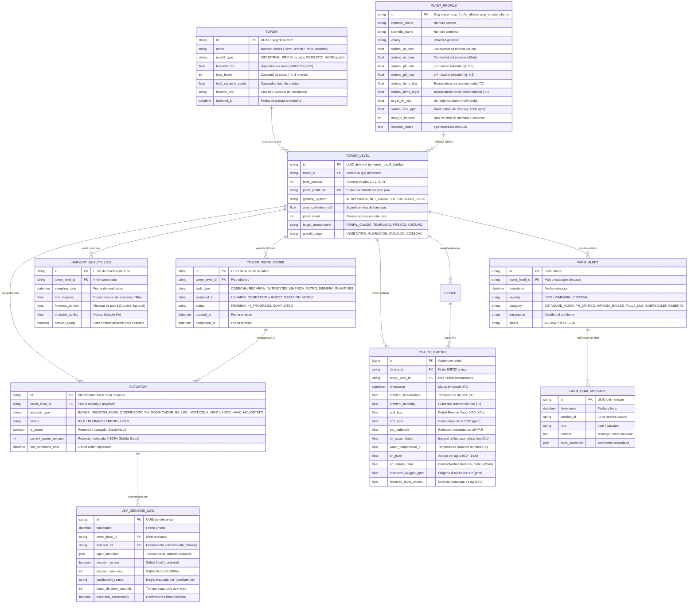

# AgroSense AI CEA — Especificación de Base de Datos y Modelo de Entidades: Torres Invernadero Autónomas y Módulos Domésticos (CEA)

**Versión:** 3.0 (Agricultura en Ambiente Controlado, Torres Verticales e Hidroponía)  
**Proyecto:** AgroSense AI (Módulos AgroSense PRO y AgroSense HOME)  
**Institución:** Santo Tomás (Sede Pedro de Valdivia, Temuco)  
**Propósito:** Especificación técnica completa de persistencia, rediseño de interfaces y funcionalidades para Web y Android ante inversores, docentes y comisiones de feria.

---

## 1. El Nuevo Paradigma: Del Potrero a la Fábrica Biológica Vertical

Este documento es la evolución directa del modelo original de AgroSense AI. En lugar de modelar parcelas de tierra abierta dependientes del clima, esta especificación modela **Torres Invernadero Verticales Bioclimáticas (AgroSense PRO)** y **Bio-Cápsulas Domésticas de Patio (AgroSense HOME)**.

### Lo que se elimina (Obsoleto en Agricultura Vertical):
* ❌ **Tabla `ManagementZone` completa**: Eliminada (no hay arado, subsolado, penetrometría ni roturación de suelo).
* ❌ **Estratificación profunda de suelo (`soil_moisture_20cm`, `40cm`, `60cm`)**: Eliminada (las raíces están suspendidas en agua o aire).
* ❌ **Potencial mátrico (`matric_potential_kpa`)**: Eliminado (el agua está libre en solución acuosa).
* ❌ **Pluviómetro (`rain_gauge_mm`)**: Eliminado (no llueve dentro de la estructura).
* ❌ **Variables de viento exterior (`wind_speed_kmh`, `wind_direction_deg`)**: Eliminadas (no hay deriva de pesticidas).

### Lo que se incorpora (Específico para Hidroponía y Clima Interior):
* 💧 **Parámetros de la Solución Nutritiva**: `water_temperature_c` (temperatura de raíz), `dissolved_oxygen_ppm` (oxígeno disuelto), `reservoir_level_percent` (nivel de estanque) y dosificación de sales por conductividad (`ec_salinity_dsm`).
* 🌬️ **Atmósfera Controlada**: `co2_ppm` (inyección de dióxido de carbono para acelerar fotosíntesis) y ventilación interna forzada.
* ☀️ **Iluminación Híbrida**: `par_radiation` (luz útil natural), `dli_accumulated` (Integral de Luz Diaria) y modulación PWM de LEDs (`led_power_percent`).
* 🏢 **Estructura Vertical Multiescala**: Entidad `Tower` (Industrial o Doméstica) y `TowerLevel` (pisos o niveles de la torre).

---

## 2. Diagrama Entidad-Relación Global (ERD CEA 3.0)



---

## 3. Especificación Detallada de Nuevas Entidades

### 3.1 Entidad `Tower` (Instalación Vertical Completa)
* **Propósito:** Representa la estructura física en su totalidad. Permite al backend gobernar tanto una torre industrial de 4 pisos en Temuco como una bio-cápsula doméstica instalada en el patio de una casa.

| Atributo | Tipo | Llave | Nulo | Descripción y Uso Práctico |
| :--- | :--- | :--- | :--- | :--- |
| `id` | `VARCHAR(64)` | **PK** | No | Slug único (ej: `torre_pro_temuco_01`, `pod_home_jonathan`). |
| `name` | `VARCHAR(150)` | - | No | Nombre visible en el Dashboard y la App Móvil. |
| `model_type` | `VARCHAR(30)` | - | No | `INDUSTRIAL_PRO` (Torre 4 pisos) o `DOMESTIC_HOME` (Mini-torre 2m²). |
| `footprint_m2` | `FLOAT` | - | No | Huella en el suelo (ej: `1000.0` m² o `2.25` m²). |
| `total_levels` | `INTEGER` | - | No | Número de pisos o niveles de cultivo (ej: 4 o 3). |
| `total_capacity_plants`| `INTEGER` | - | No | Capacidad total de plantas vivas simultáneas. |
| `location_city` | `VARCHAR(100)` | - | No | Ciudad o ubicación geográfica. |
| `installed_at` | `TIMESTAMP` | - | No | Fecha de puesta en marcha. |

---

### 3.2 Entidad `TowerLevel` (Pisos y Microclimas Independientes)
* **Propósito:** Cada piso físico de la torre. Permite que cada nivel tenga su propio cultivo, su propia altura y su propia receta de clima y nutrientes.

| Atributo | Tipo | Llave | Nulo | Descripción y Uso Práctico |
| :--- | :--- | :--- | :--- | :--- |
| `id` | `VARCHAR(64)` | **PK** | No | Identificador del nivel (ej: `torre1_piso3_frutillas`). |
| `tower_id` | `VARCHAR(64)` | **FK** | No | Enlace a la torre física (`Tower.id`). |
| `level_number` | `INTEGER` | - | No | Número de piso: `1`, `2`, `3` o `4`. |
| `plant_profile_id` | `VARCHAR(64)` | **FK** | No | Especie cultivada en este piso (`PlantProfile.id`). |
| `growing_system` | `VARCHAR(50)` | - | No | `AEROPONICS`, `NFT_CANALETAS_MOVILES`, `SUSTRATO_FIBRA_COCO`. |
| `area_cultivation_m2` | `FLOAT` | - | No | Superficie neta de canastillos de cultivo. |
| `plant_count` | `INTEGER` | - | No | Cantidad de plantas activas en este nivel. |
| `target_microclimate`| `VARCHAR(30)` | - | No | Perfil de control: `CALIDO_ALTO_SOL`, `TEMPLADO_BERRIES`, `FRESCO_HOJAS`. |
| `growth_stage` | `VARCHAR(50)` | - | No | Fase actual: `PLANTIN`, `VEGETATIVO`, `FLORACION`, `COSECHA`. |

---

### 3.3 Entidad `CEATelemetry` (Lecturas del Invernadero Vertical)
* **Propósito:** El pulso continuo del microclima interior, la luz solar/LED y la solución nutritiva recirculante.

| Atributo | Tipo | Llave | Nulo | Descripción y Uso Práctico |
| :--- | :--- | :--- | :--- | :--- |
| `id` | `BIGINT` | **PK** | No | Identificador numérico autoincremental de la muestra. |
| `device_id` | `VARCHAR(64)` | **FK** | No | Nodo ESP32 que emite la medición. |
| `tower_level_id` | `VARCHAR(64)` | **FK** | No | Nivel o piso de la torre monitoreado. |
| `timestamp` | `TIMESTAMP` | - | No | Marca de tiempo exacta UTC. |
| `ambient_temperature` | `FLOAT` | - | No | Temperatura del aire en el piso (°C). |
| `ambient_humidity` | `FLOAT` | - | No | Humedad relativa del aire interior (%). |
| `vpd_kpa` | `FLOAT` | - | No | Déficit de Presión de Vapor en kPa (control de transpiración y estomas). |
| `co2_ppm` | `FLOAT` | - | No | Concentración de $CO_2$ en ppm (objetivo: 800 - 1.200 ppm). |
| `par_radiation` | `FLOAT` | - | No | Radiación fotosintética útil PAR incidente (μmol/m²/s). |
| `dli_accumulated` | `FLOAT` | - | No | Dosis de luz acumulada hoy ($mol/m^2/día$). Apaga LEDs si se alcanza. |
| `water_temperature_c` | `FLOAT` | - | No | Temperatura de la solución nutritiva líquida (°C). |
| `ph_level` | `FLOAT` | - | No | Acidez del agua (rango estricto 5.5 - 6.5). |
| `ec_salinity_dsm` | `FLOAT` | - | No | Conductividad eléctrica de sales minerales disueltas (dS/m). |
| `dissolved_oxygen_ppm`| `FLOAT` | - | Sí | Oxígeno disuelto en el agua para oxigenación radicular (ppm). |
| `reservoir_level_percent`| `FLOAT` | - | No | Nivel restante del estanque de agua (0.0 a 100.0%). |

---

## 4. Repensando las Funcionalidades y la Interfaz de Usuario

El paso de "riego en potrero" a "torres inteligentes" exige repensar las pantallas tanto en la Web como en Android:

### 4.1 Dashboard Web (AgroSense PRO — Pantalla de Control Industrial)
Pensado para inversores, agrónomos y operadores técnicos que supervisan la torre de 4 pisos:

```
┌─────────────────────────────────────────────────────────────────────────────┐
│ 🏢 AGROSENSE PRO — TORRE BIOCLIMÁTICA 01 (TEMUCO)              [ ESTADO: OK ]│
├─────────────────────────────────────────────────────────────────────────────┤
│                                                                             │
│ [ CORTE TRANSVERSAL 3D DE LA TORRE ]    │ [ SOLUCIÓN NUTRITIVA CENTRAL ]    │
│                                         │ • Estanque Base: 82% (4.100 L)    │
│ ┌─────────────────────────────────────┐ │ • Conductividad (EC): 1.8 dS/m    │
│ │ PISO 4: TOMATES GOURMET    [25.2°C] │ │ • pH del Agua: 6.0 [ÓPTIMO]       │
│ │ CO2: 1.100 ppm | DLI: 18.4 mol/m²   │ │ • Temp. Solución: 18.5°C          │
│ ├─────────────────────────────────────┤ │ • Oxígeno Disuelto: 8.2 ppm       │
│ │ PISO 3: FRUTILLAS WINTER   [20.1°C] │ ├───────────────────────────────────┤
│ │ CO2: 950 ppm   | DLI: 14.1 mol/m²   │ │ [ ILUMINACIÓN HÍBRIDA & ESPEJOS ] │
│ ├─────────────────────────────────────┤ │ • Sol Natural: 78% del aporte     │
│ │ PISO 2: HORTALIZAS GOURMET [17.5°C] │ │ • Helioestatos: Ángulo 38° Azimut │
│ │ CO2: 800 ppm   | DLI: 11.0 mol/m²   │ │ • LEDs de Apoyo: APAGADOS (0% W)  │
│ ├─────────────────────────────────────┤ ├───────────────────────────────────┤
│ │ PISO 1: LOGÍSTICA & FORRAJE [16.0°C]│ │ [ MOTOR TYPESAFE JEV (System 1) ] │
│ │ Estación Cosecha | Bomba: ACTIVA    │ │ • Inferencia: 85 ms | Failsafe: OK│
│ └─────────────────────────────────────┘ │ • Última Decisión: Riego Pulso 45s│
└─────────────────────────────────────────────────────────────────────────────┘
```

#### Nuevas Funcionalidades Web:
1. **Selector de Pisos con Microclima:** Poder hacer clic en el Piso 3 y ver solo los gráficos de frutillas (humedad, temperatura, $CO_2$ y madurez).
2. **Balance Energético Solar vs. LED:** Un gráfico que muestra cuántos kWh se han ahorrado gracias a los helioestatos y las paredes transparentes.
3. **Simulador de Emergencias de la Torre:** Botones para simular:
   * *Nivel bajo de estanque (< 15%)*.
   * *Sobrecalentamiento solar de verano (> 30°C)* para ver a JEV abrir las compuertas de ventilación.
   * *Caída brusca de pH* para ver a JEV activar el dosificador alcalino.

---

### 4.2 Aplicación Móvil Android (AgroSense HOME — La App Familiar de Patio)
Pensada con la simplicidad de una app como **Apple Home** o **Nespresso**: una familia no quiere ver gráficos complejos de derivadas de presión de vapor; quiere saber **si la torre está sana y cuándo cosechar**.

```
┌──────────────────────────────────────┐
│  🌿 AgroSense Home       [ Casa ]    │
├──────────────────────────────────────┤
│                                      │
│      🟢 TODO EN ORDEN                │
│   Tu torre de patio está feliz       │
│                                      │
│  ┌────────────────────────────────┐  │
│  │ 💧 Estanque de Agua: 72%       │  │
│  │    Te quedan 18 días de agua   │  │
│  ├────────────────────────────────┤  │
│  │ 🧪 Nutrientes: Óptimos         │  │
│  │    Cápsula con 65% restante    │  │
│  ├────────────────────────────────┤  │
│  │ ☀️ Energía Solar: Autárquica   │  │
│  │    Batería al 100%             │  │
│  └────────────────────────────────┘  │
│                                      │
│  🍓 COSECHA LISTA PARA HOY:          │
│  • 6 Frutillas del Nivel 3 (12°Brix) │
│  • Albahaca para la cena             │
│                                      │
│  💬 "Habla con la Granja de tu Patio"│
│  [ "¿Cómo están mis frutillas?"   >] │
└──────────────────────────────────────┘
```

#### Nuevas Funcionalidades Android:
1. **Semáforo de Salud Doméstica:** Tres tarjetas táctiles simples: *Agua*, *Nutrientes* y *Batería/Luz*.
2. **Notificaciones de Cosecha Push:** *"¡Jonathan! Las frutillas del Nivel 3 llegaron a su punto máximo de dulzor. Cosecha hoy antes de que sobremaduren."*
3. **Recordatorios de Mantenimiento:** Una notificación simple una vez al mes: *"Por favor, agrega 15 litros de agua al estanque este domingo."*
4. **Chat Integrado ("Habla con tu Patio"):** Permite a cualquier miembro de la familia preguntar por voz o texto y recibir respuestas amigables generadas por DeepSeek.

---

## 5. Implementación en Código

El esquema está diseñado para ser implementado en:
1. **Backend FastAPI**: En una nueva rama o módulo `app/models_cea.py` con Pydantic v2.
2. **ESP32 Edge**: Código ligero en C++ / MicroPython que envía el payload JSON simplificado mediante WiFi o Bluetooth Low Energy (BLE) en el caso doméstico.
3. **Persistencia Azure**: Tablas PostgreSQL en Azure optimizadas para series temporales de ambiente controlado.
