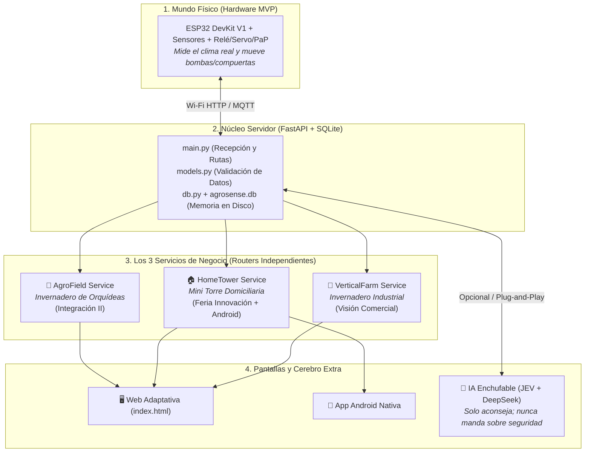

# Guía Maestra de Estudio, Arquitectura y Diagnóstico — AgroSense AI (ASAI)

> **Para quién es este documento:** Para ti (**Jonathan**), como mapa de control total del proyecto.  
> **Para qué sirve:** Para que nunca te sientas abrumado por la cantidad de archivos. Aquí cada pieza del sistema se explica usando siempre **6 preguntas simples** (*Qué, Por qué, Para quién, Con qué herramientas, Dónde está y Qué SDD revisar si falla o quieres cambiarlo*).

---

## 0. El Sistema Completo en 30 Segundos (La Foto Grande)

Piensa en **AgroSense AI** como un **edificio con un solo núcleo de servicios básicos** (servidor + base de datos + sensores) que atiende **3 negocios o casos distintos** en sus 3 "pisos":

---

## 1. Botiquín de Diagnóstico Rápido ("¿Dónde miro si pasa X?")

Guarda esta tabla para cuando sientas que algo anda mal, quieras cambiar un comportamiento o un profesor te pregunte por algo puntual:

| Si observas este problema o quieres cambiar... | Parte / Servicio responsable | Archivo(s) de código a mirar | SDD exacto donde ver las reglas |
| :--- | :--- | :--- | :--- |
| El calendario semanal de **Orquídeas** (`Lun..Dom`, hora, alerta) no guarda o calcula mal el día | **Servicio 1: AgroField** | `backend/app/routers/field_service.py` y `backend/app/db.py` | [spec-002](specs/spec-002-field-greenhouse-service.md) (Secciones 2, 3 y 4) |
| El botón **Encender Bomba**, el bloqueo `< 20%`, el **Servo SG90** o los pasos del motor fallan | **Servicio 2: HomeTower** | `backend/app/routers/home_tower_service.py` | [spec-003](specs/spec-003-home-tower-service.md) (Secciones 2, 3 y 4) |
| Los **racks industriales** o métricas de ahorro comercial necesitan cambios | **Servicio 3: VerticalFarm** | `backend/app/routers/vertical_farm_service.py` | [spec-004](specs/spec-004-vertical-farm-service.md) (Secciones 1 y 2) |
| Un dato se borra al reiniciar el servidor o falta una columna/tabla en SQLite | **Capa de Base de Datos** | `backend/app/db.py`, `backend/app/database_schema.sql`, `backend/app/config.py` | [spec-001](specs/spec-001-architecture-overview.md) (Secciones 3.1 y 3.2) |
| Una tarjeta web se ve corrida, un botón no responde o falla cambiar entre las 3 pestañas | **Frontend Web Adaptativo** | `backend/app/templates/index.html` | [spec-005](specs/spec-005-frontend-adaptive-hub.md) (Secciones 1 y 2) |
| Los botones **"Simular Estanque Vacío / Calor"**, la evaluación **JEV** o el **Chat Botánico** fallan | **IA y Simulación** | `backend/app/main.py` (`evaluate_jev_local`, `simulate_scenario`, `chat_with_farm`) | [spec-006](specs/spec-006-ai-and-simulation.md) (Secciones 1 a 4) |
| El backend rechaza el JSON del sensor (Error 422) o calcula raro el **DPV** | **Contratos y Fórmula DPV** | `backend/app/models.py` (`TelemetryInput`) y `backend/app/db.py` (`calculate_vpd`) | [spec-001](specs/spec-001-architecture-overview.md) (Secciones 3.3 y 3.4) |
| Un sensor físico (**DHT11, BME280, Nivel**) no lee o un pin del **ESP32** no reacciona | **Hardware / Firmware** *(Por crear)* | Futura carpeta `firmware/` | [spec-007](specs/spec-007-esp32-firmware.md) (Secciones 2, 3 y 4) |
| La **App Android** no conecta con el backend, no notifica o falta el mapa GPS | **App Móvil** *(Por crear)* | Carpeta `Programacion Android/` | [spec-008](specs/spec-008-android-app.md) (Secciones 2 y 3) |
| No sabes en qué orden debe trabajar el equipo de IA o qué está terminado y qué falta | **Gobierno del Proyecto** | `AGENTS.md` y `specs/PROGRESS_LOGS.md` | [AGENTS.md](AGENTS.md) y [PROGRESS_LOGS.md](specs/PROGRESS_LOGS.md) |

---

## 2. Parte A: Los 3 Servicios de Negocio (Desglose de 6 Preguntas)

### Servicio 1: `AgroField Service` (Campos e Invernadero Tradicional — Caso Orquídeas)
* **¿Qué hace?** Gestiona un cultivo tradicional en invernadero mediante un **calendario semanal** (elegir días `Lun..Dom` y hora fija), genera recordatorios de riego, recibe humedad/temperatura por Wi-Fi y consulta el historial guardado en disco.
* **¿Por qué existe?** Porque el caso oficial de *Integración de Competencias II* (`requerimientos y caso.docx`) evalúa específicamente una empresa de **orquídeas** con **80% de humedad**, **18–24 °C** y riego por días/horas, lo cual es distinto al riego continuo hidropónico. Separarlo evita deformar tu proyecto de innovación.
* **¿A quién le sirve?** A agricultores tradicionales o dueños de invernaderos en maceta/sustrato, y académicamente al docente de **Integración de Competencias II (IEI-094)** para evaluar **RF1 a RF7**.
* **¿Con qué herramientas funciona?** Python + **FastAPI `APIRouter`** (para aislar sus rutas bajo `/api/v1/services/field`), **Pydantic v2** (valida que no envíes días vacíos ni temperaturas absurdas) y **SQLite** vía `db.py` (tablas `calendario_semanal`, `estado_modulo`, `telemetria_historica`).
* **¿Dónde está en el proyecto?** [backend/app/routers/field_service.py](backend/app/routers/field_service.py).
* **¿Qué SDD revisar?** [specs/spec-002-field-greenhouse-service.md](specs/spec-002-field-greenhouse-service.md) (reglas RF1-RF7 en Sección 2; rutas en Sección 3; JSON exactos en Sección 4).

---

### Servicio 2: `HomeTower Service` (Mini Torres Domiciliarias — Tu Proyecto Estrella)
* **¿Qué hace?** Controla una torre vertical compacta para hogares: mide cuánta agua queda en el estanque, calcula transpiración (**DPV**), programa pulsos periódicos de recirculación (ej. 15 min cada 2h), acciona bomba/ventilación/nutrientes y **bloquea la bomba automáticamente** si el nivel cae del **20%**.
* **¿Por qué existe?** Porque es tu **propuesta de valor comercial e innovadora** (agricultura urbana en casa, limpia y automatizada) y el punto donde convergen el hardware real y la app del teléfono.
* **¿A quién le sirve?** A familias urbanas (balcones, departamentos) y a los evaluadores de la **Feria de Innovación Santo Tomás**, **IoT (IEI-059)** y **Programación Android (IEI-058)**.
* **¿Con qué herramientas funciona?** **FastAPI `APIRouter`** (`/api/v1/services/home-tower`), validación Pydantic (`ActuatorCommandInput`, `RecirculationUpdate`), bloqueo HTTP `400` anti-cavitación, auditoría en `registro_comandos` y estado persistido en `estado_modulo` (`celda-01`).
* **¿Dónde está en el proyecto?** [backend/app/routers/home_tower_service.py](backend/app/routers/home_tower_service.py).
* **¿Qué SDD revisar?** [specs/spec-003-home-tower-service.md](specs/spec-003-home-tower-service.md) (pinout oficial en Sección 2; endpoints en Sección 3; regla HTTP 400 en Sección 4).

---

### Servicio 3: `VerticalFarm Service` (Invernaderos Verticales Industriales)
* **¿Qué hace?** Entrega una vista ejecutiva de múltiples columnas/racks comerciales (`RACK-01` a `RACK-04`), su índice de salud, ahorro hídrico (94.2%) y optimización de parámetros para naves grandes.
* **¿Por qué existe?** Para demostrar **escalabilidad empresarial**: muestra al jurado de innovación y a tu comisión de título que tu arquitectura no muere en una maqueta casera, sino que puede crecer a producción comercial.
* **¿A quién le sirve?** A inversionistas, empresas agrícolas y defensa de visión comercial en **Feria de Innovación** / **Computación en la Nube**.
* **¿Con qué herramientas funciona?** **FastAPI `APIRouter`** (`/api/v1/services/vertical-farm`) con endpoints JSON preparados para escalar hacia brokers industriales y analítica distribuida.
* **¿Dónde está en el proyecto?** [backend/app/routers/vertical_farm_service.py](backend/app/routers/vertical_farm_service.py).
* **¿Qué SDD revisar?** [specs/spec-004-vertical-farm-service.md](specs/spec-004-vertical-farm-service.md) (Secciones 1 y 2).

---

## 3. Parte B: Las Piezas Transversales del Sistema (El Motor Común)

### 3.1. Núcleo del Servidor (`FastAPI Core Hub`)
* **¿Qué hace?** Es la "recepción principal" del sistema: arranca la base de datos al iniciar, monta los 3 servicios anteriores, sirve la página web (`/`), mantiene rutas compatibles (`/api/v1/telemetry`, `/api/v1/schedule`) y expone la documentación automática Swagger (`/docs`).
* **¿Por qué existe y por qué esta arquitectura?** Se usa un **Monolito Modular SOA**: todo corre en un solo servidor liviano (fácil de encender con un comando y fácil de depurar como estudiante), pero con carpetas separadas por dominio para no mezclar códigos distintos.
* **¿Con qué herramientas funciona?** **Python 3.12**, **FastAPI** (framework web ultrarrápido que valida datos solo), **Uvicorn** (el servidor que mantiene escuchando el puerto `8000`), **Pydantic v2** (define la forma exacta de cada JSON en `models.py`) y `python-dotenv` (lee claves secretas desde `.env` en `config.py` sin subir contraseñas a GitHub).
* **¿Dónde está en el proyecto?** [backend/app/main.py](backend/app/main.py), [backend/app/models.py](backend/app/models.py) y [backend/app/config.py](backend/app/config.py).
* **¿Qué SDD revisar?** [specs/spec-001-architecture-overview.md](specs/spec-001-architecture-overview.md) (Secciones 2 y 3).

---

### 3.2. Base de Datos y Cálculo Fisiológico (`SQLite + db.py`)
* **¿Qué hace?** Guarda en disco de forma permanente el historial de sensores, los comandos que enviaste a la bomba/servo/motor, las alertas, los días activos de tu calendario y el estado actual de cada módulo; además calcula el **DPV** (qué tanto "respira/transpira" la planta según temperatura y humedad).
* **¿Por qué existe?** Sin esto, al apagar el computador o reiniciar Uvicorn perderías todo (el historial horario que pide Integración II y la configuración de días de riego). Elegimos **1 sola base de datos SQLite** (en vez de 3 separadas) para no complicar un proyecto de titulación con sincronizaciones innecesarias.
* **¿A quién le sirve?** A todo el sistema, y cumple directamente **RF5** (registro histórico) y **RF6** (base de datos relacional) de Integración II.
* **¿Con qué herramientas funciona?** **SQLite 3** (`agrosense.db`, base relacional en un único archivo sin instalar servidores pesados, con SQL estándar compatible a futuro con PostgreSQL/Azure) + módulo Python compartido `db.py` (centraliza conexiones, llaves foráneas `PRAGMA foreign_keys = ON` y fórmula de **Tetens**).
* **¿Dónde está en el proyecto?** [backend/app/db.py](backend/app/db.py), [backend/app/database_schema.sql](backend/app/database_schema.sql) y [backend/agrosense.db](backend/agrosense.db).
* **¿Qué SDD revisar?** [specs/spec-001-architecture-overview.md](specs/spec-001-architecture-overview.md) (Secciones 3.1, 3.2 y 3.4).

---

### 3.3. Dashboard Web Adaptativo (`Frontend Hub`)
* **¿Qué hace?** Dibuja la interfaz gráfica en el navegador (`http://localhost:8000`) con **3 pestañas superiores**. Según el servicio que presiones, oculta o muestra las tarjetas exactas de ese negocio (calendario L-D para Orquídeas, actuadores y estanque para Mini Torre, racks para Industrial).
* **¿Por qué existe?** Para que en una sola URL puedas mostrarle al profe de Integración II exactamente su pauta de Orquídeas, y al jurado de la Feria exactamente la Mini Torre, sin confundir a ninguno con botones ajenos.
* **¿Con qué herramientas funciona?** **Jinja2** (plantillas HTML generadas desde FastAPI sin requerir un servidor separado de React/Node), **Tailwind CSS** (CDN, estilo limpio/oscuro minimalista tipo Vercel/Linear) y **JavaScript nativo (`fetch`)** para guardar horarios o encender la bomba sin recargar todo a mano.
* **¿Dónde está en el proyecto?** [backend/app/templates/index.html](backend/app/templates/index.html).
* **¿Qué SDD revisar?** [specs/spec-005-frontend-adaptive-hub.md](specs/spec-005-frontend-adaptive-hub.md) (Secciones 1 y 2).

---

### 3.4. Motor Ciberfísico (`JEV`), Simulador y Chat Agronómico (`DeepSeek`)
* **¿Qué hace?** Tiene 3 funciones:
  1. **Seguridad y Alivio (`evaluate_jev_local` / `evaluate_jev`):** Evalúa si el agua cayó de 20% (apaga bomba) o si hace demasiado calor (abre ventilación SG90 a 90°).
  2. **Simulador (`/api/v1/simulate/{scenario}`):** Inyecta fallas artificiales (*Estanque Vacío*, *Calor Extremo*, *Óptimo*, *Recirculación*) para demostrarle a un profesor que el sistema reacciona sin tener que vaciar el agua real en plena sala.
  3. **Chat Botánico (`/api/v1/chat/farm`):** Responde preguntas en español usando los últimos datos reales de la BD (con IA DeepSeek si hay clave API, o respuestas heurísticas locales si no hay internet).
* **¿Por qué existe y con qué criterio?** Se diseñó bajo tolerancia total a fallos (*Plug-and-Play*): **la protección física del motor nunca depende de internet ni de la IA**. Si la API externa falla, el código determinista local responde en milisegundos.
* **¿Con qué herramientas funciona?** **HTTPX** (cliente HTTP asíncrono hacia DeepSeek / OpenRouter TypeSafe Jev) y lógica determinista en Python. *(En una Fase 2 opcional tras terminar hardware y Android, aquí calzarían **MCP** para exponer herramientas de histórico/calendario al chat y **LangGraph** solo si quisieras un agente multi-paso con confirmación humana).*
* **¿Dónde está en el proyecto?** En [backend/app/main.py](backend/app/main.py) (`evaluate_jev_local`, `evaluate_jev`, `simulate_scenario`, `chat_with_farm`).
* **¿Qué SDD revisar?** [specs/spec-006-ai-and-simulation.md](specs/spec-006-ai-and-simulation.md) (Secciones 1 a 5).

---

### 3.5. Hardware IoT (`ESP32 DevKit V1 + Arduino Uno R3`) — *Siguiente Fase de Construcción*
* **¿Qué hará?** Leerá sensores reales cada pocos segundos (Temperatura/Humedad con **DHT11**, Presión/Temperatura con **BME280**, Nivel de agua con **sensor resistivo**), enviará los datos por Wi-Fi (**MQTT / HTTP**) al servidor, ejecutará órdenes (encender **mini-bomba 5V**, mover **servo SG90**, dosificar con **motor PaP 28BYJ-48**) y cortará la bomba localmente si falta agua.
* **¿Por qué integraremos estos trucos de ingeniería?**
  * **Arduino Uno R3 solo como fuente 5V (con `GND` unido):** Los motores consumen mucha corriente; si los conectas directo al ESP32, este se reinicia o se quema.
  * **Pulso de `50 ms` en `GPIO 25` antes de leer `GPIO 34`:** Si dejas el sensor de agua energizado todo el día, el cobre se corroe en horas por electrólisis; prenderlo solo 50 milisegundos al leer hace que dure meses.
  * **Pines `GPIO 19, 23, 5, 13` para el motor PaP:** Se evita `GPIO 12` porque en el ESP32 ese pin decide el voltaje de memoria al encender y puede impedir que arranque.
* **¿A quién le sirve?** Rinde al 100% en **Internet de las Cosas (IEI-059 - Prof. Nicole Ortega)** (`<PubSubClient.h>`, `<DHT.h>`, Monitor Serial) y alimenta datos reales a Integración II y Feria.
* **¿Dónde estará y qué SDD revisar?** En futura carpeta `firmware/`, siguiendo al pie de la letra [specs/spec-007-esp32-firmware.md](specs/spec-007-esp32-firmware.md) y [INVENTARIO_HARDWARE_Y_MAPEO_PINES_MVP.md](ProyectoServiciosASAI/INVENTARIO_HARDWARE_Y_MAPEO_PINES_MVP.md).

---

### 3.6. Aplicación Móvil Nativa (`Android Studio`) — *Siguiente Fase de Construcción*
* **¿Qué hará?** Permitirá ver desde el celular la temperatura, humedad y nivel del estanque de la Mini Torre, encender/apagar la bomba y abrir la ventilación, recibir alertas locales cuando falte agua o toque regar, y mostrar el módulo de **Google Maps SDK** requerido en clases.
* **¿Por qué existe y a quién sirve?** Le da portabilidad real al usuario de casa en la **Feria de Innovación** y cubre los entregables evaluados de **Programación Android (IEI-058 - Prof. Nicole Ortega)** (control tipo *NodeMCU + Android* y actividad de *Semana 13 GPS*).
* **¿Con qué herramientas funcionará?** **Android Studio (Kotlin / Java)** consumiendo endpoints REST del backend (o HTTP local `/encender`, `/apagar` directo al ESP32), `NotificationCompat` para avisos y Google Maps SDK.
* **¿Dónde estará y qué SDD revisar?** En [Programacion Android/](Programacion%20Android/), guiado por [specs/spec-008-android-app.md](specs/spec-008-android-app.md).

---

## 4. Glosario Sin Jerga (Para Defender Tu Título con Seguridad)

* **SOA (Arquitectura Orientada a Servicios):** Dividir un programa grande en piezas independientes que conversan por contratos claros (JSON/REST), en vez de meter todo en un solo archivo gigante enredado.
* **Router (`APIRouter` en FastAPI):** Es una carpeta/archivo que agrupa todas las URLs de un solo servicio (ej. todas las rutas de `/services/field` van en `field_service.py`).
* **Pydantic:** Es el "guardia de entrada" en Python: si el ESP32 manda por error una temperatura de `999 °C` o falta un campo obligatorio, Pydantic lo rechaza antes de contaminar tu base de datos.
* **RAM vs SQLite (Persistencia):** Guardar datos en una variable de Python (`dict`) es usar **RAM** (se borra si reinicias el programa). Guardarlo en `agrosense.db` (**SQLite**) lo deja escrito en el disco duro de forma permanente.
* **DPV (Déficit de Presión de Vapor, fórmula de Tetens):** Un número en `kPa` que combina temperatura y humedad para saber si el aire está demasiado seco (la planta se deshidrata) o demasiado húmedo (no puede transpirar y le salen hongos). Ideal en frutilla: `0.8 - 1.2 kPa`.
* **Cavitación:** Cuando una bomba de agua gira sin agua suficiente y chupa aire; se sobrecalienta y se quema. Por eso el sistema bloquea el relé si el nivel `< 20%`.
* **Fallback Determinista:** Un "Plan B" con reglas fijas (`if/else`) en tu propio servidor y en el ESP32, para que la maqueta jamás quede botada si se cae internet o falla una IA externa.
* **SDD (*Spec-Driven Development*):** Escribir primero las reglas exactas y contratos en `specs/` antes de programar, para que tanto tú como cualquier agente de IA trabajen alineados sin inventar cosas distintas.
