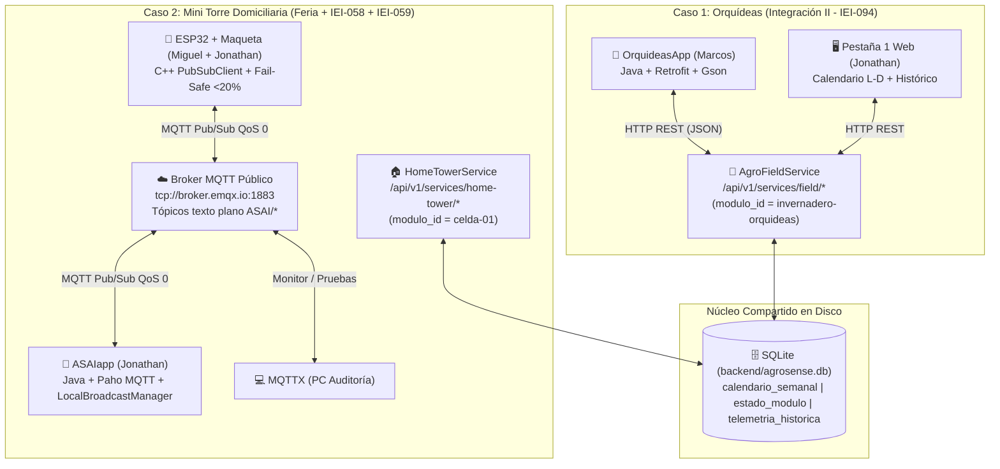

# Integración del Equipo y Arquitectura Unificada — AgroSense AI (ASAI)

> **Propósito de este documento:** Explicar de forma clara y honesta **qué construyó cada integrante**, **con qué herramientas y protocolos trabaja cada módulo**, **cómo se unificaron todas las partes en `main`** y **cómo levantar el sistema completo en vivo** para evaluaciones y Feria de Innovación.

---

## 1. Quién Hizo Qué y con Qué Herramientas

| Integrante (Usuario GitHub) | Rama Original | Módulo / Carpeta | Rol Académico / Proyecto | Lenguajes, Librerías y Protocolo |
| :--- | :--- | :--- | :--- | :--- |
| **Jonathan Seguel** (`jasmnogu93`) | `main` / `JonathanRama` | `backend/`, `specs/`, `ASAIapp/`, `firmware/` (código base) | **Arquitectura SOA, Núcleo Backend/Web, App Mini Torre y Firmware Base** (`IEI-058`, `IEI-059`, `IEI-094`, Feria) | **Backend/Web:** Python 3.12, FastAPI, Uvicorn, Pydantic v2, SQLite (`agrosense.db`), Jinja2, Tailwind CSS, `pytest`.<br>**Android Mini Torre (`ASAIapp/`):** Java, `CardView`, Eclipse Paho (`MqttAsyncClient`), `LocalBroadcastManager`, protocolo **MQTT** (`tcp://broker.emqx.io:1883`).<br>**Firmware (`firmware/`):** C++ Arduino para ESP32 DevKit V1 (`PubSubClient`, `DHT`, `ESP32Servo`, `Stepper`). |
| **Marcos Bustos** (`nacomantesmurf`) | `MarcosRama` *(PR #1 integrado en `main`)* | `OrquideasApp/` (`cl.ust.orquideaapp`) | **App Android exclusiva de Orquídeas (`AgroFieldService` — RF1 a RF7)** para **Integración de Competencias II (`IEI-094`)** | **Android (`OrquideasApp/`):** Java, Material Components (`MaterialCardView`, `Chip`), `RecyclerView`, `SwipeRefreshLayout`, **Retrofit 2.11 + OkHttp + Gson**, protocolo **HTTP REST** (`http://<IP>:8000/api/v1/services/field/`). |
| **Miguel** (`math219-afk`) | `MiguelRama` | Hardware físico + pruebas en `firmware/` (`ESP32` + maqueta) | **Armado de Maqueta Física, Cableado ESP32, Sensores/Actuadores y Pruebas de Campo** (`IEI-059` + Feria) | ESP32 DevKit V1 + fuente 5V externa (Arduino Uno R3 con `GND` común), DHT11 (`GPIO 4`), sensor de nivel (`GPIO 25/34` pulso 50 ms), relé bomba (`GPIO 26`), servo SG90 (`GPIO 18`), motor PaP ULN2003 (`GPIO 19, 23, 5, 13`) y monitoreo **MQTTX**. |

---

## 2. Cómo Se Comunican y Conviven Todas las Piezas (Sin Mezclarse)

El secreto de por qué pudimos unir el trabajo de 3 personas sin que un archivo rompa el de otro está en la **Arquitectura Orientada a Servicios (SOA)** y la **separación de protocolos por caso de uso**:



### Por qué conviven dos apps Android distintas en el mismo repositorio
1. **`OrquideasApp/` (Marcos — HTTP REST con Retrofit):** Responde a **Integración de Competencias II (`IEI-094`)**, donde el objetivo es consumir una API REST conectada a una base de datos relacional (calendario semanal RF1, notificaciones RF2, ingesta HTTP RF3, perfil 80% HR / 18–24 °C RF4, histórico filtrado por módulo RF5, SQLite RF6).
2. **`ASAIapp/` (Jonathan — MQTT con Paho):** Responde a **Programación Android (`IEI-058`)**, **IoT (`IEI-059`)** y **Feria de Innovación**, siguiendo exactamente la arquitectura enseñada por la Prof. Nicole Ortega (`Android + mqtt.pdf`): cliente asíncrono MQTT + `LocalBroadcastManager` + `BroadcastReceiver` + `CardView`, comunicándose directo en tiempo real con el ESP32 a través de `broker.emqx.io:1883`.

---

## 3. Cómo Se Unificaron las Partes (Paso a Paso Técnico)

1. **Contratos previos en `specs/` antes de dividir ramas:**
   * Se publicaron `spec-002-field-greenhouse-service.md` y `GUIA_RAPIDA_MARCOS.md` con rutas exactas, campos JSON y la regla de tildes en días (`"Mié"`, `"Sáb"`), permitiendo que Marcos programara `OrquideasApp/` en su rama `MarcosRama` de forma autónoma y compatible desde el día 1.
2. **Revisión de Pull Request (#1) y detección de bug de aislamiento antes de mezclar:**
   * Al auditar `MarcosRama -> main`, se verificó que `FieldApiService.java` y todos los modelos Gson calzaban 1:1 con `field_service.py`.
   * Se detectó y corrigió en [`backend/app/routers/field_service.py`](backend/app/routers/field_service.py) que `/api/v1/services/field/history` no filtraba por `module_id="invernadero-orquideas"`, evitando que el historial de la Mini Torre (`celda-01`) se mezclara en la app de Orquídeas. Se agregó prueba automática en [`backend/tests/test_api.py`](backend/tests/test_api.py).
3. **Merge limpio con preservación de autoría (`--no-ff`) y validación cruzada en PC:**
   * Se fusionó `origin/MarcosRama` dentro de `main` manteniendo intacto el commit original de Marcos (`76e8c80`, autor `nacoamantesmurf`).
   * Al probar la compilación de `OrquideasApp/` en el equipo host con Android Studio JDK 25, se detectó un desajuste en `OrquideasApp/gradle/gradle-daemon-jvm.properties` (`toolchainVersion=21` apuntando al artefacto Java 25) y se alineó a `toolchainVersion=25` igual que `ASAIapp/`.
4. **Sincronización final de ramas:**
   * `main`, `JonathanRama`, `MiguelRama` y `MarcosRama` quedan alineadas con la versión unificada para que todo el equipo trabaje sobre la misma base probada.

---

## 4. Cómo Probar el Sistema Completo Integrado en Vivo

### A. Flujo Integración II (Backend + Web + `OrquideasApp` de Marcos)
1. **Levantar el servidor abierto a la red Wi-Fi local (`0.0.0.0`):**
   ```powershell
   Push-Location backend; .\.venv\Scripts\python.exe -m uvicorn app.main:app --reload --host 0.0.0.0 --port 8000; Pop-Location
   ```
2. **En la app `OrquideasApp/`:**
   * Si corres en **Emulador** en el mismo PC: deja `ApiConfig.BASE_URL` en `http://10.0.2.2:8000/api/v1/services/field/`.
   * Si corres en **Celular físico** por Wi-Fi: consulta tu IP con `ipconfig` (ej. `192.168.1.50`) y actualiza `ApiConfig.BASE_URL` a `http://192.168.1.50:8000/api/v1/services/field/`.
3. **Verificación cruzada:** Guarda un nuevo horario o envía una lectura desde el celular en `OrquideasApp` y recarga la pestaña **Orquídeas** en `http://localhost:8000`: ambos muestran exactamente los mismos datos desde `backend/agrosense.db`.

### B. Flujo Feria / IoT / Android (ESP32 + `broker.emqx.io` + `ASAIapp` + MQTTX)
1. **Conectar ESP32 (`firmware/esp32_asai_mqtt/esp32_asai_mqtt.ino`)** con el Wi-Fi 2.4 GHz del punto de prueba (notebook hotspot o router).
2. **Abrir `ASAIapp/` en Android** y **MQTTX en el notebook** conectados ambos a `tcp://broker.emqx.io:1883` escuchando `ASAI/#`.
3. **Verificación cruzada:** Cada 3 segundos llegan `ASAI/Temperatura`, `ASAI/Humedad`, `ASAI/Nivel` y `ASAI/DPV`; los botones de `ASAIapp` (`ASAI/Bomba/cmd`, `ASAI/Servo/cmd`, `ASAI/Nutrientes/cmd`) accionan el hardware real respetando el bloqueo local `< 20%`.
