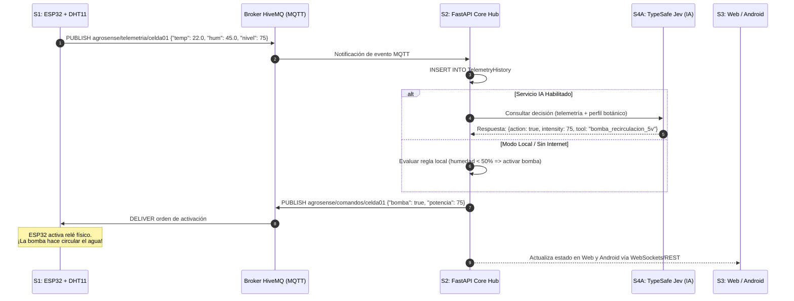
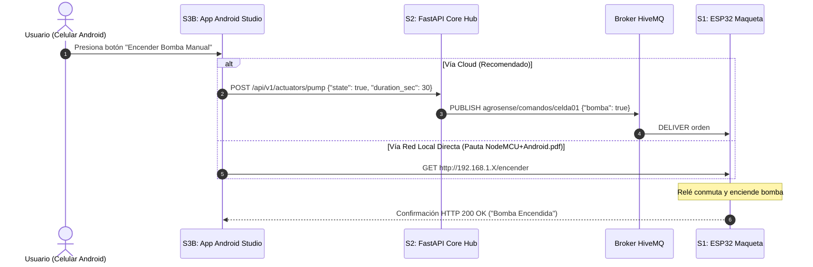

# AgroSense AI (ASAI) — Arquitectura Orientada a Servicios (SOA)

**Versión:** 1.0  
**Proyecto:** AgroSense AI (ASAI) — Módulo Celular Hidropónico  
**Enfoque:** Microservicios Desacoplados, Event-Driven (MQTT) y Servicios de IA Enchufables  
**Institución:** Santo Tomás (Sede Pedro de Valdivia, Temuco)  

---

## 1. Justificación del Cambio de Arquitectura

En la versión inicial del proyecto, el código del backend mezclaba en un mismo archivo la ingesta de telemetría, el renderizado de la web, la lógica de base de datos y la invocación a modelos de inteligencia artificial en la nube. 

Para responder a las exigencias simultáneas de **Internet de las Cosas (IEI-059)**, **Programación Android (IEI-058)** e **Integración de Competencias II (IEI-094)**, desacoplamos el sistema bajo una **Arquitectura Orientada a Servicios (SOA)**.

### Principios Rectores del Nuevo Diseño:
1. **Responsabilidad Única:** Cada servicio resuelve un problema específico (hardware, datos, interfaz o razonamiento).
2. **Desacoplamiento Tecnológico:** El hardware habla MQTT sin saber qué base de datos existe; la app Android consume endpoints REST sin saber qué microcontrolador está conectado.
3. **Servicios de IA Enchufables (*Plug-and-Play*):** Las IAs (**TypeSafe Jev** y **DeepSeek**) no son obligatorias para el funcionamiento básico del sistema. Si hay internet y claves activas, elevan el sistema a un nivel superior; si se desconectan, el núcleo opera con reglas deterministas locales seguras.

---

## 2. Mapa de Servicios del Ecosistema ASAI

```mermaid
flowchart TD
    subgraph S1 ["1. Servicio Hardware Edge (IoT)"]
        ESP["ESP32 / NodeMCU (C++ / Arduino)<br>• DHT11 (Temp / Humedad)<br>• Sensor nivel de agua<br>• Relé 5V y Mini-Bomba sumergible"]
    end

    subgraph Broker ["Bus de Eventos Asíncronos"]
        HIVEMQ["☁️ Broker MQTT (HiveMQ Cloud)<br>Puerto 8883 (MQTTS) / 8884 (WSS)"]
    end

    subgraph S2 ["2. Servicio Core Hub & Datos (FastAPI)"]
        API["FastAPI Core Service (Python 3.12)<br>• Ingesta y normalización Pydantic v2<br>• Persistencia SQLite / PostgreSQL<br>• Lógica de control determinista local"]
        DB[(Base de Datos<br>Histórico y Calendario)]
        API <--> DB
    end

    subgraph S3 ["3. Servicios de Interfaz de Usuario"]
        WEB["3A. Dashboard Web (Tailwind / Jinja2)<br>Supervisión y Simulación"]
        APP["3B. App Nativa Android Studio<br>Control Manual y Monitoreo Móvil"]
    end

    subgraph S4 ["4. Servicio de Inteligencia Artificial (Enchufable)"]
        JEV["4A. Motor TypeSafe Jev (jevai.net)<br>Inferencia Ciberfísica System 1 (80 ms)<br>Noul (Sí/No) | Score (0-100%) | Choice"]
        LLM["4B. LLM Cognitivo (DeepSeek V3)<br>Asistente Botánico 'Habla con tu Granja'"]
    end

    %% Enlaces
    ESP -->|Publica telemetría (QoS 0/1)| HIVEMQ
    HIVEMQ -->|Entrega comandos de bombeo| ESP
    HIVEMQ <-->|Suscripción y despacho| API
    
    API <-->|HTTP REST / Swagger| WEB
    API <-->|HTTP REST / JSON| APP
    ESP -.->|HTTP Local Directo (Opcional)| APP

    API <-->|Petición de inferencia (HTTP)| JEV
    API <-->|Consultas en lenguaje natural (HTTP)| LLM
```

---

## 3. Descripción Detallada de los 4 Servicios

### 3.1 Servicio 1: Hardware Edge IoT Service
* **Tecnología:** NodeMCU v1.0 (ESP8266) o ESP32, programado en C++ sobre Arduino IDE.
* **Librerías principales:** `<PubSubClient.h>`, `<DHT.h>`, `<WiFi.h>`.
* **Responsabilidad:**
  * Leer periódicamente (cada 5 a 10 segundos) los sensores físicos de la bandeja hidropónica: temperatura ambiental, humedad relativa y nivel de estanque.
  * Formatear la lectura en una carga útil JSON compacta.
  * Publicar en el broker MQTT de HiveMQ.
  * Escuchar el tópico de comandos de bomba. Al recibir una orden, conmuta el pin digital del relé para encender o apagar la mini-bomba sumergible de 5V.
* **Modo de Respaldo Local (Pauta Nicole Ortega):** Expone un micro-servidor web HTTP local con rutas `/encender` y `/apagar` para permitir mando directo desde la App Android en la red local.

---

### 3.2 Servicio 2: Core Backend Hub & Persistencia
* **Tecnología:** Python 3.12, FastAPI, Pydantic v2, SQLite (en desarrollo) / PostgreSQL (en producción Azure), Uvicorn.
* **Responsabilidad:**
  * **Ingesta dual:** Recibe datos tanto por MQTT (mediante un cliente asíncrono en segundo plano) como por REST (`POST /api/v1/telemetry`).
  * **Persistencia inmutable:** Guarda cada lectura en la tabla de series temporales con marca de tiempo UTC.
  * **Gestor de Reglas Locales:** Si no hay servicio de IA disponible, ejecuta la lógica determinista:
    * *Regla de Seguridad:* Si el estanque está bajo el 20%, bloquea la bomba para no quemarla.
    * *Regla de Riego:* Si la humedad de la bandeja cae o el calendario lo indica, autoriza el bombeo por 45 segundos.
  * **Exposición de API:** Provee endpoints limpios documentados en Swagger (`/docs`) para los clientes Web y Android.

---

### 3.3 Servicio 3: Clientes de Interfaz (Web y Móvil)

#### Servicio 3A: Dashboard Web (Integración de Competencias II)
* **Tecnología:** FastAPI Templates (Jinja2), HTML5, Tailwind CSS, JavaScript nativo.
* **Responsabilidad:**
  * Mostrar el panel de control general de la celda hidropónica.
  * Visualizar relojes en tiempo real (temperatura, humedad, nivel de solución, estado de bomba).
  * Panel de simulación interactivo para la evaluación docente (*Simular Estanque Vacío*, *Simular Óptimo*).
  * Gestión visual del **Calendario de Riego** requerido por la pauta de la Semana 13.

#### Servicio 3B: Aplicación Móvil Android (Programación Android)
* **Tecnología:** Java / Kotlin en Android Studio, ConstraintLayout, `HttpURLConnection` o cliente MQTT Android.
* **Responsabilidad:**
  * Cumplir con la pauta docente `NodeMCU + Android.pdf`: dos botones claros (`Encender Bomba` / `Apagar Bomba`).
  * Mostrar tarjetas de telemetría en vivo del cultivo.
  * Recibir alertas push si el nivel de agua es crítico.
  * Integrar la actividad evaluada de Google Maps (13 sedes Santo Tomás) y reproducción multimedia.

---

### 3.4 Servicio 4: Inteligencia Artificial Enchufable (*Plug-and-Play*)
Este servicio está completamente desacoplado del flujo crítico de la granja. Se compone de dos motores independientes:

#### Sub-servicio 4A: Motor de Decisión Rápida TypeSafe Jev (`jevai.net`)
* **Rol:** System 1 (Reacción ciberfísica en 80 ms).
* **Protocolo:** REST API asíncrona hacia OpenRouter (`typesafe/jev-latest`).
* **Primitivas evaluadas:**
  1. **Noul (Booleano):** ¿Autoriza la activación de la electrobomba? (`true / false`).
  2. **Score (0-100%):** ¿Con qué intensidad modular el actuador?
  3. **Choice:** ¿Qué herramienta física se activa? (`bomba_recirculacion_5v`, `alerta_estanque_bajo`).
* **Independencia:** Si la API de Jev no responde en 500 ms, el Core Hub ejecuta la regla local sin detener la maqueta.

#### Sub-servicio 4B: Asistente Cognitivo DeepSeek LLM ("Habla con tu Granja")
* **Rol:** System 2 (Razonamiento profundo y diálogo humano).
* **Protocolo:** REST API hacia DeepSeek V3 / OpenRouter.
* **Función:** Responde preguntas del agricultor o de los jueces de la feria (*"¿Por qué se activó el riego hace 10 minutos?"*, *"¿Cómo están los nutrientes de la frutilla?"*), inyectando el estado real de la base de datos en el System Prompt.

---

## 4. Diagramas de Secuencia Operativos

### Flujo 1: Ingesta de Telemetría y Decisión Autónoma (Modo Normal)


### Flujo 2: Mando Manual desde la Aplicación Android


---

## 5. Matriz de Protocolos y Comunicación

| Origen | Destino | Protocolo | Formato Carga | Propósito |
| :--- | :--- | :--- | :--- | :--- |
| **ESP32 (IoT)** | **HiveMQ Cloud** | MQTTS (Puerto 8883) | JSON compacto | Envío de telemetría ambiental cada 5-10 s |
| **HiveMQ Cloud** | **ESP32 (IoT)** | MQTTS (Puerto 8883) | JSON comando | Recepción de órdenes de encendido/apagado de bomba |
| **HiveMQ Cloud** | **FastAPI Core** | MQTT Client (Asyncio) | JSON evento | Ingesta en el backend para registro y auditoría |
| **FastAPI Core** | **Base de Datos** | SQL (AsyncEngine) | Registros relacionales | Persistencia inmutable histórica y calendario |
| **Dashboard Web** | **FastAPI Core** | HTTP REST / WSS | JSON / HTML | Consulta de última lectura, calendario y simulación |
| **App Android** | **FastAPI Core** | HTTP REST (`GET`/`POST`) | JSON estándar | Consulta de estado y activación manual de bomba |
| **App Android** | **ESP32 (Local)** | HTTP Local (`port 80`) | Texto plano (`200 OK`) | Respaldo según guía `NodeMCU + Android.pdf` |
| **FastAPI Core** | **TypeSafe Jev** | HTTPS REST | JSON Decisions API | Inferencia de control ciberfísico en 80 ms |
| **FastAPI Core** | **DeepSeek LLM** | HTTPS REST | JSON Chat Completions | Procesamiento de preguntas en lenguaje natural |

---

## 6. Tolerancia a Fallos y Modo Offline

Uno de los mayores atractivos de esta arquitectura ante los evaluadores es su **alta resiliencia**:

```
┌─────────────────────────────────────────────────────────────────────────────┐
│                      MATRIZ DE DEGRADACIÓN ELEGANTE                         │
├────────────────────────────┬────────────────────────────────────────────────┤
│ Evento de Falla            │ Comportamiento del Sistema                     │
├────────────────────────────┼────────────────────────────────────────────────┤
│ 1. Se corta la API de IA   │ El Core Hub conmuta a reglas locales y el      │
│    (Sin saldo / Timeout)   │ riego sigue funcionando sin interrupción.      │
├────────────────────────────┼────────────────────────────────────────────────┤
│ 2. Se cae internet en el   │ El ESP32 conmuta a temporizador local seguro;  │
│    recinto de la feria     │ la App Android controla la bomba por WiFi local│
├────────────────────────────┼────────────────────────────────────────────────┤
│ 3. El estanque se vacía    │ Regla de seguridad prioritaria apaga la bomba  │
│    (Nivel de agua < 15%)   │ físicamente para evitar que se queme en seco.  │
└────────────────────────────┴────────────────────────────────────────────────┘
```
