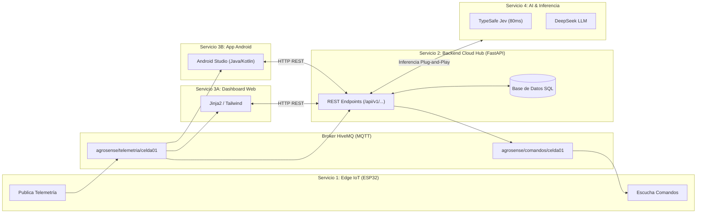

# Especificación de Datos, Protocolos y Contratos de Servicios
## Proyecto: AgroSense AI (ASAI) — Módulo Celular Hidropónico Inteligente
### Enfoque: Arquitectura Orientada a Servicios (SOA)

**Fecha:** Noviembre 2026  
**Versión:** 2.0 (Celda Piloto 01 - 1 Bandeja Hidropónica)  
**Institución:** Universidad Santo Tomás — Sede Pedro de Valdivia, Temuco  
**Cátedras Integradas:** Internet de las Cosas (IEI-059), Programación Android (IEI-058), Integración de Competencias II (IEI-094), Feria de Innovación.

---

## 1. Propósito del Documento

Este documento define de forma formal e inequívoca todos los **contratos de datos, formatos de intercambio (JSON), tópicos MQTT, endpoints REST y el esquema de base de datos relacional (SQL DDL)**. 

Al trabajar con una **Arquitectura Orientada a Servicios (SOA)**, cualquier integrante del equipo puede desarrollar su parte (firmware en ESP32, app nativa Android o backend FastAPI) de manera completamente autónoma, siempre que respete los contratos aquí especificados.



---

## 2. Contratos de Datos (Pydantic v2 / Python)

Estos esquemas gobiernan la validación de datos en el backend y sirven de modelo para las clases `Model` en Java/Kotlin y structs en C++.

```python
from pydantic import BaseModel, Field
from typing import Optional, List
from datetime import datetime

# -------------------------------------------------------------
# 1. Perfil del Cultivo Activo (Bandeja Celular)
# -------------------------------------------------------------
class PlantProfile(BaseModel):
    species_name: str = Field(default="Frutilla Hidropónica", description="Nombre de la especie")
    ph_optimal_min: float = Field(default=5.5, ge=0.0, le=14.0)
    ph_optimal_max: float = Field(default=6.5, ge=0.0, le=14.0)
    ec_optimal_min_dsm: float = Field(default=1.2, ge=0.0, le=5.0, description="Conductividad eléctrica mínima en dS/m")
    ec_optimal_max_dsm: float = Field(default=2.0, ge=0.0, le=5.0, description="Conductividad eléctrica máxima en dS/m")
    water_temp_optimal_min_c: float = Field(default=18.0)
    water_temp_optimal_max_c: float = Field(default=24.0)
    recirculation_cycle_minutes: int = Field(default=15, description="Minutos de riego por ciclo")
    recirculation_interval_hours: int = Field(default=2, description="Frecuencia de recirculación")

# -------------------------------------------------------------
# 2. Telemetría de la Bandeja (ESP32 -> Broker -> Backend)
# -------------------------------------------------------------
class TelemetryInput(BaseModel):
    module_id: str = Field(default="celda-01", description="Identificador único de la bandeja")
    timestamp_utc: datetime = Field(default_factory=datetime.utcnow)
    
    # Variables primarias (Sensores Físicos)
    air_temperature_c: float = Field(..., ge=-10.0, le=60.0, description="Sensor DHT11 / DHT22")
    air_humidity_percent: float = Field(..., ge=0.0, le=100.0, description="Sensor DHT11 / DHT22")
    reservoir_level_percent: float = Field(..., ge=0.0, le=100.0, description="Nivel del estanque de solución")
    
    # Variables hidropónicas avanzadas (Físicas o Simuladas según kit)
    ph_level: float = Field(default=6.0, ge=0.0, le=14.0, description="pH de la solución nutritiva")
    ec_salinity_dsm: float = Field(default=1.5, ge=0.0, le=10.0, description="Salinidad en dS/m")
    water_temperature_c: float = Field(default=20.5, ge=0.0, le=50.0, description="Temperatura del agua")
    light_lux: Optional[float] = Field(default=450.0, ge=0.0, le=100000.0, description="Luz ambiental LDR")
    
    # Estado del actuador
    pump_active: bool = Field(default=False, description="Estado de la mini-bomba sumergible 5V")

# -------------------------------------------------------------
# 3. Comando hacia Actuador (Backend / App -> ESP32)
# -------------------------------------------------------------
class ActuatorCommand(BaseModel):
    module_id: str = Field(default="celda-01")
    target: str = Field(default="bomba_riego", description="bomba_riego | iluminacion | valvula")
    action: str = Field(..., description="ON | OFF | PULSE")
    duration_seconds: Optional[int] = Field(default=0, description="Si es PULSE, duración en segundos")
    triggered_by: str = Field(default="manual", description="manual | schedule | jev_rule | emergency")
    timestamp_utc: datetime = Field(default_factory=datetime.utcnow)

# -------------------------------------------------------------
# 4. Respuesta Inferencia Ciberfísica (TypeSafe Jev)
# -------------------------------------------------------------
class JevDecisionResponse(BaseModel):
    action_required: bool
    recommended_pump_state: bool
    reason: str
    risk_level: str = Field(default="NORMAL", description="NORMAL | WARNING | CRITICAL")
    execution_time_ms: float = Field(default=80.0)
    fallback_rule_applied: bool = False
```

---

## 3. Especificación de Mensajería MQTT (HiveMQ Cloud)

El broker MQTT actúa como el bus de eventos en tiempo real desacoplado.

### 3.1 Servidor y Credenciales:
* **Host:** `broker.hivemq.com` (Público de pruebas) o Cluster HiveMQ Cloud TLS (`xxxx.hivemq.cloud:8883`).
* **Transporte:** TCP (Port 1883 / 8883) y WebSockets (Port 8000 / 8884 con SSL).

### 3.2 Jerarquía de Tópicos:

| Tópico | Dirección | Emisor | Receptor | Descripción |
| :--- | :--- | :--- | :--- | :--- |
| `agrosense/telemetria/celda01` | Salida (Publish) | ESP32 / Gateway | Backend, Android, Web | Emisión periódica de sensores (cada 5 a 10s) |
| `agrosense/comandos/celda01` | Entrada (Subscribe) | Backend / Android | ESP32 | Órdenes de conmutación de relé/bomba |
| `agrosense/alertas/celda01` | Salida (Publish) | Backend / JEV | Android, Web | Alertas críticas (estanque vacío, pH anormal) |
| `agrosense/estado/celda01` | Salida (LWT) | ESP32 | Backend, Dashboard | Estado de conectividad (`ONLINE` / `OFFLINE`) |

### 3.3 Ejemplos de Payload JSON en MQTT:

#### Payload de Telemetría (`agrosense/telemetria/celda01`):
```json
{
  "modulo": "celda-01",
  "temperatura": 22.4,
  "humedad": 58.2,
  "nivel_estanque": 85.0,
  "ph": 6.1,
  "conductividad": 1.45,
  "temp_agua": 20.8,
  "luz_lux": 520,
  "bomba_activa": false,
  "timestamp": 1731336000
}
```

#### Payload de Comando (`agrosense/comandos/celda01`):
```json
{
  "comando": "SET_PUMP",
  "estado": "ON",
  "duracion_segundos": 60,
  "origen": "android_app_jonathan"
}
```

#### Payload de Alerta Crítica (`agrosense/alertas/celda01`):
```json
{
  "nivel": "CRITICAL",
  "mensaje": "Nivel de estanque bajo (12%). Bomba bloqueada para evitar cavitación.",
  "sensor": "reservoir_level",
  "valor": 12.0,
  "timestamp": 1731336025
}
```

---

## 4. Contratos de la API REST (Backend Cloud Hub)

El backend de FastAPI expone una interfaz REST estándar para sincronización, persistencia histórica y orquestación de IA.

### 4.1 Resumen de Endpoints:

| Método | Endpoint | Descripción | Consumidor Principal |
| :--- | :--- | :--- | :--- |
| `GET` | `/health` | Chequeo de salud del servicio | Monitoreo general |
| `POST` | `/api/v1/telemetry` | Ingesta de lectura ambiental | ESP32 (HTTP fallback) o simulador |
| `GET` | `/api/v1/telemetry/latest` | Última lectura registrada | Android, Web Dashboard |
| `GET` | `/api/v1/telemetry/history?hours=24` | Histórico para gráficos | Dashboard Web, Android |
| `POST` | `/api/v1/actuators/pump` | Encender / apagar bomba de 5V | App Android, Web Dashboard |
| `GET` | `/api/v1/schedule` | Próximo ciclo de riego programado | App Android, Web Dashboard |
| `POST` | `/api/v1/ai/consult` | Consulta agronómica al LLM | Chatbot Web, App Android |

---

### 4.2 Detalle de Endpoints Críticos:

#### A. Ingesta de Telemetría
* **Ruta:** `POST /api/v1/telemetry`
* **Request Body:**
```json
{
  "module_id": "celda-01",
  "air_temperature_c": 23.5,
  "air_humidity_percent": 62.0,
  "reservoir_level_percent": 75.0,
  "ph_level": 6.2,
  "ec_salinity_dsm": 1.6,
  "water_temperature_c": 21.0,
  "light_lux": 480.0,
  "pump_active": false
}
```
* **Response `200 OK`:**
```json
{
  "status": "success",
  "record_id": 1042,
  "jev_evaluation": {
    "action_required": false,
    "recommended_pump_state": false,
    "reason": "Parámetros hidropónicos dentro de rango óptimo.",
    "risk_level": "NORMAL"
  }
}
```

#### B. Control de Actuador (Bomba 5V)
* **Ruta:** `POST /api/v1/actuators/pump`
* **Request Body:**
```json
{
  "action": "ON",
  "duration_seconds": 120,
  "triggered_by": "android_user"
}
```
* **Response `200 OK`:**
```json
{
  "status": "command_published",
  "module_id": "celda-01",
  "target": "bomba_riego",
  "new_state": true,
  "message": "Comando enviado exitosamente vía MQTT al ESP32."
}
```

#### C. Consulta Inteligente (Servicio 4: LLM DeepSeek)
* **Ruta:** `POST /api/v1/ai/consult`
* **Request Body:**
```json
{
  "prompt": "¿Por qué el agua tiene temperatura alta y qué efecto tiene en las frutillas?",
  "include_current_telemetry": true
}
```
* **Response `200 OK`:**
```json
{
  "answer": "La temperatura del agua registrada es 25.4°C. Para frutillas hidropónicas, temperaturas sobre 24°C disminuyen la concentración de oxígeno disuelto en la raíz, incrementando el riesgo de hongos patógenos (Pythium). Se recomienda recircular en horas más frescas o añadir solución fresca.",
  "tokens_used": 142,
  "source": "DeepSeek-V3 via OpenRouter"
}
```

---

## 5. Esquema de Base de Datos Relacional (SQL DDL)

Este script es ejecutable en **SQLite** (entorno de pruebas local) y en **PostgreSQL / Azure Database**. Cumple con los requisitos del Avance #4 (Semana 15) de *Integración de Competencias II*.

```sql
-- =============================================================================
-- ESQUEMA DE BASE DE DATOS RELACIONAL: AGROSENSE AI (ASAI)
-- MODELO CELULAR PARA BANDEJA HIDROPÓNICA PILOTO 01
-- =============================================================================

-- 1. Tabla de Módulos Físicos
CREATE TABLE IF NOT EXISTS modulos_hidroponicos (
    id VARCHAR(50) PRIMARY KEY,
    nombre VARCHAR(100) NOT NULL,
    descripcion TEXT,
    ubicacion_fisica VARCHAR(100) DEFAULT 'Laboratorio Sede Temuco',
    ip_asignada VARCHAR(45),
    broker_topic VARCHAR(100) NOT NULL,
    creado_en TIMESTAMP DEFAULT CURRENT_TIMESTAMP,
    activo BOOLEAN DEFAULT 1
);

-- 2. Tabla de Perfiles de Especies Cultivadas
CREATE TABLE IF NOT EXISTS perfiles_cultivo (
    id INTEGER PRIMARY KEY AUTOINCREMENT,
    especie VARCHAR(100) NOT NULL,
    ph_min REAL NOT NULL DEFAULT 5.5,
    ph_max REAL NOT NULL DEFAULT 6.5,
    ec_min_dsm REAL NOT NULL DEFAULT 1.2,
    ec_max_dsm REAL NOT NULL DEFAULT 2.0,
    temp_agua_min REAL NOT NULL DEFAULT 18.0,
    temp_agua_max REAL NOT NULL DEFAULT 24.0,
    recirculacion_minutos INTEGER DEFAULT 15,
    intervalo_riego_horas INTEGER DEFAULT 2
);

-- 3. Tabla de Asociación Módulo - Cultivo
CREATE TABLE IF NOT EXISTS asignacion_cultivo_modulo (
    id INTEGER PRIMARY KEY AUTOINCREMENT,
    modulo_id VARCHAR(50) NOT NULL,
    perfil_id INTEGER NOT NULL,
    fecha_siembra DATE DEFAULT CURRENT_DATE,
    estado_cultivo VARCHAR(50) DEFAULT 'VEGETATIVO',
    FOREIGN KEY (modulo_id) REFERENCES modulos_hidroponicos(id),
    FOREIGN KEY (perfil_id) REFERENCES perfiles_cultivo(id)
);

-- 4. Tabla de Histórico de Telemetría (Series de Tiempo)
CREATE TABLE IF NOT EXISTS telemetria_historica (
    id INTEGER PRIMARY KEY AUTOINCREMENT,
    modulo_id VARCHAR(50) NOT NULL,
    fecha_hora TIMESTAMP DEFAULT CURRENT_TIMESTAMP,
    temp_ambiente REAL NOT NULL,
    humedad_ambiente REAL NOT NULL,
    nivel_estanque REAL NOT NULL,
    ph_solucion REAL,
    conductividad_ec REAL,
    temp_agua REAL,
    luz_lux REAL,
    bomba_encendida BOOLEAN DEFAULT 0,
    origen_dato VARCHAR(20) DEFAULT 'MQTT_ESP32',
    FOREIGN KEY (modulo_id) REFERENCES modulos_hidroponicos(id)
);

-- 5. Tabla de Registro de Comandos a Actuadores
CREATE TABLE IF NOT EXISTS registro_comandos (
    id INTEGER PRIMARY KEY AUTOINCREMENT,
    modulo_id VARCHAR(50) NOT NULL,
    actuador VARCHAR(50) NOT NULL,
    accion VARCHAR(20) NOT NULL,
    duracion_segundos INTEGER DEFAULT 0,
    disparado_por VARCHAR(50) NOT NULL, -- 'ANDROID_APP', 'WEB_DASHBOARD', 'JEV_RULE'
    fecha_hora TIMESTAMP DEFAULT CURRENT_TIMESTAMP,
    FOREIGN KEY (modulo_id) REFERENCES modulos_hidroponicos(id)
);

-- 6. Tabla de Registro de Alertas y Eventos Críticos
CREATE TABLE IF NOT EXISTS alertas_sistema (
    id INTEGER PRIMARY KEY AUTOINCREMENT,
    modulo_id VARCHAR(50) NOT NULL,
    severidad VARCHAR(20) NOT NULL, -- 'INFO', 'WARNING', 'CRITICAL'
    mensaje TEXT NOT NULL,
    leida BOOLEAN DEFAULT 0,
    fecha_hora TIMESTAMP DEFAULT CURRENT_TIMESTAMP,
    FOREIGN KEY (modulo_id) REFERENCES modulos_hidroponicos(id)
);

-- =============================================================================
-- INSERCIÓN DE DATOS SEMILLA (SEED DATA PARA PRUEBAS INMEDIATAS)
-- =============================================================================

INSERT OR IGNORE INTO modulos_hidroponicos (id, nombre, descripcion, ubicacion_fisica, broker_topic)
VALUES ('celda-01', 'Bandeja Piloto 01', 'Prototipo hidropónico NFT de 1 nivel con recirculación', 'Santo Tomás Temuco - Lab IoT', 'agrosense/telemetria/celda01');

INSERT OR IGNORE INTO perfiles_cultivo (especie, ph_min, ph_max, ec_min_dsm, ec_max_dsm, temp_agua_min, temp_agua_max, recirculacion_minutos, intervalo_riego_horas)
VALUES ('Frutilla Hidropónica', 5.5, 6.5, 1.2, 2.0, 18.0, 24.0, 15, 2);

INSERT OR IGNORE INTO asignacion_cultivo_modulo (modulo_id, perfil_id, estado_cultivo)
VALUES ('celda-01', 1, 'FLORACIÓN');
```

---

## 6. Resumen de Independencia Técnica

Siguiendo esta especificación:
1. **Compañero 1 (Hardware / IoT):** Programa su ESP32 para que publique exactamente el JSON de la sección 3.3 en `agrosense/telemetria/celda01` y se suscriba a `agrosense/comandos/celda01`.
2. **Compañero 2 (Android):** Diseña su interfaz en Android Studio con botones que ejecuten `POST /api/v1/actuators/pump` o publiquen en MQTT, y tarjetas que muestren el JSON recibido.
3. **Compañero 3 (Backend / Web / Base de Datos):** Levanta FastAPI, ejecuta el script DDL de la sección 5, valida con los esquemas Pydantic de la sección 2, y monta el Dashboard Web y la orquestación de IA.
