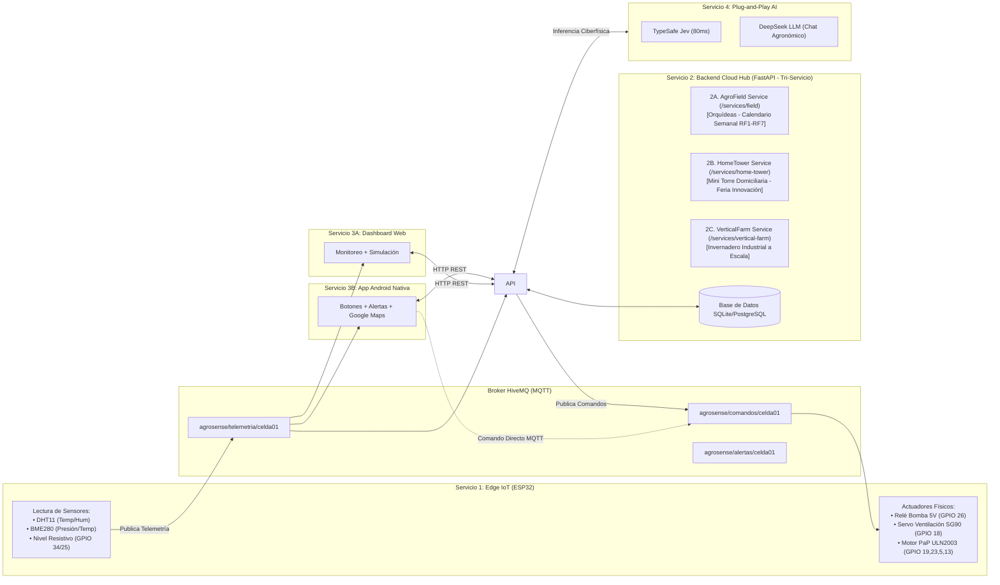

# Especificación de Datos, Protocolos y Contratos de Servicios
## Proyecto: AgroSense AI (ASAI) — Módulo Celular Hidropónico Inteligente
### Enfoque: Arquitectura Orientada a Servicios (SOA)

**Fecha:** Noviembre 2026  
**Versión:** 2.1 (Alineada al Inventario Físico Real de Hardware MVP)  
**Institución:** Universidad Santo Tomás — Sede Pedro de Valdivia, Temuco  
**Microcontrolador:** ESP32 DevKit V1 + Arduino Uno R3 (Alimentación 5V regulada)  
**Cátedras Integradas:** Internet de las Cosas (IEI-059), Programación Android (IEI-058), Integración de Competencias II (IEI-094), Feria de Innovación.

---

## 1. Arquitectura de Servicios y Flujo de Datos

El sistema opera mediante **servicios desacoplados** que se comunican mediante contratos JSON estándar por MQTT y REST.



---

## 2. Contratos de Datos (Pydantic v2 / Python)

Estos modelos representan la realidad física del hardware actual, con capacidad de admitir extensiones futuras de forma transparente.

```python
from pydantic import BaseModel, Field
from typing import Optional, List
from datetime import datetime

# ------------------------------------------------------------------------------
# 1. Telemetría de Sensores Reales del MVP (ESP32 -> Broker -> Backend)
# ------------------------------------------------------------------------------
class TelemetryInput(BaseModel):
    module_id: str = Field(default="celda-01", description="Identificador único de la celda hidropónica")
    timestamp_utc: datetime = Field(default_factory=datetime.utcnow)
    
    # --- Sensores Físicos Reales Conectados al ESP32 ---
    air_temperature_c: float = Field(..., ge=-10.0, le=60.0, description="Temperatura ambiental (DHT11 / BME280)")
    air_humidity_percent: float = Field(..., ge=0.0, le=100.0, description="Humedad relativa aérea % (DHT11)")
    barometric_pressure_hpa: float = Field(default=1013.25, ge=800.0, le=1200.0, description="Presión atmosférica (BME280/BMP280)")
    reservoir_level_percent: float = Field(..., ge=0.0, le=100.0, description="Nivel de estanque (Sensor Resistivo GPIO 34 con pulso en 25)")
    
    # --- Métrica Fisiológica Calculada en Firmware o Backend ---
    vpd_kpa: Optional[float] = Field(default=None, description="Déficit de Presión de Vapor calculado (kPa)")
    
    # --- Estado de Actuadores Físicos en la Maqueta ---
    pump_active: bool = Field(default=False, description="Estado de la mini-bomba sumergible 5V (Relé GPIO 26)")
    vent_servo_angle: int = Field(default=0, ge=0, le=180, description="Ángulo del servo SG90 para ventilación (GPIO 18)")
    stepper_dosing_steps: int = Field(default=0, description="Pasos acumulados en el motor 28BYJ-48 (ULN2003)")

    # --- Sensores Futuros (Opcionales / Fase 2 - No rompen si son None) ---
    ph_level: Optional[float] = Field(default=None, ge=0.0, le=14.0, description="Sonda análoga de pH (Fase 2)")
    ec_salinity_dsm: Optional[float] = Field(default=None, ge=0.0, le=10.0, description="Sonda de conductividad EC (Fase 2)")
    light_lux: Optional[float] = Field(default=None, ge=0.0, le=100000.0, description="Sensor fotocelda LDR (Fase 2)")

# ------------------------------------------------------------------------------
# 2. Comando Hacia Actuadores Físicos (Backend / App Móvil -> ESP32)
# ------------------------------------------------------------------------------
class ActuatorCommand(BaseModel):
    module_id: str = Field(default="celda-01")
    target: str = Field(..., description="bomba_agua | servo_ventilacion | motor_nutrientes")
    action: str = Field(..., description="ON | OFF | SET_ANGLE | DISPENSE_STEPS")
    parameter_value: Optional[float] = Field(default=0.0, description="Ángulo (0-180°), pasos motor o duración en segundos")
    triggered_by: str = Field(default="manual", description="manual_android | manual_web | jev_rule | schedule")
    timestamp_utc: datetime = Field(default_factory=datetime.utcnow)

# ------------------------------------------------------------------------------
# 3. Perfil de Cultivo de la Bandeja (Celda 01)
# ------------------------------------------------------------------------------
class PlantProfile(BaseModel):
    species_name: str = Field(default="Frutilla Hidropónica", description="Especie cultivada")
    optimal_temp_min_c: float = Field(default=18.0)
    optimal_temp_max_c: float = Field(default=24.0)
    optimal_humidity_min: float = Field(default=55.0)
    optimal_humidity_max: float = Field(default=75.0)
    optimal_vpd_min_kpa: float = Field(default=0.8, description="DPV mínimo para transpiración sana")
    optimal_vpd_max_kpa: float = Field(default=1.2, description="DPV máximo antes de estrés hídrico")
    recirculation_cycle_minutes: int = Field(default=15)
    recirculation_interval_hours: int = Field(default=2)

# ------------------------------------------------------------------------------
# 4. Respuesta Inferencia Ciberfísica (TypeSafe Jev)
# ------------------------------------------------------------------------------
class JevDecisionResponse(BaseModel):
    action_required: bool
    recommended_pump_state: bool
    recommended_vent_angle: int = 0
    reason: str
    risk_level: str = Field(default="NORMAL", description="NORMAL | WARNING | CRITICAL")
    execution_time_ms: float = Field(default=80.0)
    fallback_rule_applied: bool = False
```

---

## 3. Jerarquía y Payloads MQTT (HiveMQ Cloud)

### 3.1 Tópico de Telemetría: `agrosense/telemetria/celda01`
El ESP32 emite este JSON cada 5 a 10 segundos:
```json
{
  "modulo": "celda-01",
  "temp_ambiente": 22.4,
  "humedad_ambiente": 60.5,
  "presion_hpa": 1014.2,
  "dpv_kpa": 1.05,
  "nivel_estanque": 82.0,
  "bomba_activa": false,
  "servo_angulo": 0,
  "timestamp": 1731336000
}
```

### 3.2 Tópico de Comandos: `agrosense/comandos/celda01`
El backend o la app Android publican órdenes hacia los 3 actuadores físicos:

* **Para la Mini-Bomba Sumergible (Relé GPIO 26):**
```json
{
  "actuador": "bomba_agua",
  "accion": "ON",
  "parametro": 60,
  "origen": "android_app"
}
```

* **Para el Servomotor SG90 (Ventilación Cenital GPIO 18):**
```json
{
  "actuador": "servo_ventilacion",
  "accion": "SET_ANGLE",
  "parametro": 90,
  "origen": "jev_rules_engine"
}
```

* **Para el Motor Paso a Paso 28BYJ-48 (Dosificador Nutrientes ULN2003):**
```json
{
  "actuador": "motor_nutrientes",
  "accion": "DISPENSE_STEPS",
  "parametro": 512,
  "origen": "manual_dashboard"
}
```

### 3.3 Tópico de Alertas Críticas: `agrosense/alertas/celda01`
```json
{
  "nivel": "CRITICAL",
  "mensaje": "Estanque en nivel crítico (12%). Bomba apagada por seguridad.",
  "actuador_bloqueado": "bomba_agua",
  "timestamp": 1731336025
}
```

---

## 4. Endpoints REST de la API (Backend Cloud Hub)

| Método | Endpoint | Descripción | Consumidor Principal |
| :--- | :--- | :--- | :--- |
| `GET` | `/health` | Estado del backend, DB y broker | Monitoreo y Azure probe |
| `POST` | `/api/v1/telemetry` | Ingesta de telemetría (vía HTTP de respaldo) | ESP32 o simulador de pruebas |
| `GET` | `/api/v1/telemetry/latest` | Última lectura de sensores y actuadores | App Android, Dashboard Web |
| `GET` | `/api/v1/telemetry/history?hours=24` | Histórico para gráficos temporales | Web y Reporte Semanal |
| `POST` | `/api/v1/actuators/command` | Envío de orden a cualquier actuador (Bomba, Servo, Motor PaP) | App Android, Dashboard Web |
| `GET` | `/api/v1/schedule` | Próximo ciclo programado de recirculación | App Android, Web |
| `POST` | `/api/v1/ai/consult` | Consulta agronómica al LLM con datos en vivo | App Android, Chat Web |

---

## 5. Esquema de Base de Datos Relacional Adaptado (SQL DDL)

Este esquema se diseñó bajo el principio **"Abierto a Extensión, Cerrado a Modificación"**:
- Contiene columnas nativas para todo el hardware actual del MVP.
- La tabla `registro_comandos` es **polimórfica**: soporta la bomba, el servo y el motor paso a paso sin modificar columnas.
- Incluye campos `NULLABLE` para sensores de la Fase 2 (pH, EC, Luz) para que cuando se agreguen, no haya que rehacer la base de datos ni romper las aplicaciones.

```sql
-- =============================================================================
-- ESQUEMA DE BASE DE DATOS RELACIONAL: AGROSENSE AI (ASAI)
-- COMPATIBLE CON SQLITE Y POSTGRESQL / AZURE
-- =============================================================================

-- 1. Tabla de Módulos Físicos
CREATE TABLE IF NOT EXISTS modulos_hidroponicos (
    id VARCHAR(50) PRIMARY KEY,
    nombre VARCHAR(100) NOT NULL,
    descripcion TEXT,
    ubicacion_fisica VARCHAR(100) DEFAULT 'Santo Tomás Temuco - Lab IoT',
    broker_topic_telemetria VARCHAR(100) NOT NULL,
    broker_topic_comandos VARCHAR(100) NOT NULL,
    creado_en TIMESTAMP DEFAULT CURRENT_TIMESTAMP,
    activo BOOLEAN DEFAULT 1
);

-- 2. Tabla de Perfiles de Especies Cultivadas
CREATE TABLE IF NOT EXISTS perfiles_cultivo (
    id INTEGER PRIMARY KEY AUTOINCREMENT,
    especie VARCHAR(100) NOT NULL,
    temp_min REAL NOT NULL DEFAULT 18.0,
    temp_max REAL NOT NULL DEFAULT 24.0,
    humedad_min REAL NOT NULL DEFAULT 55.0,
    humedad_max REAL NOT NULL DEFAULT 75.0,
    dpv_min_kpa REAL NOT NULL DEFAULT 0.8,
    dpv_max_kpa REAL NOT NULL DEFAULT 1.2,
    recirculacion_minutos INTEGER DEFAULT 15,
    intervalo_riego_horas INTEGER DEFAULT 2
);

-- 3. Tabla de Telemetría Histórica (Series Temporales del Hardware Real)
CREATE TABLE IF NOT EXISTS telemetria_historica (
    id INTEGER PRIMARY KEY AUTOINCREMENT,
    modulo_id VARCHAR(50) NOT NULL,
    fecha_hora TIMESTAMP DEFAULT CURRENT_TIMESTAMP,
    
    -- Variables Físicas Reales MVP
    temp_ambiente REAL NOT NULL,          -- DHT11 / BME280
    humedad_ambiente REAL NOT NULL,       -- DHT11
    presion_atmosferica REAL NOT NULL,    -- BME280 / BMP280 (hPa)
    dpv_kpa REAL,                         -- Déficit Presión de Vapor calculado
    nivel_estanque REAL NOT NULL,         -- Sensor Resistivo GPIO 34/25 (%)
    
    -- Estado de Actuadores Físicos
    bomba_encendida BOOLEAN DEFAULT 0,    -- Relé 5V (GPIO 26)
    servo_angulo INTEGER DEFAULT 0,       -- SG90 PWM (GPIO 18, 0° a 180°)
    pasos_motor_acumulados INTEGER DEFAULT 0, -- ULN2003 28BYJ-48
    
    -- Extensiones Futuras (NULLABLE - Se activan solo al conectar sondas)
    ph_solucion REAL,                     -- Futuro: Sonda pH análoga
    conductividad_ec REAL,                -- Futuro: Sonda EC
    luz_lux REAL,                         -- Futuro: Fotocelda LDR
    
    origen_dato VARCHAR(20) DEFAULT 'MQTT_ESP32',
    FOREIGN KEY (modulo_id) REFERENCES modulos_hidroponicos(id)
);

-- 4. Tabla Polimórfica de Comandos a Actuadores (Soporta N Actuadores)
CREATE TABLE IF NOT EXISTS registro_comandos (
    id INTEGER PRIMARY KEY AUTOINCREMENT,
    modulo_id VARCHAR(50) NOT NULL,
    actuador VARCHAR(50) NOT NULL,         -- 'bomba_agua', 'servo_ventilacion', 'motor_nutrientes'
    accion VARCHAR(50) NOT NULL,           -- 'ON', 'OFF', 'SET_ANGLE', 'DISPENSE_STEPS'
    parametro_valor REAL DEFAULT 0.0,      -- 90 (grados), 512 (pasos), 60 (segundos)
    disparado_por VARCHAR(50) NOT NULL,    -- 'ANDROID_APP', 'WEB_DASHBOARD', 'JEV_RULE'
    fecha_hora TIMESTAMP DEFAULT CURRENT_TIMESTAMP,
    FOREIGN KEY (modulo_id) REFERENCES modulos_hidroponicos(id)
);

-- 5. Tabla de Alertas y Eventos Críticos
CREATE TABLE IF NOT EXISTS alertas_sistema (
    id INTEGER PRIMARY KEY AUTOINCREMENT,
    modulo_id VARCHAR(50) NOT NULL,
    severidad VARCHAR(20) NOT NULL,        -- 'INFO', 'WARNING', 'CRITICAL'
    mensaje TEXT NOT NULL,
    leida BOOLEAN DEFAULT 0,
    fecha_hora TIMESTAMP DEFAULT CURRENT_TIMESTAMP,
    FOREIGN KEY (modulo_id) REFERENCES modulos_hidroponicos(id)
);

-- =============================================================================
-- INSERCIÓN DE DATOS INICIALES (SEED DATA)
-- =============================================================================

INSERT OR IGNORE INTO modulos_hidroponicos (id, nombre, descripcion, broker_topic_telemetria, broker_topic_comandos)
VALUES (
    'celda-01', 
    'Bandeja Piloto 01', 
    'Prototipo hidropónico NFT de 1 nivel con ESP32, BME280, DHT11, Relé 5V, Servo SG90 y PaP ULN2003',
    'agrosense/telemetria/celda01',
    'agrosense/comandos/celda01'
);

INSERT OR IGNORE INTO perfiles_cultivo (especie, temp_min, temp_max, humedad_min, humedad_max, dpv_min_kpa, dpv_max_kpa, recirculacion_minutos, intervalo_riego_horas)
VALUES ('Frutilla Hidropónica', 18.0, 24.0, 55.0, 75.0, 0.8, 1.2, 15, 2);
```
