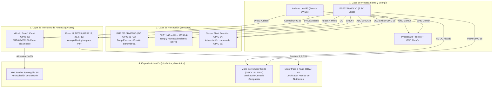

# Inventario Oficial de Hardware y Mapeo de Pines (MVP)
## Proyecto: AgroSense AI (ASAI) — Módulo Celular Hidropónico Inteligente
### Plataforma de Demostración: Celda Piloto 01

**Fecha:** Noviembre 2026  
**Institución:** Universidad Santo Tomás — Sede Pedro de Valdivia, Temuco  
**Microcontrolador Principal:** ESP32 DevKit V1 (30 / 38 pines)  
**Fuente de Potencia Auxiliar:** Arduino Uno R3 (5V DC regulado)

---

## 1. Inventario Físico de Componentes por Capa

---

## 2. Mapeo Exhaustivo de Pines (Pinout ESP32 DevKit V1)

| Pin ESP32 | Tipo de Pin | Dispositivo Conectado | Protocolo / Función | Nivel Lógico | Notas de Conexión y Seguridad |
| :--- | :--- | :--- | :--- | :--- | :--- |
| **3V3** | Salida Alimentación | Sensores DHT11 y BME280 | VCC Lógica Sensores | 3.3V DC | No sobrecargar el regulador del ESP32. |
| **GND** | Tierra | Riel negativo Protoboard | Tierra Común (GND) | 0V | **OBLIGATORIO:** Unir al GND del Arduino Uno. |
| **GPIO 21** | I/O Digital (I2C) | Sensor BME280 / BMP280 | **SDA** (Línea de Datos) | 3.3V | Requiere resistencias pull-up (integradas en placa morada). |
| **GPIO 22** | I/O Digital (I2C) | Sensor BME280 / BMP280 | **SCL** (Línea de Reloj) | 3.3V | Protocolo I2C estándar del ESP32. |
| **GPIO 4** | I/O Digital | Sensor DHT11 | **DATA** (One-Wire) | 3.3V | Medición de humedad y temperatura ambiente. |
| **GPIO 25** | Salida Digital | Sensor Nivel Resistivo | **VCC Conmutado** | 3.3V | **Circuito Anti-Electrólisis:** Solo se pone en HIGH 50ms antes de leer. |
| **GPIO 34** | Entrada Analógica | Sensor Nivel Resistivo | **SIG** (Lectura ADC1) | 0 a 3.3V (ADC) | Pin exclusivo de entrada (Input-Only). Seguro y preciso. |
| **GPIO 26** | Salida Digital | Módulo Relé 1 Canal | **IN** (Disparo de Relé) | 3.3V / 5V Opto | Activa/Desactiva la mini bomba sumergible de 5V. |
| **GPIO 18** | Salida PWM | Servomotor SG90 | **PWM** (Señal de Control) | 3.3V PWM | Control de ángulo (0° cerrado a 90°/180° ventilación cenital). |
| **GPIO 19** | Salida Digital | Driver ULN2003 | **IN1** (Bobina A PaP) | 3.3V | Paso a paso 28BYJ-48 para dosificación de nutrientes. |
| **GPIO 23** | Salida Digital | Driver ULN2003 | **IN2** (Bobina B PaP) | 3.3V | Paso a paso 28BYJ-48. |
| **GPIO 5** | Salida Digital | Driver ULN2003 | **IN3** (Bobina C PaP) | 3.3V | Paso a paso 28BYJ-48. |
| **GPIO 13** | Salida Digital | Driver ULN2003 | **IN4** (Bobina D PaP) | 3.3V | Paso a paso 28BYJ-48. |

---

## 3. Consideraciones Eléctricas Críticas para la Maqueta

### 3.1 Aislamiento de Potencia (El Rol del Arduino Uno R3)
* Los motores (bomba sumergible, servomotor SG90 y motor paso a paso) demandan corrientes transitorias de entre **300 mA y 800 mA**.
* **Peligro:** Si estos motores se alimentan directamente desde el pin de 3.3V o 5V del ESP32, el microcontrolador se reiniciará por caída de tensión (*brownout reset*) o se quemará el regulador AMS1117.
* **Solución Adoptada:** La placa **Arduino Uno R3** se conecta por USB o cargador y se utiliza exclusivamente como **fuente regulada de 5V** hacia los rieles de potencia del protoboard.
* **Tierra Común (GND):** Es imprescindible unir con un cable jumper el pin `GND` del ESP32 con el pin `GND` del Arduino Uno. Sin esta referencia común, las señales PWM del servo y de los pasos del motor no funcionarán.

### 3.2 Protección contra Electrólisis en el Sensor de Nivel Resistivo
* Si el sensor de pistas de cobre se deja con corriente continua constante sumergido en agua con sales nutritivas, las pistas se desgastan por electrólisis galvánica en pocas horas.
* **Técnica de software implementada:**
  1. El pin VCC del sensor se conecta al **GPIO 25**.
  2. En el ciclo `loop()`, el GPIO 25 permanece en `LOW` (0V).
  3. Cada 10 segundos, el ESP32 pone `GPIO 25 = HIGH`, espera 50 milisegundos para estabilizar la lectura, toma el valor analógico en **GPIO 34**, y vuelve a poner inmediatamente `GPIO 25 = LOW`.
  4. Esto alarga la vida útil del sensor de días a meses.

---

## 4. Métricas Físicas vs. Métricas Calculadas en el Software

Con este hardware exacto, el sistema produce las siguientes variables:

| Variable | Sensor Físico / Origen | Unidad | Rango de Operación |
| :--- | :--- | :--- | :--- |
| **Temperatura DHT** | Sensor DHT11 (GPIO 4) | °C | 0 - 50 °C (±2 °C) |
| **Humedad Relativa** | Sensor DHT11 (GPIO 4) | % HR | 20 - 90 % (±5%) |
| **Temperatura BME** | Sensor BME280/BMP280 (I2C) | °C | -40 - 85 °C (±0.5 °C) |
| **Presión Atmosférica** | Sensor BME280/BMP280 (I2C) | hPa / mbar | 300 - 1100 hPa |
| **Déficit de Presión de Vapor (DPV)** | **Calculado** en Firmware o Backend | kPa | 0.4 - 1.6 kPa (Óptimo) |
| **Nivel de Solución en Estanque** | Sensor Resistivo (GPIO 34) | % (0-100%) | 0 - 100% calibrado |
| **Estado Bomba de Agua** | Relé 5V (GPIO 26) | Booleano | Encendida (1) / Apagada (0) |
| **Apertura Ventilación Cenital** | Servomotor SG90 (GPIO 18) | Grados / % | 0° (Cerrada) a 90° (Abierta) |
| **Nutrientes Dosificados** | Motor PaP 28BYJ-48 (ULN2003) | Pasos / ml | Acumulado en el ciclo |
