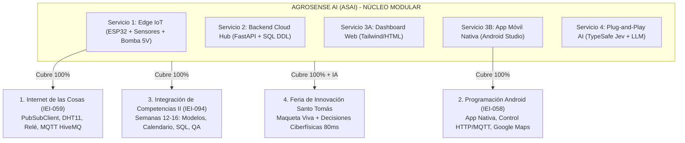

# Plan de Desarrollo, División de Equipo y Matriz de Entregables
## Proyecto: AgroSense AI (ASAI) — Módulo Celular Hidropónico Inteligente
### Estrategia: 1 Proyecto Unificado en 4 Evaluaciones con Arquitectura SOA

**Fecha:** Noviembre 2026  
**Institución:** Universidad Santo Tomás — Sede Pedro de Valdivia, Temuco  
**Equipo:** 3 Integrantes  
**Asignaturas Integradas:**
1. **Internet de las Cosas (IEI-059)** — Docente: Nicole Ortega V.
2. **Programación Android (IEI-058)** — Docente: Nicole Ortega V.
3. **Integración de Competencias II (IEI-094)** — Docente Guía
4. **Feria de Innovación y Tecnología Santo Tomás** — Jurado Académico e Inversores

---

## 1. Estrategia Maestra: "Desarrollar 1 Sola Vez, Entregar en 4 Instancias"

El error más común en proyectos de fin de semestre es intentar construir cuatro cosas distintas para cuatro ramos diferentes. Con nuestra **Arquitectura Orientada a Servicios (SOA)**, construimos un único sistema modular donde cada servicio responde a los requerimientos de cada asignatura:

---

## 2. División de Roles para 3 Compañeros

Para garantizar que nadie dependa de que otro termine para poder avanzar, el trabajo se divide en **tres roles técnicos bien definidos**:

```mermaid
flowchart LR
    subgraph COMP1 ["Compañero 1: Hardware & IoT Edge"]
        direction TB
        C1_A["ESP32 / NodeMCU"]
        C1_B["DHT11 + Nivel + Relé Bomba"]
        C1_C["Maqueta Física 1 Nivel (3D)"]
        C1_D["Tópicos MQTT en HiveMQ"]
    end

    subgraph COMP2 ["Compañero 2: Mobile Android Developer"]
        direction TB
        C2_A["Android Studio (Java/Kotlin)"]
        C2_B["Botones Control Bomba (HTTP/MQTT)"]
        C2_C["Visualización Sensores en Vivo"]
        C2_D["Google Maps SDK (Sedes UST / Granja)"]
    end

    subgraph COMP3 ["Compañero 3: Backend Hub, DB, Web & QA"]
        direction TB
        C3_A["FastAPI Python + Docker/Azure"]
        C3_B["Base de Datos SQL DDL + Histórico"]
        C3_C["Dashboard Web + Plan de Pruebas"]
        C3_D["Conector Plug-and-Play IA (JEV/LLM)"]
    end

    COMP1 <-->|MQTT HiveMQ| COMP2
    COMP1 <-->|MQTT / REST| COMP3
    COMP2 <-->|REST API| COMP3
```

---

### Detalle de Responsabilidades por Integrante

### 👤 Integrante 1: Especialista en Hardware, Firmware y Prototipado IoT
* **Responsabilidad Principal:** Construir la maqueta física de 1 bandeja hidropónica y programar el microcontrolador.
* **Asignaturas en las que rinde:**
  * **IoT (IEI-059):** Cumplimiento de la guía de la Prof. Nicole Ortega (`DHT11 + MQTT.pdf`), código en C++ con librerías `<PubSubClient.h>` y `<DHT.h>`, Carta Gantt de hardware.
  * **Integración II (IEI-094):** Evidencias físicas de maqueta, esquemáticos Fritzing, script `.ino` y lecturas seriales en consola.
  * **Feria de Innovación:** Operación mecánica e hidráulica de la mini-bomba sumergible frente al jurado.
* **Archivos / Entregables a su cargo:**
  * `firmware/esp32_hidroponico.ino` (código fuente Arduino).
  * `docs/esquematico_electronico.png` (diagrama de cableado).
  * Maqueta física terminada (bandeja plástica/acrílica, canastillos impresos en 3D, tubería de recirculación de 5V).

---

### 👤 Integrante 2: Especialista en Desarrollo Móvil Android Nativo
* **Responsabilidad Principal:** Desarrollar la aplicación móvil en Android Studio para el monitoreo y control del sistema.
* **Asignaturas en las que rinde:**
  * **Programación Android (IEI-058):** App nativa en Java/Kotlin con actividades, botones de control de actuador (`Encender Bomba` / `Apagar Bomba`), conexión HTTP/MQTT, y módulo de geolocalización con **Google Maps SDK** mostrando las sedes de Santo Tomás (según pauta de Semana 13) o la ubicación geográfica de los módulos hidropónicos.
  * **Integración II (IEI-094):** Evidencia de la interfaz móvil como canal de usuario en el avance de interfaces.
  * **Feria de Innovación:** Demostración con el smartphone en mano: encender la bomba desde la app y ver fluir el agua inmediatamente.
* **Archivos / Entregables a su cargo:**
  * Proyecto completo en `android/AgroSenseMobile/` (código fuente Gradle/Android Studio).
  * APK compilado funcional (`app-release.apk` o `app-debug.apk`).
  * Manual de usuario móvil y capturas de pantalla de la app funcionando.

---

### 👤 Integrante 3: Especialista en Cloud Backend Hub, Base de Datos, Web y QA
* **Responsabilidad Principal:** Diseñar la base de datos relacional, la API de ingesta, el Dashboard Web y la integración modular de IA.
* **Asignaturas en las que rinde:**
  * **Integración de Competencias II (IEI-094):** Modelos Pydantic (Semana 12), endpoint de calendario de riego (Semana 13), endpoint de telemetría (Semana 14), script SQL DDL e histórico (Semana 15), Plan de Pruebas de integración formal (Semana 16) y presentación final en PPT.
  * **Feria de Innovación:** Orquestación de la inteligencia artificial ciberfísica (TypeSafe Jev en 80ms) y asistente agronómico (DeepSeek LLM).
* **Archivos / Entregables a su cargo:**
  * `backend/app/main.py`, `backend/app/models.py`, `backend/app/database_schema.sql`.
  * `backend/app/templates/index.html` (Dashboard Web interactivo).
  * `docs/PLAN_DE_PRUEBAS_INTEGRACION.md` y `docs/PRESENTACION_FINAL_FERIA.pptx`.

---

## 3. Matriz Semanal de Entregables de "Integración de Competencias II" (Semanas 12 a 16)

Esta matriz sincroniza exactamente lo solicitado en las pautas oficiales de la cátedra IEI-094 con el trabajo de los 3 integrantes:

| Semana / Hito | Requisito Oficial de la Pauta | Integrante 1 (IoT & Maqueta) | Integrante 2 (Android Móvil) | Integrante 3 (Backend & Web) |
| :--- | :--- | :--- | :--- | :--- |
| **Semana 12 (Avance 1)** | • Bosquejo UI • Diagrama Entidad-Relación (ERD) • Modelos de datos en código | Esquemático de conexiones electrónicas y pines del ESP32. | Wireframe de la App Android (pantalla de control y monitoreo). | Modelos Pydantic v2 en `backend/app/models.py` y diagrama ERD formal. |
| **Semana 13 (Avance 2)** | • Notificaciones de riego • Manejo de API Keys • Calendario de riego | Prueba de encendido y apagado de bomba 5V con relé. | Pantalla de control manual con botón de encendido y notificación push. | Endpoint `/api/v1/schedule` con lógica de intervalos y protección de variables `.env`. |
| **Semana 14 (Avance 3)** | • Ingesta de telemetría • Lectura en consola serial • Pruebas de simulación | Script Arduino C++ leyendo DHT11 y mostrando telemetría por Monitor Serial (115200 baud). | Visualización en vivo de tarjetas de temperatura, humedad y nivel en Android. | Endpoint `POST /api/v1/telemetry` + reglas deterministas de corte por estanque bajo. |
| **Semana 15 (Avance 4)** | • Base de datos relacional • Histórico de datos • Consultas SQL con timestamp | Montaje y fijación definitiva de sensores en la maqueta hidropónica. | Módulo de historial en Android (últimas lecturas recibidas). | Script formal `database_schema.sql` ejecutado en SQLite/Postgres + consultas temporales. |
| **Semana 16 (Examen Final)** | • Maqueta 100% operativa • Plan de pruebas de integración • Defensa y PPT | Presentación física de la bandeja hidropónica con agua y planta viva. | Demostración en vivo controlando la maqueta desde el smartphone Android. | Ejecución del Plan de Pruebas (CP-01 a CP-06 APROBADO) + diapositivas finales. |

---

## 4. Requisitos de la Pauta de IoT (Nicole Ortega V.)

Para el ramo de IoT, el Integrante 1 (con apoyo del equipo) debe asegurar el cumplimiento de los siguientes puntos exigidos en la guía `DHT11 + MQTT.pdf` y `Semana 8.pdf`:
1. **Conexión MQTT estándar:** Uso estricto de la librería `<PubSubClient.h>` en ESP32 / NodeMCU.
2. **Lectura de Sensor DHT11:** Lectura periódica con `<DHT.h>` en el pin GPIO correspondiente (ej. D4 / GPIO 2).
3. **Publicación y Suscripción:**
   - Publica en `agrosense/telemetria/celda01` (o topics individuales como `ESP32/Temperatura` y `ESP32/Humedad` si la profesora lo pide explícitamente).
   - Se suscribe a `agrosense/comandos/celda01` para activar el actuador (relé de la mini-bomba).
4. **Carta Gantt de IoT:** Cronograma de hitos de conectividad, calibración de sensores y pruebas de latencia.

---

## 5. Requisitos de la Pauta de Programación Android (Nicole Ortega V.)

Para el ramo de Android, el Integrante 2 (con apoyo del equipo) debe asegurar:
1. **Control de Actuadores (Semana NodeMCU + Android):**
   - Interfaz con botones claros: `Encender Bomba`, `Apagar Bomba`, `Ciclo 1 Minuto`.
   - Envío de comandos mediante peticiones HTTP `POST` a la IP local del ESP32 o vía la API de FastAPI.
2. **Monitoreo en Tiempo Real:**
   - Lectura y actualización visual de los valores de temperatura, humedad y nivel de estanque.
3. **Módulo de Geolocalización (Semana 13 GPS + Instrucciones):**
   - Integración de **Google Maps SDK** en la app.
   - Visualización de marcadores de las sedes de Santo Tomás a nivel nacional y/o del punto geográfico donde está instalada la maqueta hidropónica.
   - Reproductor multimedia con `VideoView` si se solicita en la pauta de actividades.

---

## 6. Estrategia Gradual de Inteligencia Artificial (Plug-and-Play)

Para evitar que una falla externa en servicios de IA afecte las notas académicas, aplicamos la regla de oro:

1. **Fase 1 (Sistemas Base Operativos al 100%):**
   - El ESP32 lee los sensores y activa el relé.
   - Android y la Web encienden y apagan la bomba y leen los datos.
   - El backend guarda en base de datos.
   - *Con esto, las notas de IoT, Android e Integración II están 100% aseguradas (Nota 7.0).*

2. **Fase 2 (Inyección de Inteligencia Artificial para la Feria y Distinción):**
   - **Servicio 4A (TypeSafe Jev):** Se conecta como validador ciberfísico en 80ms. Si el estanque está en 10%, Jev bloquea el encendido de la bomba para evitar que se queme. Si los servidores de Jev no responden, entra la regla local fallback de Python de inmediato sin caída.
   - **Servicio 4B (DeepSeek LLM):** Se activa el endpoint `/api/v1/ai/consult`. Permite a los evaluadores de la Feria preguntar en lenguaje natural: *"¿Cómo está mi cultivo hoy?"* y el sistema responde analizando los datos reales de la bandeja.

---

## 7. Plan de Acción Inmediato para el Equipo

1. **Reunión inicial de 10 minutos con los 3 compañeros:**
   - Compartir esta carpeta `ProyectoServiciosASAI/`.
   - Asignar formalmente los 3 roles (Quién toma IoT/Hardware, quién toma Android, quién toma Backend/Web).
2. **Configuración de ramas en GitHub:**
   - Cada integrante trabajará en su propia rama (`HardwareRama`, `AndroidRama`, `BackendRama`).
   - El repositorio unificado en `origin/main` servirá como punto de integración.
3. **Validación de Contratos:**
   - Revisar el archivo [ESPECIFICACION_DATOS_Y_SERVICIOS_ASAI.md](file:///c:/Users/Jonathan/Desktop/Santo%20Tomas/Proyecto%20Feria/ProyectoServiciosASAI/ESPECIFICACION_DATOS_Y_SERVICIOS_ASAI.md) para confirmar que todos entienden los JSON de entrada y salida.
