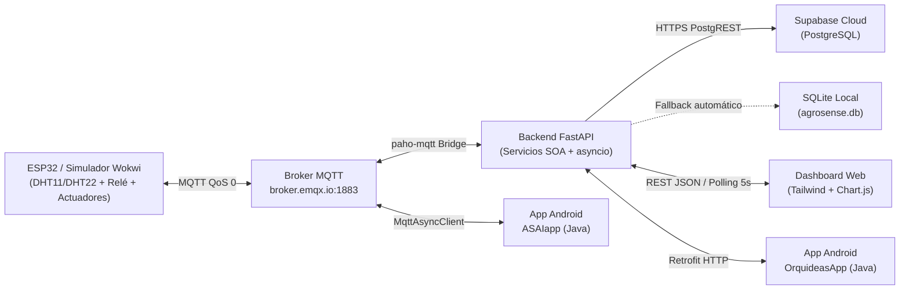
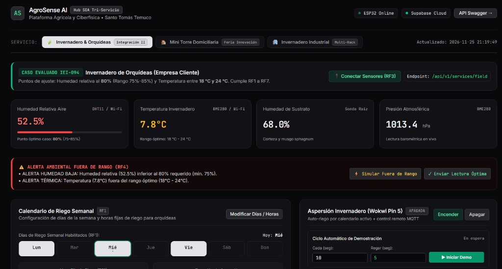
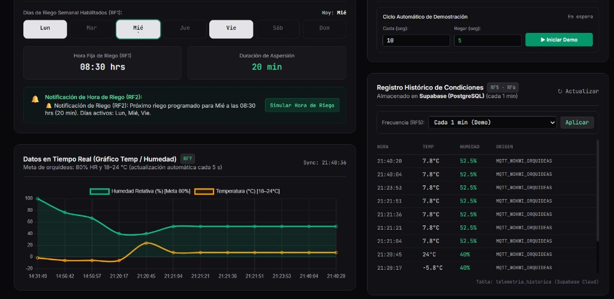
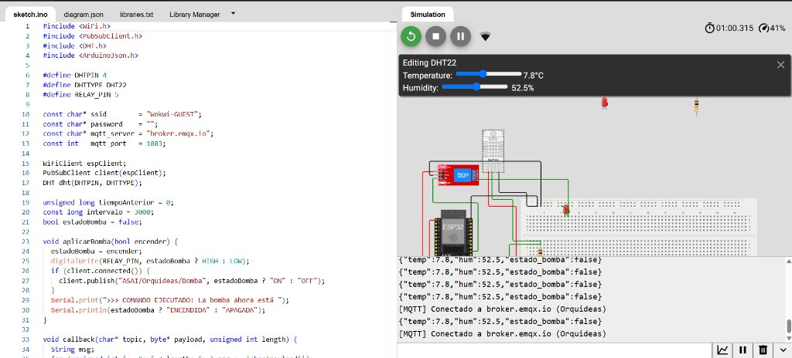

# AgroSense AI (ASAI) — Plataforma Ciberfísica para Agricultura e Hidroponía Inteligente


**AgroSense AI (ASAI)** es una plataforma modular de monitoreo y automatización agrícola e hidropónica que integra **microcontroladores ESP32 (hardware real y simulación en Wokwi)**, mensajería asíncrona **MQTT**, un backend REST en **FastAPI**, persistencia híbrida **Supabase Cloud (PostgreSQL) + respaldo local SQLite**, dashboard web en tiempo real (`Chart.js`) y clientes móviles **Android**.

---

## Arquitectura del Sistema (SOA Tri-Servicio)

El backend implementa una **Arquitectura Orientada a Servicios (SOA)** en un monolito modular con tres dominios aislados:

| Servicio | Router / Carpeta | Caso de Uso | Stack Principal |
| :--- | :--- | :--- | :--- |
| **`AgroFieldService`** | [`backend/app/routers/field_service.py`](backend/app/routers/field_service.py) · [`OrquideasApp/`](OrquideasApp) | **Invernadero de Orquídeas** (`80% HR`, `18–24 °C`), calendario semanal `L–D`, notificaciones, diagnóstico Wi-Fi/BT y alertas | FastAPI, `asyncio`, Supabase + SQLite, Chart.js, Wokwi |
| **`HomeTowerService`** | [`backend/app/routers/home_tower_service.py`](backend/app/routers/home_tower_service.py) · [`ASAIapp/`](ASAIapp) · [`firmware/`](firmware) | **Mini Torre Hidropónica Domiciliaria** con telemetría en vivo y control de bomba, servo y motor paso a paso | ESP32 DevKit V1, MQTT (`EMQX`), Android Java + Eclipse Paho |
| **`VerticalFarmService`** | [`backend/app/routers/vertical_farm_service.py`](backend/app/routers/vertical_farm_service.py) | **Invernadero Vertical Industrial** para escalamiento multi-rack y analítica comercial | FastAPI, Pydantic, DPV Tetens |



---

## Decisiones Clave de Ingeniería

- **Seguridad física determinista sin depender de internet ni IA:** en `HomeTowerService`, el firmware del ESP32 ejecuta corte inmediato de la bomba (`GPIO 26`) si el nivel del estanque cae bajo el `20%` (protección anti-cavitación) y aplica un pulso de lectura de `50 ms` en `GPIO 25` para evitar electrólisis en el sensor resistivo (`GPIO 34`).
- **Resiliencia Cloud + Local:** [`backend/app/db.py`](backend/app/db.py) persiste en **Supabase PostgreSQL** mediante su API REST (`PostgREST`) cuando `SUPABASE_URL` y `SUPABASE_KEY` están configurados, y conmuta automáticamente a **SQLite** ante pérdida de conectividad o en pruebas aisladas.
- **Ejecución no bloqueante:** el firmware utiliza temporización con `millis()` en `loop()` para mantener receptiva la escucha de comandos MQTT, mientras el backend usa `asyncio` para programar riegos semanales y ciclos demostrativos en segundo plano.
- **Cálculo agronómico de DPV (Tetens):** estima el Déficit de Presión de Vapor en kPa a partir de temperatura y humedad relativa para diagnosticar estrés hídrico o riesgo de condensación.
- **Pruebas automatizadas aisladas:** la suite en [`backend/tests/test_api.py`](backend/tests/test_api.py) ejecuta `13` pruebas sobre una base SQLite temporal y simulaciones mockeadas de MQTT y Supabase sin tocar datos reales.

---

## Demostración Visual y Simulación IoT

* **Simulación Wokwi en vivo (Invernadero de Orquídeas):** [Abrir circuito ESP32 + DHT22 + Relé en Wokwi](https://wokwi.com/projects/481413419177388033)

<p align="center">
  
  
</p>
<p align="center">
  
</p>

---

## Inicio Rápido (3 Pasos)

### 1. Configurar variables de entorno
Copia la plantilla [`backend/.env.example`](backend/.env.example) como `backend/.env` (este último está excluido en `.gitignore`):

```powershell
Copy-Item backend\.env.example backend\.env
```

> Si dejas `SUPABASE_URL` y `SUPABASE_KEY` vacíos, el sistema funcionará inmediatamente con la base local **SQLite** (`backend/agrosense.db`).

### 2. Instalar dependencias y levantar el servidor FastAPI

```powershell
cd backend
python -m venv .venv
.\.venv\Scripts\python.exe -m pip install -r requirements.txt
.\.venv\Scripts\python.exe -m uvicorn app.main:app --reload --host 0.0.0.0 --port 8000
```

Luego abre en tu navegador:
- **Dashboard Web:** `http://localhost:8000`
- **Documentación interactiva Swagger:** `http://localhost:8000/docs`

*(En Windows también puedes usar el lanzador [`INICIAR_SERVIDOR_AGROSENSE.bat`](INICIAR_SERVIDOR_AGROSENSE.bat).)*

### 3. Ejecutar la suite de pruebas (`pytest`)

```powershell
cd backend
.\.venv\Scripts\python.exe -m pytest tests/test_api.py -v
```

Resultado esperado: **`13 passed`**.

---

## Estructura del Proyecto

```text
AGROSENSE_AI/
├── backend/
│   ├── app/
│   │   ├── main.py                      # Punto de entrada FastAPI y ciclo de vida MQTT/Scheduler
│   │   ├── config.py                    # Carga segura de variables de entorno (.env)
│   │   ├── db.py                        # Adaptador híbrido Supabase Cloud (PostgREST) + SQLite
│   │   ├── mqtt_bridge.py               # Suscripción y publicación bidireccional MQTT (EMQX)
│   │   ├── database_schema_supabase.sql # Esquema relacional PostgreSQL para Supabase
│   │   ├── routers/                     # Servicios SOA: field_service, home_tower_service, vertical_farm_service
│   │   └── templates/index.html         # Dashboard adaptativo tri-servicio con Chart.js
│   ├── tests/test_api.py                # Suite automatizada pytest (13 pruebas)
│   ├── .env.example                     # Plantilla segura sin credenciales
│   └── requirements.txt
├── firmware/
│   ├── esp32_asai_mqtt/                 # Firmware ESP32 DevKit V1 (Mini Torre Hidropónica)
│   └── wokwi_orquideas_mqtt/            # Firmware ESP32 + DHT22 + Relé (Invernadero Orquídeas)
├── ASAIapp/                             # App Android Java + Eclipse Paho MQTT (Mini Torre)
├── OrquideasApp/                        # App Android Java + Retrofit HTTP (Invernadero Orquídeas)
├── docs/assets/                         # Capturas reales del sistema y simulación
├── specs/                               # Especificaciones de arquitectura, contratos API y bitácora SDD
├── SECURITY.md                          # Política de manejo de secretos y roadmap de seguridad
└── LICENSE                              # Licencia MIT
```

---

## Seguridad y Hoja de Ruta a Producción

Este proyecto nació como **MVP funcional académico e integrador** (`Santo Tomás, Sede Temuco`), por lo que prioriza la portabilidad demostrativa:

- **Estado actual (MVP):**
  - Secretos desacoplados en `.env` local (nunca versionados en Git).
  - Broker MQTT público (`broker.emqx.io:1883`) sin autenticación para facilitar pruebas en Wokwi/hardware de laboratorio.
  - Esquema Supabase con `RLS` deshabilitado en entorno demo para acceso directo desde el prototipo backend.
- **Evolución planificada para producción:**
  1. Migrar el enlace IoT a **MQTT sobre TLS (puerto `8883`)** con credenciales únicas por nodo ESP32 y ACL por tópico.
  2. Activar **Row Level Security (RLS)** en todas las tablas de Supabase PostgreSQL y rotación periódica de llaves.
  3. Incorporar autenticación **JWT / OAuth2** y rate limiting en los endpoints de escritura FastAPI.
  4. Contenerizar el backend con **Docker** y agregar pipeline **CI en GitHub Actions** ejecutando `pytest` en cada Push/PR.

Consulta los detalles en [`SECURITY.md`](SECURITY.md).

---

## Equipo y Licencia

- **Jonathan Seguel** — Backend FastAPI, Arquitectura SOA, Integración Supabase Cloud, Puente MQTT y Dashboard Web.
- **Miguel Torres** — Firmware ESP32, integración de sensores y actuadores IoT.
- **Marcos Bustos** — Cliente móvil Android (`OrquideasApp`).

Distribuido bajo licencia **[MIT](LICENSE)**.
