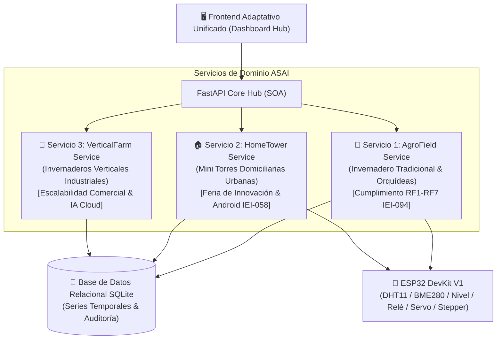

# SPEC-001: Visión General de la Arquitectura Tri-Servicio (ASAI)

> **Documento:** `specs/spec-001-architecture-overview.md`  
> **Estado:** APROBADO  
> **Metodología:** Spec-Driven Development (SDD)  
> **Autor:** `architect` & `spec_lead`

---

## 1. Contexto y Justificación del Sistema
La plataforma **AgroSense AI (ASAI)** adopta una **Arquitectura Orientada a Servicios (SOA)** modular diseñada para resolver simultáneamente los requerimientos académicos formales y la propuesta de valor comercial para la Feria de Innovación Santo Tomás.

Para evitar la fricción entre la pauta de un invernadero tradicional de flores y un sistema hidropónico vertical de alta tecnología, el sistema se divide en **tres servicios de dominio independientes**:

---

## 2. Definición de los Tres Servicios

| Servicio | Nombre Técnico | Caso de Uso Principal | Tipo de Riego | Parámetros Clave | Evaluación Destino |
| :--- | :--- | :--- | :--- | :--- | :--- |
| **Servicio 1** | `AgroFieldService` | Cultivo de Orquídeas en Invernadero / Maceta | **Calendario Semanal** (Días L-D + Horas fijas de riego) | HR óptima ~80%, Temp 18-24 °C | **Integración de Competencias II (IEI-094)** |
| **Servicio 2** | `HomeTowerService` | Mini Torres Hidropónicas Domiciliarias | **Recirculación Continua por Pulsos** (ej. 15 min cada 2h) | Nivel estanque > 20%, DPV, Nutrientes, Ventilación | **Feria de Innovación** & **Android (IEI-058)** |
| **Servicio 3** | `VerticalFarmService` | Granjas Verticales Comerciales Multi-Torre | Recirculación Hidrodinámica Multi-Nivel | DPV industrial, balance electroquímico, inferencia IA | **Escalabilidad y Visión Empresarial** |

---

## 3. Contratos de Datos y Esquema Compartido (Shared Kernel)
Todos los servicios comparten:
1. **Base de Datos Relacional SQLite (`agrosense.db`):**
   * `modulos_hidroponicos`: Registro de unidades de hardware activas.
   * `perfiles_cultivo`: Parámetros agronómicos (Orquídeas, Frutillas, Hortalizas).
   * `telemetria_historica`: Registro cronológico persistente de sensores ambientales.
   * `registro_comandos`: Auditoría polimórfica de actuadores (Relé, Servo, Stepper).
   * `calendario_semanal`: Almacenamiento de días activos y horarios de riego (RF1).
2. **Protocolos de Comunicación:**
   * Endpoints REST (HTTP/1.1 con JSON UTF-8).
   * Documentación OpenAPI autogenerada en `/docs`.
   * Payloads tipados mediante esquemas Pydantic v2.
