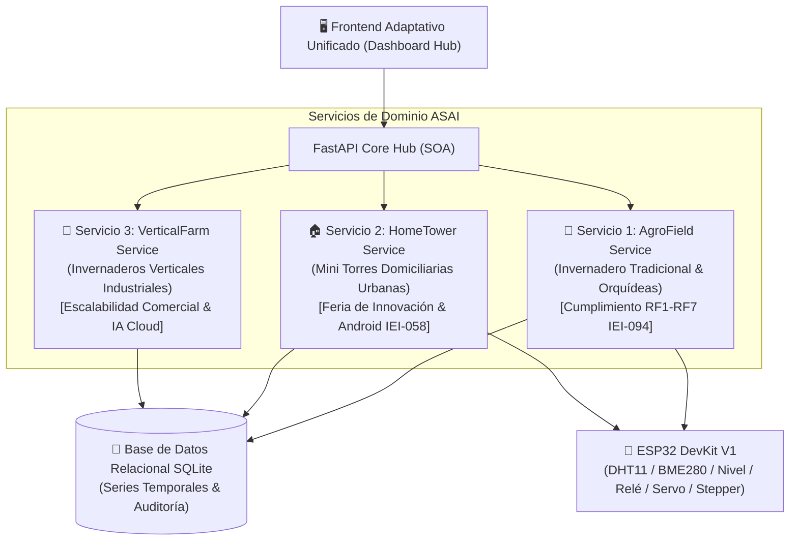

# SPEC-001: Visión General de la Arquitectura Tri-Servicio (ASAI)

> **Documento:** `specs/spec-001-architecture-overview.md`  
> **Estado:** APROBADO  
> **Metodología:** Spec-Driven Development (SDD)  
> **Autor:** `architect` & `spec_lead`

---

## 1. Contexto y Justificación del Sistema
La plataforma **AgroSense AI (ASAI)** adopta una **Arquitectura Orientada a Servicios (SOA)** modular diseñada para resolver simultáneamente los requerimientos académicos formales y la propuesta de valor comercial para la Feria de Innovación Santo Tomás.

Para evitar la fricción entre la pauta de un invernadero tradicional de flores y un sistema hidropónico vertical de alta tecnología, el sistema se divide en **tres servicios de dominio independientes**:



---

## 2. Definición de los Tres Servicios

| Servicio | Nombre Técnico | Caso de Uso Principal | Tipo de Riego | Parámetros Clave | Evaluación Destino |
| :--- | :--- | :--- | :--- | :--- | :--- |
| **Servicio 1** | `AgroFieldService` | Cultivo de Orquídeas en Invernadero / Maceta | **Calendario Semanal** (Días L-D + Horas fijas de riego) | HR óptima ~80%, Temp 18-24 °C | **Integración de Competencias II (IEI-094)** |
| **Servicio 2** | `HomeTowerService` | Mini Torres Hidropónicas Domiciliarias | **Recirculación Continua por Pulsos** (ej. 15 min cada 2h) | Nivel estanque > 20%, DPV, Nutrientes, Ventilación | **Feria de Innovación** & **Android (IEI-058)** |
| **Servicio 3** | `VerticalFarmService` | Granjas Verticales Comerciales Multi-Torre | Recirculación Hidrodinámica Multi-Nivel | DPV industrial, balance electroquímico, inferencia IA | **Escalabilidad y Visión Empresarial** |

---

## 3. Contratos de Datos y Esquema Compartido (Shared Kernel)

### 3.1. Decisión Arquitectónica: Monolito Modular + Base de Datos Única
* **Arquitectura:** Monolito Modular SOA en un único servidor FastAPI (`backend/app/main.py`) que monta 3 routers independientes por dominio (`/api/v1/services/field`, `/api/v1/services/home-tower`, `/api/v1/services/vertical-farm`).
* **Base de Datos Única (`backend/agrosense.db`):** Todos los servicios comparten una única base de datos SQLite gestionada desde el módulo compartido `backend/app/db.py` (con `DATABASE_URL = "sqlite:///./agrosense.db"` en `config.py`). No se crean 3 bases de datos separadas en esta fase para conservar consistencia ACID y consultas históricas unificadas.

### 3.2. Esquema Relacional Oficial (`backend/app/database_schema.sql`)
Tablas implementadas en SQLite (8 tablas):
1. `modulos_hidroponicos`: `id` (PK), `nombre`, `descripcion`, `ubicacion_fisica`, `broker_topic_telemetria`, `broker_topic_comandos`, `creado_en`, `activo`.
2. `perfiles_cultivo`: `id` (PK), `especie`, `temp_min`, `temp_max`, `humedad_min`, `humedad_max`, `dpv_min_kpa`, `dpv_max_kpa`, `recirculacion_minutos`, `intervalo_riego_horas`.
3. `asignacion_cultivo_modulo`: `id` (PK), `modulo_id` (FK), `perfil_id` (FK), `fecha_siembra`, `estado_cultivo`.
4. `telemetria_historica`: `id` (PK), `modulo_id` (FK), `fecha_hora`, `temp_ambiente`, `humedad_ambiente`, `presion_atmosferica`, `dpv_kpa`, `nivel_estanque`, `bomba_encendida`, `servo_angulo`, `pasos_motor_acumulados`, `ph_solucion` (NULLABLE), `conductividad_ec` (NULLABLE), `luz_lux` (NULLABLE), `origen_dato`.
5. `registro_comandos`: `id` (PK), `modulo_id` (FK), `actuador`, `accion`, `parametro_valor`, `disparado_por`, `fecha_hora`.
6. `alertas_sistema`: `id` (PK), `modulo_id` (FK), `severidad`, `mensaje`, `leida`, `fecha_hora`.
7. `calendario_semanal`: `modulo_id` (PK/FK), `dias_activos_json`, `hora_riego`, `duracion_minutos`, `intervalo_horas`, `actualizado_en`.
8. `estado_modulo`: `modulo_id` (PK/FK), `temp_ambiente`, `humedad_ambiente`, `presion_hpa`, `nivel_estanque`, `dpv_kpa`, `bomba_encendida`, `servo_angulo`, `pasos_motor_acumulados`, `humedad_sustrato`, `actualizado_en`.

### 3.3. Contratos Pydantic Base (`backend/app/models.py`)
* **`TelemetryInput`:**
  * `module_id: str = "celda-01"`
  * `timestamp: datetime` (UTC)
  * `air_temperature: float` (`-10.0 <= x <= 60.0`)
  * `air_humidity: float` (`0.0 <= x <= 100.0`)
  * `barometric_pressure_hpa: float = 1013.25` (`800.0 <= x <= 1200.0`)
  * `reservoir_level_percent: float` (`0.0 <= x <= 100.0`)
  * `vpd_kpa: Optional[float] = None`
  * `pump_active: bool = False`
  * `vent_servo_angle: int = 0` (`0 <= x <= 180`)
  * `stepper_dosing_steps: int = 0`
  * Extensiones Fase 2 (`Optional[float] = None`): `ph_level` (`0..14`), `ec_salinity_dsm` (`0..10`), `light_lux` (`0..100000`).
* **`ActuatorCommand`:** `module_id: str`, `target: str` (`bomba_agua | servo_ventilacion | motor_nutrientes`), `action: str` (`ON | OFF | SET_ANGLE | DISPENSE_STEPS`), `parameter_value: Optional[float] = 0.0`, `triggered_by: str = "manual"`, `timestamp: datetime`.
* **`HealthStatus`:** `status = "healthy"`, `service`, `version`, `environment`, `hardware_target`, `timestamp`.

### 3.4. Fórmula Fisiológica Oficial de DPV (Tetens)
Cuando `vpd_kpa` no llega informado desde el hardware, el backend calcula:
```python
svp = 0.61078 * math.exp((17.27 * temp_c) / (temp_c + 237.3))
avp = svp * (rh_pct / 100.0)
dpv_kpa = round(svp - avp, 2)
```

---

## 4. Mapa de Especificaciones del Ecosistema
* `spec-002-field-greenhouse-service.md` — Servicio Campos/Orquídeas (IEI-094).
* `spec-003-home-tower-service.md` — Servicio Mini Torres Domiciliarias (Feria & Android/IoT).
* `spec-004-vertical-farm-service.md` — Servicio Invernadero Vertical Industrial.
* `spec-005-frontend-adaptive-hub.md` — Interfaz Web Adaptativa.
* `spec-006-ai-and-simulation.md` — Motor Ciberfísico JEV, Chat Agronómico y Simulación de Fallos.
* `spec-007-esp32-firmware.md` — Firmware C++ ESP32 DevKit V1, Pinout Oficial y MQTT.
* `spec-008-android-app.md` — Aplicación Móvil Nativa Android (IEI-058).
